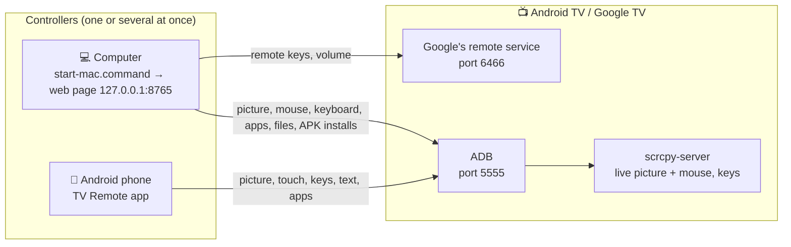
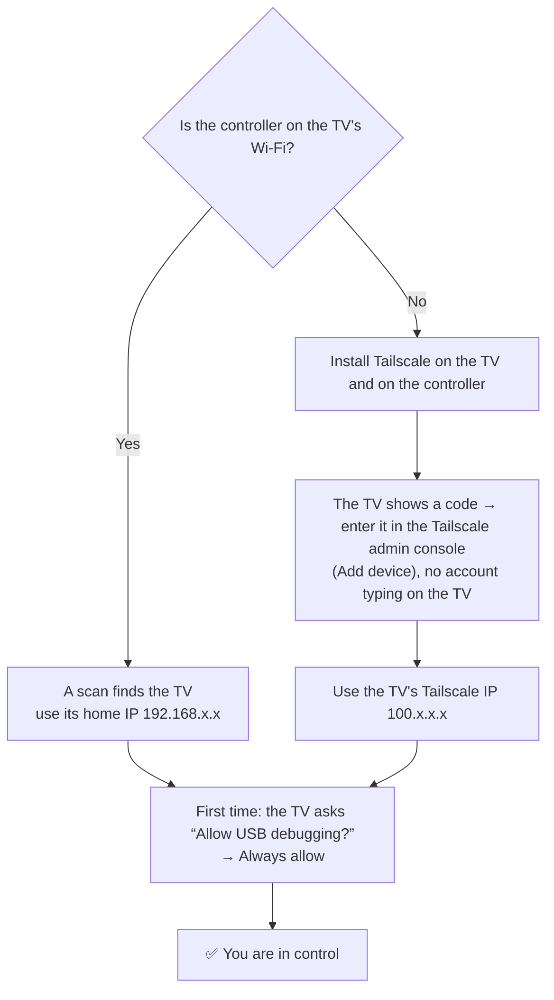
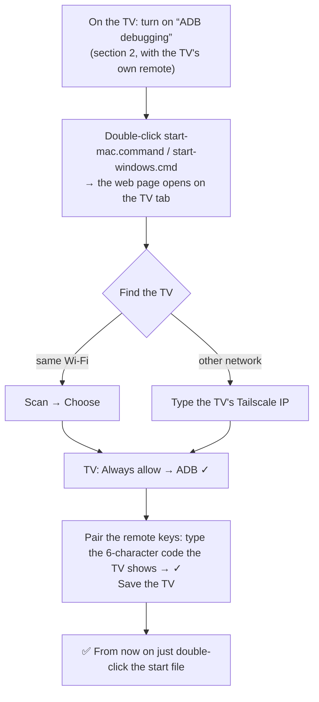
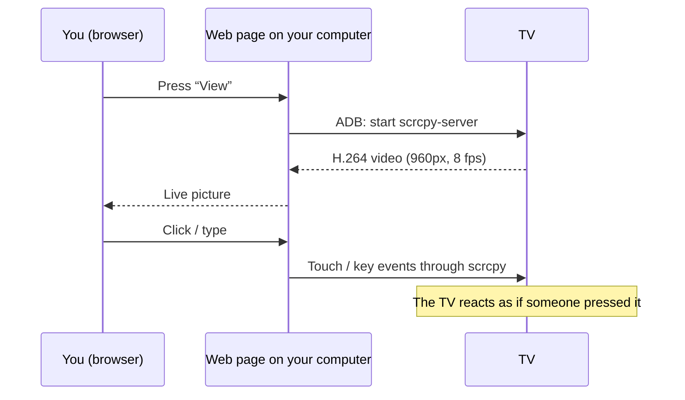

# tv-remote

[Tiếng Việt](README.md) · **English**

Control an Android TV / Google TV from a computer through a web page that runs on your own machine: remote buttons, live view of the TV screen, mouse clicks and keyboard typing on the TV, open/uninstall apps, browse files, install APKs, wake the TV. Works from another network through Tailscale.

Used for real with a Sony BRAVIA (Android 9) from macOS and Windows 11. Other TV brands are untested.

**Three ways to use it; pick the one that fits:**

| You have | Use | Get it | What it does |
|---|---|---|---|
| A computer (Mac, Windows, Linux) | The web remote on the computer | Download this repo, double-click `start-mac.command` / `start-windows.cmd` (section 3) | Everything: buttons, live screen, mouse, keyboard, speaking to the TV, apps, files, APK install, TV health, terminal |
| An Android phone | The **TV Remote** app | `tv-remote.apk` from [Releases](https://github.com/HoangTran0410/tv-remote/releases) (section 4D) | Buttons, live screen with touch, typing, speaking to the TV, apps, files, APK install, TV health, terminal |
| Anything with a browser (iPhone too) | The **TV Setup** app on the TV, then open `http://<TV's IP>:8765` | `tv-setup.apk` from [Releases](https://github.com/HoangTran0410/tv-remote/releases) (section 4C) | Buttons, volume, typing, apps, files, APK install, TV health, live screen with touch, terminal |

---

## At a glance: how it works

**Who talks to whom**



Every connection goes straight from your device to the TV, over the home Wi-Fi or over Tailscale. There is no server in between.

**Same network or not?**



**First-time setup (computer)**



**Watching the screen and clicking on the TV**



---

## 1. What you need

**TV**
- Android TV or Google TV (Sony, TCL, Xiaomi, Chromecast with Google TV...). Samsung (Tizen) and LG (webOS) TVs do **not** work.
- The TV is on Wi-Fi or Ethernet.
- No app has to be installed beforehand. Tailscale and the launcher are installed for you in step 3.

**Computer** (macOS, Windows or Linux)
- Python 3.10 or newer.
- `adb` and `ffmpeg`. On Windows the installer downloads `adb`; on macOS: `brew install android-platform-tools ffmpeg`.
- Tailscale, signed in, if you want to control the TV from a different network.

**A Tailscale account** (free, [tailscale.com](https://tailscale.com)) – only for remote use. On the same Wi-Fi as the TV you do not need it.

**One person next to the TV for the first setup** (about 2 minutes) to switch on "ADB debugging" and press "Allow". No script or app can do that part.

---

## 2. What to do on the TV (once, with the TV's own remote)

Menu names differ a little between brands; these are Sony's.

1. **Enable Developer options:** Settings → Device Preferences → About → scroll to **Build** → press OK **7 times** until it says "You are now a developer".
2. **Enable ADB:** Settings → Device Preferences → Developer options → turn on **ADB debugging** (some TVs call it "USB debugging").
3. **(Recommended) Enable remote start:** Settings → Network & Internet → **Remote start** = On. Without it the TV cannot be switched on remotely once it is off.

### Finding the TV's IP address
- On the TV: Settings → Network & Internet → select the connected Wi-Fi → **IP address** (looks like `192.168.1.88`).
- Or open your router's admin page and look at the list of connected devices.
- Tailscale IP (looks like `100.x.x.x`, used when you are away): open the Tailscale app on the TV, or see [login.tailscale.com/admin/machines](https://login.tailscale.com/admin/machines).

---

## 3. Install on the computer and add the TV

1. Get the source (git clone, or download the zip and extract it).
2. **Double-click one file to run it:**
   - macOS: **`start-mac.command`**. Linux: run `./start-linux.sh`. (The first run creates the Python environment and installs the packages.)
   - Windows: **`start-windows.cmd`** (the first run installs the packages and downloads `adb`; if it reports ffmpeg missing: `winget install Gyan.FFmpeg`).
3. The browser opens `http://127.0.0.1:8765`. With no TV saved yet the page opens on the **TV** tab:
   - Press **Quét mạng** (Scan) to find TVs on the same Wi-Fi (and Android devices on your Tailscale network), or type the TV's IP and press **Chọn** (Choose).
   - **Cài đặt lần đầu** (First-time setup) lists each step with its button; finished steps get a ✓:
     1. **ADB** – the TV shows "Allow USB debugging?" → tick **Always allow from this computer** → OK.
     2. **Tailscale** – press *Cài Tailscale* (official build, checksum verified), then *Mở Tailscale trên TV*: the page switches to the live TV screen and the TV shows **a code** (and a QR code). No account typing on the TV: open the [Tailscale admin console](https://login.tailscale.com/admin/machines) → **Add device** → enter that code (or scan the QR with a phone). Then open the TV's ⋯ menu there → **Disable key expiry**, otherwise the TV is signed out after about 180 days. Skip this step if you only use the TV on the same Wi-Fi.
     3. **Pair the remote buttons** – press *Ghép*, the TV shows a 6-character code, type it into the page.
     4. **Save** – name it and save. If the TV has a Tailscale IP the page connects through that from now on, so it also works away from home.
     5. **Optimise the TV** – optional, see section 6.

From then on just double-click `start-mac.command` / `start-windows.cmd`. With several TVs, switch between them on the **TV** tab. Close the window to stop; nothing keeps running in the background on the computer.

> The computer must be able to reach the TV: same Wi-Fi, or both on the same Tailscale account. The fully fresh path (steps 2–3 on a TV that has none of this yet) has not been run end to end; scanning, choosing, saving and switching TVs and the remaining steps have been run on macOS, and the command-line path on Windows. The page is in Vietnamese.
>
> Prefer the command line: `app/web/cli/tv-new.sh <ip>` (Windows: `app\web\cli\tv-new.cmd <ip>`) does the same steps.

---

## 4. What if I only have a phone, no computer?

The web page needs a computer to run on (it uses Python, `adb`, `ffmpeg`), so **this tool cannot run with a phone alone**. Two situations can still be handled:

**A. The person at home only has a phone; the helper elsewhere has a computer** (the common case)

The person next to the TV, using just the TV remote and a phone:
1. On the TV open **Google Play** → find and install **Tailscale**.
2. Open Tailscale on the TV → it shows a code (and a QR code) → read the code to the helper; they enter it in the Tailscale admin console (*Add device*), so nobody types an account on the TV. The TV joins **the helper's Tailscale account** (or to their own account, then share the device with the helper in the Tailscale admin console).
3. Turn on **ADB debugging** as in section 2.

The helper, on a computer with Tailscale running:
4. Open the web page, **TV** tab → **Quét mạng** (the TV appears labelled "qua Tailscale") → **Chọn**, then follow the steps.
5. Ask the person at home to press **Always allow → OK** when the TV asks, and to read out the 6-character code.

**B. You only want to control the TV from a phone on the same Wi-Fi**

You do not need this tool: use the **Google TV** app (Android/iPhone) → *Remote*. It cannot show the TV screen, install apps, or work from another network.

*(Running this tool on an Android phone under Termux may be possible in theory, but it is untested, so there are no instructions for it here.)*

---

**C. Neither a phone nor a computer next to the TV: the TV Setup app**

`app/tv/tv-setup.apk` is a small app installed on the TV itself. After turning on "ADB debugging" (section 2), open it, choose "Always allow" when the TV asks, then use the TV remote:
- **⚡ Tối ưu TV** (Optimise) / **Hoàn tác** (Undo) – the same as section 6, run on the TV.
- **Tailscale** – opens Tailscale's Google Play page, or opens Tailscale to get the code that adds the TV, if it is already installed.
- **Cập nhật** (Update) – downloads the latest TV Setup from GitHub Releases and installs it (through the TV's own ADB; the app closes, reopen it and it is the new version). Each time it opens, the app also tells you when a newer version exists.

**A web remote on the TV itself (no computer, no app on the phone).** Open TV Setup once and it is on. On a phone or computer, open a browser at the address the app shows on the TV, like `http://<TV's IP>:8765` (the home IP on the same Wi-Fi, the `100.x` IP over Tailscale). The first time the TV shows a **6-digit code**; type it into the page and that device is paired from then on. The page has the remote buttons (hold = long press), volume, typing, and the TV's apps with their logos. It starts again when the TV boots. **Remote qua web** turns it off/on, **Hủy ghép mọi thiết bị** makes every device pair again. Besides the remote it has Apps, Files, Install, Health and Terminal tabs like the web UI on a computer. The eye button at the top turns the TV picture on (touch the picture to tap, with a full screen button); one browser at a time can watch. The connection is plain HTTP on your home network (not encrypted), so do not expose port 8765 to the Internet; away from home, go through Tailscale.

It also shows the TV's home-network IP and Tailscale IP, to read out to whoever is helping. Get the APK onto the TV with a USB stick or the Downloader app. It has only been run on a Sony BRAVIA with Android 9; it needs the TV to open ADB on port 5555, so newer TVs that only offer pairing-code "Wireless debugging" (some Google TV devices on Android 12+) may not work.

---

**D. Control from an Android phone: the TV Remote app**

`app/android/tv-remote.apk` is a remote for Android phones; no computer and no command line. Install the APK, open it, then:
- **Same Wi-Fi as the TV:** press *Scan the Wi-Fi* and choose the TV, or type its IP.
- **Another network:** turn on Tailscale on both the phone and the TV and type the TV's `100.x` IP.

The first time, the TV asks "Allow USB debugging?": tick **Always allow**, then OK. The app shows the TV's live picture (touch it to tap on the TV), remote buttons (hold = long press), a text box, the app list, and the phone's volume buttons control the TV. Under ⚙️ you can pick the picture quality (Data saver / Balanced / Sharp) to use less data; the status line shows the KB/s in use. The eye button at the top right turns the picture off/on: with it off only the buttons remain and the TV does no extra work. The TV only needs "ADB debugging" on (section 2). Several devices can control at once, but each one watching the picture costs the TV more CPU.

**TV is off:** tap the red power button next to the TV to wake it. If the TV kept its network on (standby), the app turns the screen on, also over Tailscale. If its network is off too, only a Wake-on-LAN packet can reach it, and that only works when the phone is on the TV's own Wi-Fi (the TV needs "Remote start" on); from another network use Wake in the web UI on a computer, which relays through a machine at home. The ⚙️ button (top right) switches Tiếng Việt / English.

**Managing the TV and speaking to it:** on the remote screen, the grid button opens management (Apps, Files, APK install, Health, Terminal). The microphone button: tap and say something like "open YouTube"; the phone turns speech into text and hands it to the TV's Google Assistant; long-press it to open the Assistant on the TV itself. App names in the list are package names (the phone cannot read display names remotely); for names and logos use the page on the TV or the web UI on a computer.

**Updates:** the app asks GitHub for a newer version each time it opens (can be turned off under ⚙️) and shows a green "New version" button; tap it to download and install, and Android asks you to confirm (the first time you must allow the app to "install unknown apps"). APKs of every version are on the [Releases](https://github.com/HoangTran0410/tv-remote/releases) page; see [CHANGELOG.md](CHANGELOG.md) for what changed.

---

## 5. Everyday use

Double-click `start-mac.command` / `start-windows.cmd` → the browser opens `http://127.0.0.1:8765` with the TV you used last. The page itself is in Vietnamese; the tab names below are as shown on screen.

| Tab | What it does |
|---|---|
| **Remote** | Remote buttons (hold a button = long press), volume slider, wake the TV, live screen, click/drag/scroll on the picture, type on the TV with the computer keyboard, open apps, open links |
| **Ứng dụng** (Apps) | App list with names and icons; open, stop, uninstall |
| **Tệp** (Files) | Browse TV storage and USB; download, upload (drag and drop), rename, delete, open a file on the TV, install an `.apk` |
| **Tải / Cài** (Download / Install) | Download a file from a link to the TV, install an APK from a link or from the computer, the **Tối ưu TV** (Optimise TV) button |
| **Sức khỏe** (Health) | The TV at a glance: power, current app, volume, latency, stream, CPU, RAM, storage, top CPU processes, Wi-Fi (signal, speed, band), hardware |
| **Terminal** | Run commands as the TV's shell user (like `adb shell`), 30 seconds at most per command |
| **TV** | Saved TVs, network scan, first-time setup steps, switching between TVs |

Two indicators at the top right show the state: **TV** (remote connection) and **ADB**.

**What is lost when ADB is closed?** What still works: remote buttons, power, mute, volume (one step at a time), wake. What is lost: live screen, mouse, keyboard, opening apps/links, app list, files, installing APKs. The page says so and offers a "retry connection" button.

**Notes**
- Live view has two modes: *light* (default, ~8 frames/second) and *sharp* (720p, which makes the TV noticeably slower because the TV has to encode the video itself).
- Copy-protected video (Netflix...) shows as black here.
- The TV's on-screen keyboard cannot be clicked with the mouse; type with the computer keyboard instead. For Vietnamese or other accented text, type in the "Bàn phím" (Keyboard) box.

---

## 6. Optimise the TV (optional)

The **⚡ Tối ưu TV** button on the page, or `app/web/cli/tv-setup.sh` (Windows: `app\web\cli\tv-setup.cmd`). Safe to run any number of times, nothing is uninstalled; **Hoàn tác** (Undo) / `tv-setup.sh undo` puts things back.

- Keeps Tailscale alive through standby and reboots.
- Halves system animations.
- Installs FLauncher (a home screen that is just a grid of apps) and turns off the Google home screen, which uses a lot of CPU.
- Turns off unused system apps. That list is written for **Sony BRAVIA**; on other brands the packages that do not exist are skipped (add that brand's own packages to `EXTRA` in `app/web/cli/tv_setup.py`).

People at home will see a different home screen. If the TV ever shows no home screen and ADB is gone too: Settings → Apps → System apps → **Android TV Home** → Enable.

---

## 7. When the TV is off, loses power, or restarts

- **Light standby:** the **Đánh thức** (Wake) or **Nguồn** (Power) button on the page is enough.
- **Fully off / deep standby:** the TV drops Wi-Fi, so Tailscale cannot reach it. A machine **on the same home network** has to send a Wake-on-LAN packet; The TV's MAC address is recorded when you save the TV. To send it through a machine at home over SSH, add `relay_user`, `relay_host` (and `relay_cmd` if needed) to that TV's entry in `tvs.json`. That machine must stay on, with Tailscale and SSH running.
- **After a restart:** Tailscale rejoins by itself if "Optimise TV" has been run. Whether the ADB port reopens by itself depends on the firmware (not verified on this TV); if it does not, only the ADB features are lost, and someone at home can toggle "ADB debugging" off and on.
- In the Tailscale admin console, **disable key expiry** for the TV; otherwise it gets signed out after a few months.

---

## 8. Troubleshooting

| Symptom | What to do |
|---|---|
| The ADB step does not pass | Are the TV and the computer on the same network? Is ADB debugging on? Is the TV showing an "allow" prompt? Is the IP right? |
| Indicator **ADB: chờ TV cho phép** (waiting for the TV) | Choose "Always allow" on the TV, then press "Thử kết nối lại" (retry) on the page |
| Indicator **ADB: cổng đóng** (port closed) | The TV is off / in deep standby, or it just restarted and has not opened the port: toggle "ADB debugging" off and on |
| Buttons do nothing, indicator **TV: mất kết nối** (disconnected) | Not paired: **TV** tab → the pairing step; or two remote windows are open for the same TV (only one of them controls it) |
| Live view stutters, TV is slow | Use "Trực tiếp · nhẹ" (light live mode); stop viewing when you do not need it |
| Cannot connect from elsewhere | Are the computer and the TV on the same Tailscale account, and both online? |

---

## 9. Security

- `cert.pem` / `key.pem` are the "key" that pairs this computer with the TV. **Anyone who has `key.pem` can control the TV.** These files are kept out of git.
- The web page listens on `127.0.0.1` only (only your own machine can open it) and rejects requests coming from other websites.
- ADB over the network has no password: any computer the TV has "always allowed" has full control of the TV. Enable it only on a network you trust and through Tailscale. To revoke: Developer options → Revoke USB debugging authorisations.
- Only install APKs from sources you trust.

---

## 10. For people changing the code

```
start-mac.command, start-windows.cmd, start-linux.sh   double-click to run the web remote on a computer (the only three files to click in the top folder)
app/web/      the web remote that runs on a computer
              server.py    web page + API (aiohttp, 127.0.0.1 only)     static/      the UI: index.html, style.css, js/ (i18n.js = the English text)
              adbtools.py  apps, files, installs over adb               appmeta.py   app names + icons, read straight from the APKs on the TV
              tvconfig.py  saved TVs (tvs.json)                         tvtools.py   finds adb / ffmpeg, shared paths
              cli/         command line: tv_new.py, tv_setup.py (add a TV, optimise a TV; .sh / .cmd are thin wrappers), pair.py, tvctl.py, wake.py
              requirements.txt, install-windows.ps1 (first-run setup on Windows, called by start-windows.cmd)
app/android/  the TV Remote app for Android phones (Kotlin; build.sh runs Gradle) + the built tv-remote.apk + its own VERSION
app/tv/       the TV Setup app for the TV (Kotlin), with the web remote the TV serves + the built tv-setup.apk + its own VERSION
app/shared/   shared by the two apps (Kotlin): ADB, the TV session, TV management, the update check; web/index.html (the page both apps serve);
              assets/scrcpy-server.jar (Genymobile/scrcpy v5.0.1, Apache-2.0); web/jmuxer.min.js (samirkumardas/jmuxer 2.1.0, MIT)
app/settings.gradle.kts, gradlew   the Gradle project of the two apps: open the app/ folder in Android Studio, or run app/android/build.sh, app/tv/build.sh (needs JDK 17 + the Android SDK)
dev/          for developers: release.sh (builds the APKs + creates the GitHub release), gen_icons.py (one icon set for the web and both apps)
VERSION, CHANGELOG.md   the release number (also the web UI's version) and the change log
tvs.json, cert.pem, key.pem, venv/, tools/, .cache/   your machine's own data, not in git
```

**Versions:** there are three numbers, each bumped only when its own part changes. `VERSION` is the release and the web UI; `app/android/VERSION` and `app/tv/VERSION` belong to each app. Every release carries both APKs and a `versions.json` listing each app's number; an app reads its own number there, so an app that did not change is not offered an update. `dev/release.sh` stops if an app's code changed but its number was not bumped.

- **Remote buttons:** Android TV Remote v2 protocol (`androidtvremote2`), ports 6466/6467. This TV ignores the protocol's launch-app command, so opening apps and links goes through ADB.
- **Live view:** H.264 from the TV → ffmpeg → MJPEG multipart (`/api/stream`). Light mode uses scrcpy-server capped at 8 fps / 960 px (measured at about 0.7 of the TV's 4 CPU cores); `?q=hd` uses `screenrecord` at 720p (about 1.8 cores). On failure the page falls back to screenshots.
- **Mouse and keyboard:** scrcpy-server's control channel (no video, so no encoding cost). Accented text is put on the TV's clipboard and pasted with Ctrl+V.
- **Volume:** a direct `AudioService.setStreamVolume` call (Android 9 only; the transaction number differs per release), otherwise `media volume`, and without ADB one key press per step.
- **App names and icons:** range reads of the APK on the TV (zip directory, manifest, resource table, icon) instead of pulling the whole file; vector-only icons come from the Google Play listing. Cached in `.cache/apps`.
