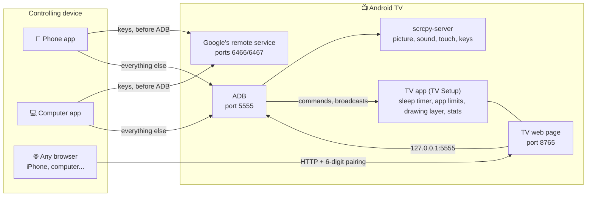
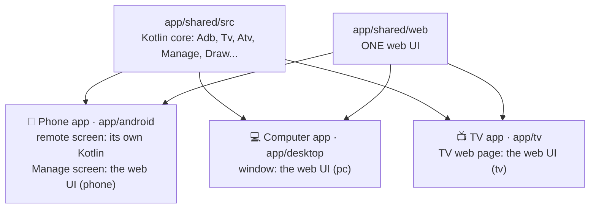
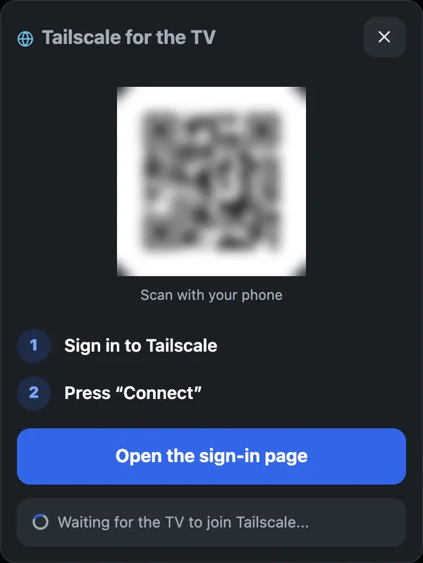
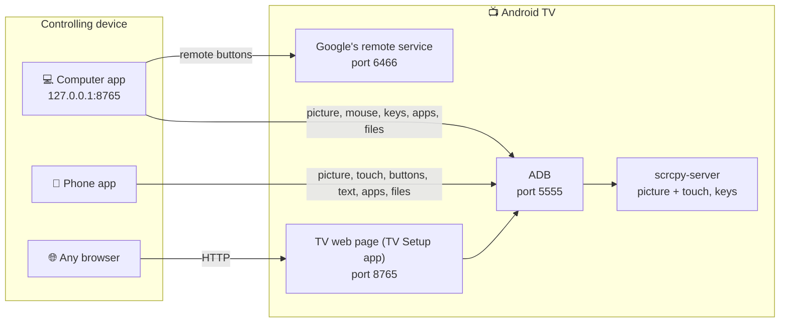

# tv-remote

[Tiếng Việt](README.md) · **English** · 🌐 [tvremote.pages.dev](https://tvremote.pages.dev)

<!-- aio-desktop-badge:start -->
[](https://fbaio.org/#/desktop)
<!-- aio-desktop-badge:end -->

Control an Android TV / Google TV (and LG, Samsung, Roku, Hisense / Toshiba VIDAA TVs) from a phone or a computer, straight to the TV with no server in between. **Features, screenshots and downloads: [tvremote.pages.dev](https://tvremote.pages.dev).** This README covers setup, troubleshooting and the technical details.

Tested for real on a Sony BRAVIA (Android 9). Other brands are untested. LG, Samsung, Roku, VIDAA TVs: **beta** ([see the table](#three-apps-and-a-web-page)).

<table>
<tr>
<td align="center"><br><sub>Phone app</sub></td>
<td align="center"><br><sub>TV web page</sub></td>
<td align="center"><br><sub>Computer app</sub></td>
</tr>
</table>

**Contents**

- [Pick how to use it](#pick-how-to-use-it)
- [Three apps and a web page](#three-apps-and-a-web-page): names, comparison, diagrams
- [Prepare the TV](#prepare-the-tv)
- [Install TV Setup with a Downloader code](#install-tv-setup-with-a-downloader-code)
- Setting up each way:
  - [Phone app](#1-phone-app-android)
  - [TV web page](#2-tv-web-page-through-the-tv-setup-app)
  - [Computer app](#3-computer-app)
- [From another network](#from-another-network-tailscale)
- [When the TV is off](#when-the-tv-is-off)
- [Optimize TV](#optimize-tv)
- [Troubleshooting](#troubleshooting)
- [Security](#security)
- [Technical details](#technical-details)

## Pick how to use it

| You have | Use | Get it from |
|---|---|---|
| An Android phone | The **Phone app** (TV Remote) | `tv-remote.apk` in [Releases](https://github.com/HoangTran0410/tv-remote/releases), or the Downloader code **`2973135`** |
| Any browser, iPhone included | The **TV web page**: install the **TV app** (TV Setup) on the TV, then open `http://<TV IP>:8765` | On the TV: the Downloader app, code **`2397346`** ([how](#install-tv-setup-with-a-downloader-code)) |
| A computer (Mac, Windows, Linux) | The **Computer app** (TV Remote) | The file for your computer on [Releases](https://github.com/HoangTran0410/tv-remote/releases/latest) ([see the table](#3-computer-app)) |

The site has the [feature list](https://tvremote.pages.dev/#features).

## Three apps and a web page

The README, the code and the site always call the parts by these names:

| Name | What it is | Code | `data-core` |
|---|---|---|---|
| **Phone app** | The Android app, called *TV Remote* on the phone | `app/android` | `phone` |
| **Computer app** | The app for Mac, Windows, Linux, called *TV Remote* there | `app/desktop` | `pc` |
| **TV app** | The app installed on the TV, called *TV Setup* there: sleep timer, app limits, drawing, stats, Tailscale | `app/tv` | |
| **TV web page** | The page the TV app serves on port 8765, opened from any browser after a 6-digit code; also on the TV's own screen (*Manage on this TV*, no Remote tab) | `app/tv` (`RemoteService`) | `tv` |

**What each can do**

| | Phone app | TV web page | Computer app |
|---|---|---|---|
| Remote, see and touch the TV's picture, ✏️ draw, 🖼️ put a picture or 💬 a message on the TV | ✓ | ✓ | ✓ |
| ▶️ Now playing (title, seek, pause), 📋 the TV's clipboard, screen off while it keeps playing | ✓ | ✓ | ✓ |
| 🔊 Volume limits by time of day (with the sleep timer, bedtime, app limits) | ✓ | ✓ | ✓ |
| 🎧 Listen to the TV | ✓, with the screen off too | ✓, while the page is open | ✓, high quality |
| Apps, Files, Health, Automation, Setup | ✓ | ✓ | ✓ |
| *Sharpest* picture quality | | | ✓ |
| Several TVs, switching TVs | ✓ | only that TV | ✓ |
| Turning on a TV that is fully off (Wake-on-LAN) | ✓ | off with the TV | ✓ |
| Keys while the TV has not allowed ADB | ✓ | | ✓ |
| Widget, Quick Settings tiles, the phone's volume keys | ✓ | | |
| Install on the controlling device | the app | nothing, fine on an iPhone | the app |
| LG, Samsung, Roku, VIDAA TVs | ✓ | | ✓ |

**LG, Samsung, Roku, VIDAA TVs** (beta, not yet tried on a real TV). The Phone app and the Computer app control them without ADB, found by the network scan. The first time, choose Allow on the TV (VIDAA: type the 4-digit code).

| | LG | Samsung | Roku | VIDAA |
|---|:-:|:-:|:-:|:-:|
| Keys, typing, apps, power on, scenes | ✓ | ✓ | ✓ | ✓ |
| Inputs | ✓ | | ✓ | ✓ |
| Volume to a number | ✓ | | | ✓ |
| YouTube links, screen off | ✓ | | | |

The picture, files, health and timers need Android TV. If the TV gets something wrong: About → 📋 Send the log.

**How the parts connect.** No server in between: everything goes straight to the TV.



**In the code**, the three apps share one Kotlin core and one web UI. Only the Phone app's remote screen is its own Kotlin, for smoothness, so a change to the remote screen goes in two places: `app/shared/web` and `app/android`.



## Prepare the TV

Once, with the TV's own remote. Menu names below are Sony's; other brands differ slightly.

1. **Turn on Developer options:** Settings → Device Preferences → About → **Build** → press OK 7 times.
2. **Turn on ADB:** Settings → Device Preferences → Developer options → **ADB debugging** (some TVs say "USB debugging").
3. **Recommended, remote wake:** Settings → Network & Internet → **Remote start**. Without it the TV cannot be turned back on remotely once it is fully off.

The first time each device connects, the TV asks "Allow USB debugging?": tick **Always allow**, then OK. Someone has to be at the TV for this. Meanwhile all three show a full-screen "Look at the TV" that closes by itself once the TV allows it.

<details>
<summary><b>When you are away and the TV asks again</b> (it forgot this device, Android 11+ revokes after 7 days unused...)</summary>

- **Automatic:** the phone app and the computer app, whenever they have ADB, fetch a "pass" from TV Setup. The next time the TV asks, they have TV Setup press Allow, nobody needed at the TV. TV Setup presses only when **the key code in the question matches the asking device's own**, and shows a notice on the TV each time.
- **By hand:** any page that has ADB (the TV web page once paired, the Computer app, the Phone app) shows a "The TV is asking... for a device" bar with the code and **Allow / Decline**. Allow only when the code matches the one the TV Remote app shows while it waits.
- A device that never connected and never paired with TV Setup still needs someone at the TV. That is on purpose, so strangers cannot get in.
</details>

ADB cannot be turned on (an operator box hides Settings, asks for a password...)? Install TV Setup with the [Downloader code](#install-tv-setup-with-a-downloader-code): it opens the right place directly. The app on the computer has **🧭 Turn ADB on for me**, and the phone app a similar assistant: using only the remote buttons, it installs TV Setup on the TV, or opens the TV's Settings in every way it knows.

<details>
<summary>Where to find the TV's IP</summary>

- On the TV: Settings → Network & Internet → the connected Wi-Fi name → **IP address** (like `192.168.1.88`).
- The Tailscale IP (like `100.x.x.x`): open the Tailscale app on the TV, or see [login.tailscale.com/admin/machines](https://login.tailscale.com/admin/machines).
- The TV Setup app also shows both IPs on the TV.
</details>

## Install TV Setup with a Downloader code

The easiest way for a newcomer: only the TV's remote is needed, no computer or Android phone. Afterwards any phone (iPhone included) controls the TV from its browser.

1. On the TV open the **Play Store**, find and install **Downloader** (by AFTVnews, an orange icon).
2. Open Downloader. If it asks for access to files, choose **Allow**.
3. In the address field type the code **`2397346`** and choose **Go**.
4. Downloader fetches the latest TV Setup. The TV asks to install: choose **Install**. If it says installs from this source are not allowed: allow Downloader, press Back, then choose Install.
5. Open **TV Setup**. If ADB debugging is still off, the app explains how and opens Developer options directly.
6. TV Setup shows a **QR code**: scan it with the phone's camera and enter the **6-digit code** shown on the TV. Done.

| App | Downloader code | Direct link |
|---|---|---|
| TV Setup (on the TV) | **`2397346`** | [tv-setup.apk](https://github.com/HoangTran0410/tv-remote/releases/latest/download/tv-setup.apk) |
| TV Remote (Android phone) | **`2973135`** | [tv-remote.apk](https://github.com/HoangTran0410/tv-remote/releases/latest/download/tv-remote.apk) |

The codes always point at the latest release. Without Downloader, opening `go.aftvnews.com/<code>` in a browser downloads it too.

## 1. Phone app (Android)

1. Install `tv-remote.apk` from [Releases](https://github.com/HoangTran0410/tv-remote/releases) (or the Downloader code `2973135`).
2. Open the app, tap **Scan Wi-Fi** and pick the TV, or type the TV's IP. With ADB still off the app can send keys after pairing with a code, and walks you step by step until TV Setup is installed.

The phone's volume keys set the TV's volume; a widget, Quick Settings tiles and shortcuts control the TV used last without opening the app. The app tells you when a new version exists.

## 2. TV web page (through the TV Setup app)

Works from any browser, with nothing to install on the phone or computer.

1. Install TV Setup on the TV: the [Downloader code `2397346`](#install-tv-setup-with-a-downloader-code), a USB stick, or let the phone app / computer app do it.
2. Open **TV Setup** on the TV and choose "Always allow" when the TV asks.
3. On a phone or computer, open the address the app shows on the TV: `http://<TV IP>:8765`.
4. Enter the **6-digit code** the TV shows. That device gets straight in from then on.

<details>
<summary>Notes on TV Setup</summary>

- **iPhone:** in Safari tap Share → "Add to Home Screen" for an icon that opens like an app (opened from the icon, it asks for the pairing code once more).
- No address to type: the TV Setup app shows a QR code for this page; scan it with the phone's camera.
- It starts again by itself when the TV boots.
- **No phone or computer at hand?** On the TV pick **Manage on this TV**: the Apps, Files, Health, Automation and Setup tabs right on the TV, driven with the TV's remote (Back closes / leaves). Works with the web remote turned off too.
- On the TV, the app also offers **Optimize TV** / **Undo**, **Tailscale** (installs it and brings up its sign-in code), **Update**, turning the web remote on and off, and **Unpair all**.
- The connection is plain HTTP, not encrypted. **Do not expose port 8765 to the Internet**; away from home, go through Tailscale.
- It needs the TV's ADB on port 5555. Some newer Google TVs that only have pairing-code "Wireless debugging" may not work.
- **On an Android phone / tablet** it installs too (a one-column layout for small screens), to control that device itself from another browser. It needs ADB on port 5555. A normal phone opens ADB over the cable only: plug it into a computer and run `adb tcpip 5555` once, again after every restart. Android 11+ "Wireless debugging" does not work yet. Optimize TV refuses to run on anything that is not a TV.

<p align="center"></p>
</details>

## 3. Computer app

An app with its own window, about 20 MB; nothing else to install (no Python, no adb).

| Computer | Download |
|---|---|
| Mac (Apple chip and Intel) | [TV-Remote-mac.zip](https://github.com/HoangTran0410/tv-remote/releases/latest/download/TV-Remote-mac.zip) |
| Windows 10 / 11 | [TV-Remote-windows-x64.zip](https://github.com/HoangTran0410/tv-remote/releases/latest/download/TV-Remote-windows-x64.zip) |
| Linux x64 / arm64 | [TV-Remote-linux-x64.tar.gz](https://github.com/HoangTran0410/tv-remote/releases/latest/download/TV-Remote-linux-x64.tar.gz) · [arm64](https://github.com/HoangTran0410/tv-remote/releases/latest/download/TV-Remote-linux-arm64.tar.gz) |

1. Download the file for your computer from the table and unzip it.
   - **Mac:** drag **TV Remote** into Applications and open it. If the Mac refuses because the developer is “unverified”: System Settings → Privacy & Security → scroll down, **Open Anyway**. Only the first time.
   - **Windows:** open the `TV Remote` folder and run **`TV Remote.exe`**. If Windows says “Windows protected your PC”: **More info → Run anyway**.
   - **Linux:** run `tv-remote/bin/tv-remote`. The window needs `libwebkit2gtk-4.1-0` (usually there on Ubuntu 22.04 and newer); without it the app opens in the browser.
2. The app's window lists the TVs (it scans the network the first time). Pick a TV, or type its IP. The first time, the TV asks “Allow USB debugging?”: choose Always allow.
3. A ready TV goes straight to the Remote tab. Otherwise the **Setup** tab lists the steps, each ticked when done: ADB → Tailscale (optional, one button) → Pair the remote (type the 6-character code the TV shows) → Save.

The **📺 Change TV** button at the top goes back to the list.

Closing the window (or ⏻ Quit in 🛠️ Settings) stops the app; nothing keeps running. Links to other sites open in the browser; screenshots and backups are saved to the Downloads folder. The app only listens on `127.0.0.1`: other devices on the network cannot reach it.

**Updates:** the app looks for a new version (when it opens and every few hours), downloads it in the background and says so at the top of the page. **Update** swaps it in and opens it again; **Later** puts it in place when the app closes. Saved TVs, pairing and scenes stay. If the app sits in a folder it cannot write (Program Files, or on a Mac run straight from Downloads without moving it to Applications) the button becomes **Download the new version**.

**When ADB is closed**, only the buttons, power, step-by-step volume and wake remain; the page says so and has a "Retry connection" button.

<details>
<summary>Usage notes</summary>

- Picture quality goes from 240p to 960p; lower is lighter on the TV and the network. The app on the computer adds *Sharpest* (slows the TV noticeably). *Screenshots* fetch one picture at a time, the lightest. On another tab the picture shrinks into a corner.
- **▶️ Now playing**: the remote shows what the TV is playing (title, channel or artist); drag the bar to seek, tap to pause or skip. Needs ADB; an app that does not tell its length gets no seek bar.
- **📋 The TV's clipboard** (*Open on the TV* → *The TV's clipboard*): see the text the TV has copied, copy it to your device, or send text to the TV and paste it where it is typing.
- **✏️ Draw on the TV's screen** (the ✏️ next to the picture; in the phone app, *Draw on the TV* under More keys): what you draw on the picture shows on the TV at once, over every app, to show the person watching where to go. Needs TV Setup on the TV; it clears with 🗑 or goes by itself after 10 minutes.
- **📲 Share** (More keys → *Share*): a QR code another phone scans to open the TV's remote in its browser with no code to type (once, within 10 minutes; needs TV Setup; pick Full access, Remote only or View only), and a QR code for the phone app. When this device reaches the TV through Tailscale it says so: the phone that scans must be on the TV's Wi-Fi.
- **💬 A message on the TV** (the 💬 Text button while drawing): type a sentence; it shows in big letters on the TV, moved and sized like a picture.
- **Screen off, keep listening** (*Sleep timer* → *Screen off, keep listening*): the TV's screen goes off and the music plays on. Any key, the TV's own remote too, turns the screen back on.
- **📱 Running apps** (Health tab): which apps run, in the background too, and how much memory each takes; ⏹ Stop closes one. Only apps you installed or with a home screen tile can be stopped; the home screen, keyboard, Android's own parts, TV Remote and Tailscale show 🔒 Must keep.
- **🧹 Full memory notice** (Automation tab, off by default): past the level picked (80–95%), the TV shows a notice over the app on screen: Free RAM, See the apps or Skip. Needs TV Setup.
- **🔊 Volume limits** (Automation tab): pick times of day and the highest volume for each, e.g. 22:00 – 06:00 at most 30%. Turned up past it, the TV turns it back down and says why on screen. Needs TV Setup; a TV whose volume is kept by an external speaker (over HDMI) cannot be limited.
- Protected video (Netflix and the like) shows as black.
- The TV's on-screen keyboard cannot be clicked with the mouse; type on the computer keyboard. For accented text, type in the "Keyboard" box.
</details>

## From another network (Tailscale)

Once, while at home (on the TV's Wi-Fi):

1. Open the **Setup** tab (phone app: grid button → Setup; TV Setup app on the TV: the **Tailscale** button) → **⚡ Install and sign in to Tailscale**.
2. Wait about half a minute: the TV downloads the official Tailscale (checksum checked), installs it, skips the VPN question, has it start again whenever the TV turns on, switches it on and fetches its sign-in link.
3. Press **🔑 Open the Tailscale sign-in page** (or scan the QR code), sign in to your Tailscale account (none yet? Create one for free with Google, Microsoft or GitHub) and press **Connect**. Nothing is typed on the TV. The page notices when the TV is in.
4. Recommended: in the [Tailscale admin console](https://login.tailscale.com/admin/machines), open the TV's ⋯ menu → **Disable key expiry**, or the TV is signed out after about 180 days.
5. Install Tailscale on the controlling device (same account), then use the TV's `100.x.x.x` IP instead of the home one. The app on the computer has a **Save** step that switches to that IP for you.

<details>
<summary>The Tailscale box, and why the sign-in goes through a link</summary>

<p align="center"></p>

Why not send the account from the phone to the TV? Tailscale only takes a sign-in through its own web page (Google, Microsoft...) or a key handed out by company device-management software, which a home TV does not have. Sending the sign-in link is the fewest steps without giving a password to any app.
</details>

<details>
<summary>The person at home only has the TV remote, the helper is far away</summary>

The person at the TV: turn on ADB debugging, install TV Setup (or let the helper install it remotely with "Turn ADB on for me"), open TV Setup and press **Tailscale**. The TV shows a QR code: take a photo and send it to the helper. The helper scans it with a phone signed in to their Tailscale, presses Connect, then connects to the TV's `100.x` IP.
</details>

## When the TV is off

- **Standby (network still up):** Power or Wake is enough, over Tailscale too.
- **Fully off (network down):** only a Wake-on-LAN packet reaches the TV, and it must be sent from **inside the home network**. The phone app and the app on the computer both send it when on the TV's network. From away, the app on the computer can ask a machine at home to send it over SSH: add `relay_user` and `relay_host` to the TV's entry in `tvs.json`.
- Holding the power key on the TV's own remote opens the full power-off menu; press it briefly if you want to wake the TV remotely later.
- **After the TV restarts:** Tailscale starts again by itself if it was installed with the Tailscale button (or Optimize TV was run). If ADB does not reopen, turn "ADB debugging" off and on.

## Optimize TV

The **⚡ Optimize TV** button on the Setup tab of all three (and in the TV Setup app on the TV itself) opens a box to **choose what to do**; **Undo** puts everything back. Safe to run again. Optional.

<details>
<summary>The choices</summary>

- **Turn off transition animations** (ticked).
- **Use FLauncher as the home screen** (ticked): installs FLauncher and turns off Google's "Android TV Home" screen, which uses a lot of CPU. TVs with the newer Google TV interface, operator boxes (FPT, for one) and TVs that run 64-bit apps only keep their home screen.
- **Suggested apps to turn off** (ticked): unused system apps, a list written for Sony BRAVIA plus a few Google apps; only the ones this TV has are shown.
- **Turn off other apps** (not ticked): every app with an icon on the TV, with a filter. Essential apps (Settings, the system UI, the keyboard, Google Play Services, TV Setup, Tailscale...) are never listed.

Turning off only pauses an app, nothing is uninstalled. **Undo** also turns back on the apps you added yourself (the TV keeps the list in `/data/local/tmp/tvr-disabled.txt`).

If the TV later shows no home screen: Settings → Apps → System apps → **Android TV Home** → Enable.
</details>

## Troubleshooting

| Symptom | What to do |
|---|---|
| Cannot connect | Same network as the TV? ADB debugging on? Right IP? Look at the TV for a permission dialog |
| **ADB: waiting for the TV** | Choose "Always allow" on the TV. Closed the question by mistake (Back, Home, Cancel)? The apps ask again a few times; on the web press "Retry connection". Away from home: see "When you are away and the TV asks again" above |
| **ADB: port closed** | The TV is off, or just restarted: turn "ADB debugging" off and on |
| Buttons do nothing (app on the computer) | The remote is not paired (the **Setup** tab), or two windows are open for the same TV |
| The TV web page asks for the 6-digit code again | "Unpair all" was pressed on the TV, or the browser cleared the page's data: enter a new code |
| Tailscale gives no sign-in link | The TV's screen must be on (not in standby) and online. Press the button again; failing that, open Tailscale on the TV and scan the QR code it shows |
| Choppy picture, slow TV | Pick a lower quality; turn the picture off when not needed |
| Cannot connect from far away | Are both devices in the same Tailscale account and online? |
| Android calls the app "harmful" on install | Play Protect warns about unknown apps that can install APKs. The source is in this repo; choose "Install anyway" if you trust it |

## Security

- ADB over the network has no password: any device the TV has "Always allowed" has full control of it. Use it only on networks you trust and over Tailscale. To revoke: Developer options → Revoke USB debugging authorizations.
- **Who may have TV Setup press Allow:** only a device paired with the 6-digit code (shown on the TV's screen, so someone was there) or one that already has ADB. The pass for a device with ADB is handed out through a broadcast only ADB's shell can send, so no other app on the TV can get one. Each Allow checks the key code and shows a notice on the TV. **Unpair all** on the TV voids every pass.
- The computer app's `keys` folder (Mac: `~/Library/Application Support/TV Remote`, Windows: `%APPDATA%\TV Remote`, Linux: `~/.local/share/tv-remote`) holds the pairing keys. **Whoever has those files can control the TV.** Never share them.
- The Computer app listens on `127.0.0.1` only, with a new key each time it starts: its window and the browser it opens carry the key by themselves; other programs or users of the computer cannot get in. The TV web page listens on the home network and requires the pairing code.
- **The TV's owner** is whoever reached the TV itself: the phone app, the computer app (over ADB), Manage on this TV, and a browser that typed the 6-digit code shown on the TV's screen. They have full access. Someone given a shared QR code gets what the sharer picked: **Full access**, **Remote only** (keys, typing, the picture, opening apps, the sleep timer, running saved scenes; no installing, files or Setup) or **View only** (the TV's picture and what is playing). The owner changes each device's access in Setup → Paired devices.
- The phone app asks before sending a file or link that another app shared to the TV.
- Install APKs only from sources you trust.

## Technical details

<details>
<summary>How it works</summary>



- **The phone app and TV Setup** speak the ADB protocol themselves and push `scrcpy-server` to the TV for H.264 video and for touch and key input. TV Setup connects to the TV's own ADB (`127.0.0.1:5555`).
- **Picture on the TV web page:** H.264 over `/api/video`, played in the browser by JMuxer (MSE).
- **The computer app** (`app/desktop`) runs on the same Kotlin core as the two Android apps (ADB, scrcpy, the remote protocol), on its own bundled Java; its window is the system's web view (the [webview](https://github.com/webview/webview) library, through JNA). H.264 goes straight to the page, as on the TV's page. Remote buttons without ADB: the Android TV Remote v2 protocol, ports 6466/6467.
- **Accented text:** put on the TV's clipboard, then pasted.
- **Volume:** calls `AudioService.setStreamVolume` directly (Android 9), falls back to `media volume`, and without ADB presses step by step.
- **App names and icons:** all three ask the TV's own system. TV Setup asks directly; the phone app and the app on the computer copy the phone app's APK to `/data/local/tmp` and start its `Meta` class with `app_process`. The app on the computer caches the result in `.cache/apps`.
- **ADB still off:** the phone app and the computer app can still send keys after pairing with the 6-character code the TV shows (Android TV Remote protocol, ports 6466/6467). The picture, apps and files need ADB.
- **History:** TV Setup writes to `/sdcard/Android/data/dev.tvremote.setup/files/stats/` (`usage.json` for 90 days, `samples.jsonl` for about 30); the remotes read it over ADB and draw it with `app/shared/web/stats.js`. Usage access is granted through ADB.
- **Power (both apps):** the SLEEP (223) / WAKEUP (224) keys instead of POWER, so repeating a press never flips the state.
- **Tailscale in one button** (`Tailscale.kt`): downloads the APK from `pkgs.tailscale.com` and checks its SHA-256, installs it over ADB, `appops set com.tailscale.ipn ACTIVATE_VPN allow` so there is no VPN question, switches it on with the `CONNECT_VPN` broadcast; when it is still signed out, opens the app, presses "Log in" and reads the code under the QR with `uiautomator dump`. The sign-in link is `https://login.tailscale.com/a/<code>`.
</details>

<details>
<summary>For people changing the code</summary>

The full guide for people (and AI agents) changing the code: [AGENTS.md](AGENTS.md).

**You need:** JDK 17, the Android SDK (with Emulator and Command-line Tools), Node.js (the web tests), Python 3 (the tools in `dev/`). Mac and Linux run it as is; on Windows use Git Bash.

**Where the code is**

```
app/shared/web/  ONE web UI for all three places (the Computer app, the TV web page, the Phone app's Manage screen)
app/shared/src/  the shared Kotlin core: ADB, picture and sound (scrcpy), the remote of each TV brand, /api
app/desktop/     the Computer app (Kotlin JVM; the window is the system's web view)
app/android/     the Phone app (remote screen in Kotlin, Manage screen is the web UI)
app/tv/          the TV app (TV Setup) + the TV web page
app/gradle/      the Gradle build of everything Kotlin (open this folder in Android Studio)
dev/             emu.sh (emulators), release.sh (releases), gen_icons.py, contrast.py, shots.py (dev/README.md)
docs/            the product page https://tvremote.pages.dev (docs/README.md)
tvs.json, cert.pem, key.pem, *.jks, .cache/      your machine's own data, never committed
```

**The Computer app from source**

| To | Run |
|---|---|
| Build | `cd app/gradle && ./gradlew :desktop:installDist` |
| Open in its own window | `app/desktop/build/install/desktop/bin/desktop --window` |
| Open in a browser | `app/desktop/build/install/desktop/bin/desktop` (prints the link with its `?k=` key) |
| Try things without touching your real TV list | `TVS_FILE=/tmp/x.json TVR_KEYS=/tmp/keys TVR_PASS=testtest app/desktop/build/install/desktop/bin/desktop --port 8769`, open `http://127.0.0.1:8769/?k=testtest` (curl: header `x-tvr-pass: testtest`) |
| Package the app for people | `./gradlew :desktop:packageApp` → `app/desktop/build/package/` |

A change in `app/shared/web` only needs the page reloaded (the app reads that folder); a Kotlin change, a build again (a few seconds). Run inside the repo, the app uses the repo's `tvs.json` and ADB keys in `.cache/keys`, apart from the installed app.

**The Android apps**

- `app/android/build.sh`, `app/tv/build.sh` → `app/*/build/*.apk`. The web UI is packed into both APKs.

**Emulators** (`dev/emu.sh help` lists every command)

| To | Run |
|---|---|
| Make a Google TV emulator and a phone emulator (Android 14), once | `dev/emu.sh create` |
| Start both (the TV first), build and install TV Setup on the TV and TV Remote on the phone | `dev/emu.sh` |
| Only build and install again (emulators running) | `dev/emu.sh install` |
| Reduce the phone app's TV list to `10.0.2.2` | `dev/emu.sh reset` |
| Stop | `dev/emu.sh stop` |

The TV emulator's address: from the phone app (an emulator) it is **`10.0.2.2`**, from the Computer app **`127.0.0.1`**. The `10.0.2.15` the TV emulator shows means something only inside itself. The first time, choose Allow on "Allow USB debugging?" in the TV emulator's window. Emulators open only the ADB port, so the Android TV remote pairing (without ADB) cannot be tried on them.

**Checks**

| To | Run |
|---|---|
| Web UI tests | `node --test app/shared/tests/` |
| Kotlin tests | `cd app/gradle && ./gradlew :shared:testDebugUnitTest :android:testDebugUnitTest :tv:testDebugUnitTest` |
| Colour contrast on the real page | `dev/contrast.py` |
| Screenshots for the product page | `dev/shots.py` |

**Other**

- **Versions:** three numbers, each bumped only when its part changes: `VERSION` (the release and the Computer app), `app/android/VERSION`, `app/tv/VERSION`. `dev/release.sh` bumps the number of each part that changed, builds the APKs and creates the GitHub release; the next release's notes go under `## Unreleased` in `CHANGELOG.md`.
- **Keep the three in sync:** any change to the controls goes into the Phone app, the TV web page and the Computer app. The remote screen's keys live in one place: `app/shared/web/remote.json`. Names and diagrams: [Three apps and a web page](#three-apps-and-a-web-page).
- **Credits:** [scrcpy](https://github.com/Genymobile/scrcpy) v5.0.1 (Apache-2.0), [JMuxer](https://github.com/samirkumardas/jmuxer) 2.1.0 (MIT), [webview](https://github.com/webview/webview) 0.12.0 (MIT), [JNA](https://github.com/java-native-access/jna) (Apache-2.0).
</details>

Changes per release: [CHANGELOG.md](CHANGELOG.md).

<!-- aio-desktop:start -->
### 🖥️ AIO Desktop

Find this app and many more free tools & games in **[AIO Desktop](https://fbaio.org/#/desktop)**, a Windows/macOS-style web desktop by Social AIO. [▶ Open AIO Desktop](https://fbaio.org/#/desktop)
<!-- aio-desktop:end -->
