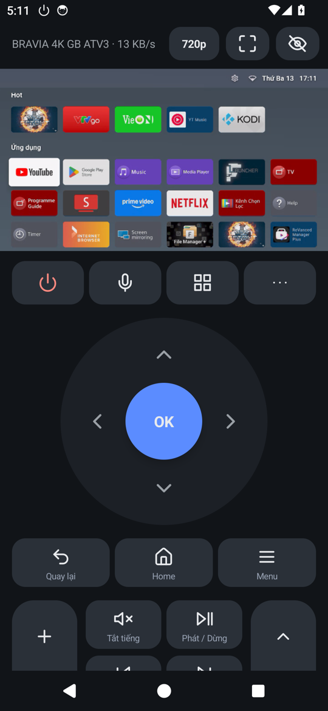
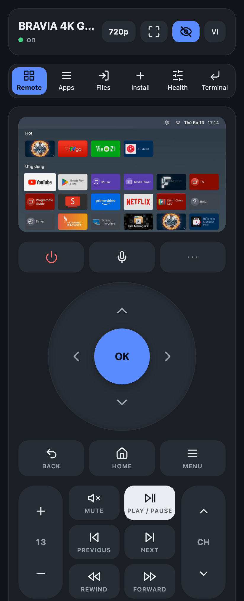
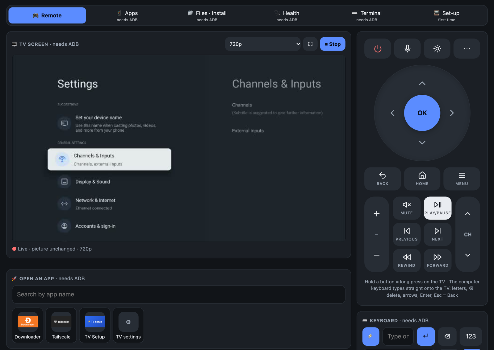
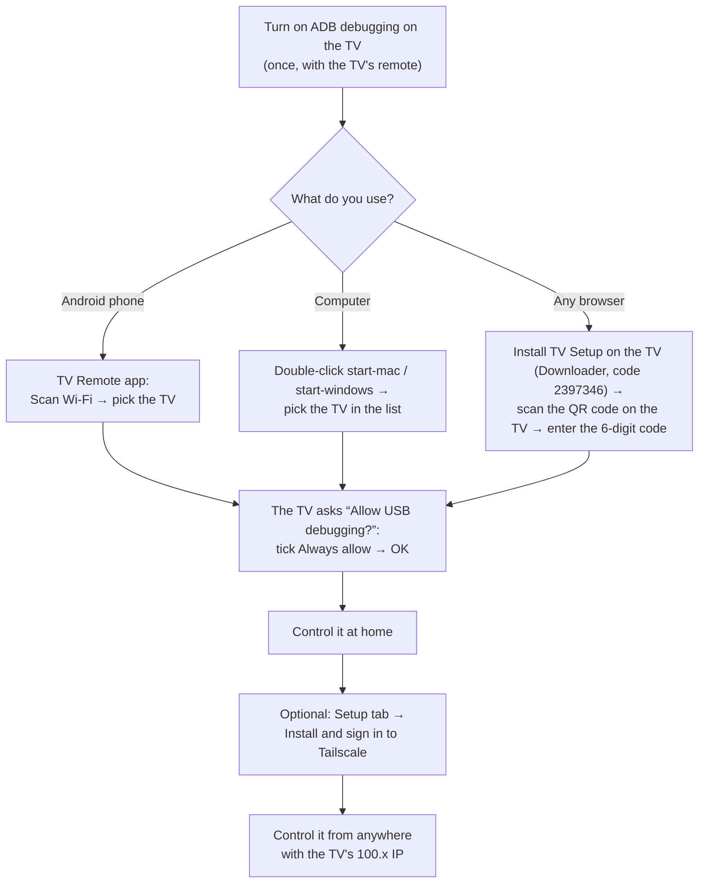
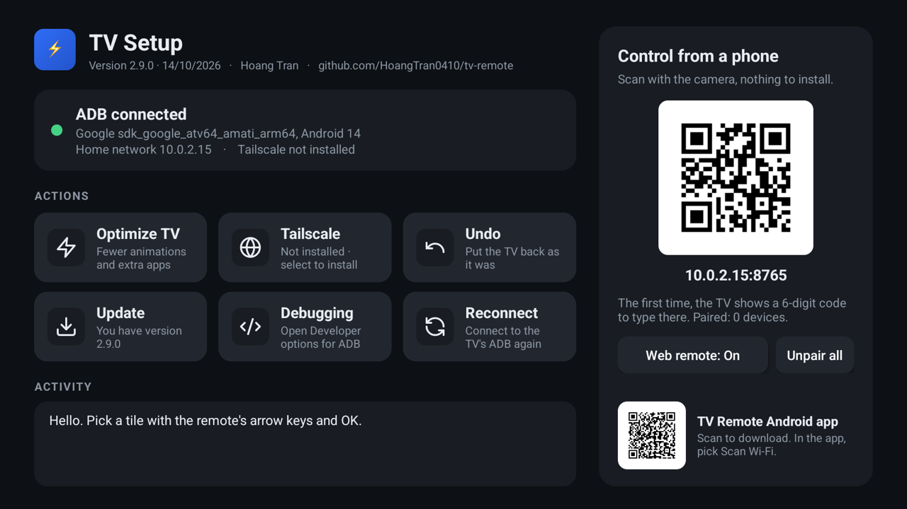
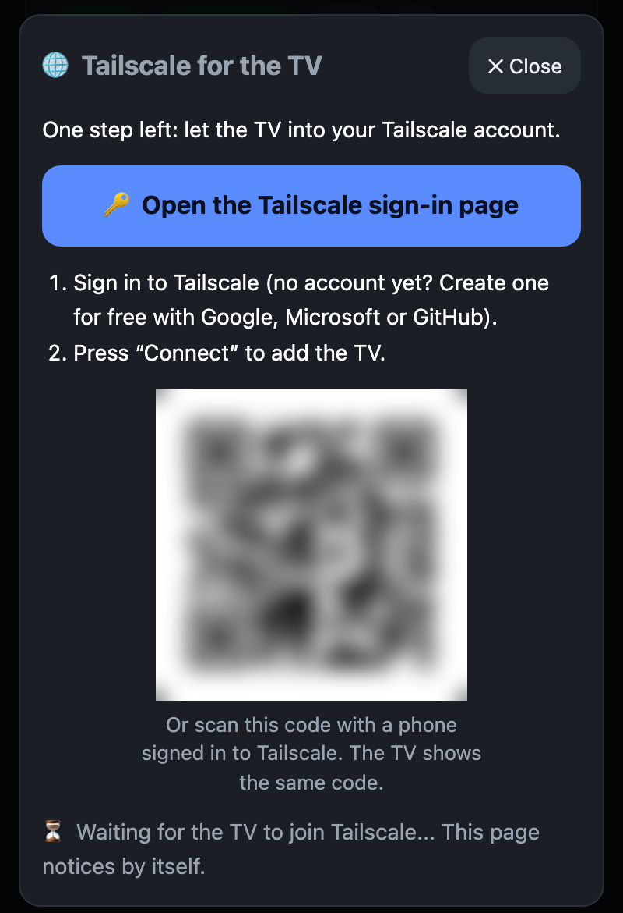
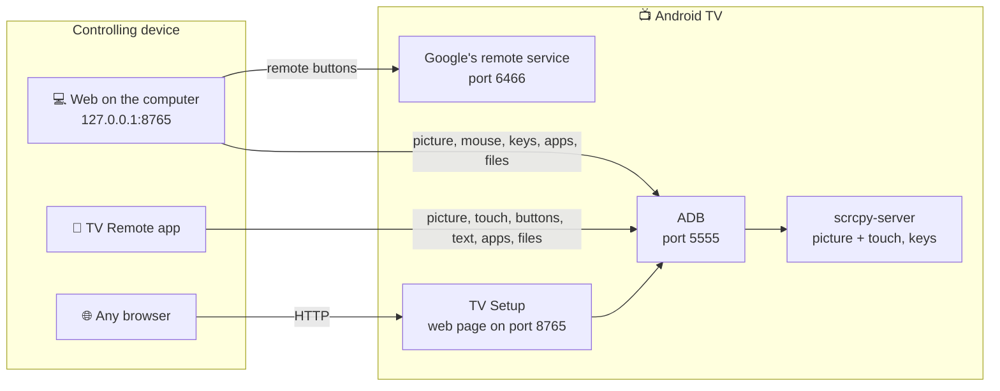

# tv-remote

[Tiếng Việt](README.md) · **English**

Control an Android TV / Google TV from a phone or a computer: remote buttons, the live TV picture with touch, typing, talking to the TV, managing apps and files, installing APKs, TV health, a terminal. Every connection goes straight to the TV with no server in between; from another network, use Tailscale.

Tested for real on a Sony BRAVIA (Android 9). Other brands are untested. Samsung (Tizen) and LG (webOS) do not work.

<table>
<tr>
<td align="center"><br><sub>Phone app</sub></td>
<td align="center"><br><sub>Page served by the TV</sub></td>
<td align="center"><br><sub>Web on the computer</sub></td>
</tr>
</table>

**Contents:** [Pick how to use it](#pick-how-to-use-it) · [Prepare the TV](#prepare-the-tv) · [Install TV Setup with a Downloader code](#install-tv-setup-with-a-downloader-code) · [Phone app](#1-android-phone-app-tv-remote) · [Page served by the TV](#2-page-served-by-the-tv-tv-setup) · [Web on the computer](#3-web-on-the-computer) · [From another network](#from-another-network-tailscale) · [When the TV is off](#when-the-tv-is-off) · [Optimize TV](#optimize-tv) · [Troubleshooting](#troubleshooting) · [Security](#security) · [Technical details](#technical-details)

## Pick how to use it

| You have | Use | Get it from |
|---|---|---|
| An Android phone | The **TV Remote** app | `tv-remote.apk` in [Releases](https://github.com/HoangTran0410/tv-remote/releases), or the Downloader code **`2973135`** |
| Any browser, iPhone included | The **TV Setup** app installed on the TV, then open `http://<TV IP>:8765` | On the TV: the Downloader app, code **`2397346`** ([how](#install-tv-setup-with-a-downloader-code)) |
| A computer (Mac, Windows, Linux) | The **web on the computer** | Download the repo, double-click `start-mac.command` / `start-windows.cmd` |

All three use **one shared web UI** with these tabs: Remote, Apps, Files · Install, Health, Terminal, Setup. The phone app has its own remote screen (swipes, the phone's volume keys) and opens the other tabs from the grid button. The web on the computer adds the mouse, the computer keyboard, several TVs, and keys that work even before the TV has ADB on.



## Prepare the TV

Once, with the TV's own remote. Menu names below are Sony's; other brands differ slightly.

1. **Turn on Developer options:** Settings → Device Preferences → About → **Build** → press OK 7 times.
2. **Turn on ADB:** Settings → Device Preferences → Developer options → **ADB debugging** (some TVs say "USB debugging").
3. **Recommended, remote wake:** Settings → Network & Internet → **Remote start**. Without it the TV cannot be turned back on remotely once it is fully off.

The first time each device connects, the TV asks "Allow USB debugging?": tick **Always allow**, then OK. Someone has to be at the TV for this. Meanwhile all three show a full-screen "Look at the TV" that closes by itself once the TV allows it.

<details>
<summary><b>When you are away and the TV asks again</b> (it forgot this device, Android 11+ revokes after 7 days unused...)</summary>

- **Automatic:** the phone app and the computer web, whenever they have ADB, fetch a "pass" from TV Setup. The next time the TV asks, they have TV Setup press Allow, nobody needed at the TV. TV Setup presses only when **the key code in the question matches the asking device's own**, and shows a notice on the TV each time.
- **By hand:** any page that has ADB (the TV's page once paired, the computer web, the phone app) shows a "The TV is asking... for a device" bar with the code and **Allow / Decline**. Allow only when the code matches the one the TV Remote app shows while it waits.
- A device that never connected and never paired with TV Setup still needs someone at the TV. That is on purpose, so strangers cannot get in.
</details>

ADB cannot be turned on (an operator box hides Settings, asks for a password...)? Install TV Setup with the [Downloader code](#install-tv-setup-with-a-downloader-code): it opens the right place directly. The web on the computer has **🧭 Turn ADB on for me**, and the phone app a similar assistant: using only the remote buttons, it installs TV Setup on the TV, or opens the TV's Settings in every way it knows.

<details>
<summary>Where to find the TV's IP</summary>

- On the TV: Settings → Network & Internet → the connected Wi-Fi name → **IP address** (like `192.168.1.88`).
- The Tailscale IP (like `100.x.x.x`): open the Tailscale app on the TV, or see [login.tailscale.com/admin/machines](https://login.tailscale.com/admin/machines).
- The TV Setup app also shows both IPs on the TV.
</details>

## Install TV Setup with a Downloader code

The easiest way for a newcomer: only the TV's remote is needed, no computer or Android phone. Afterwards any phone (iPhone included) controls the TV from its browser.

1. On the TV open the **Play Store**, find and install **Downloader** (by AFTVnews, an orange icon).
2. Open Downloader. If it asks for access to files, choose **Allow**.
3. In the address field type the code **`2397346`** and choose **Go**.
4. Downloader fetches the latest TV Setup. The TV asks to install: choose **Install**. If it says installs from this source are not allowed: allow Downloader, press Back, then choose Install.
5. Open **TV Setup**. If ADB debugging is still off, the app explains how and opens Developer options directly.
6. TV Setup shows a **QR code**: scan it with the phone's camera and enter the **6-digit code** shown on the TV. Done.

| App | Downloader code | Direct link |
|---|---|---|
| TV Setup (on the TV) | **`2397346`** | [tv-setup.apk](https://github.com/HoangTran0410/tv-remote/releases/latest/download/tv-setup.apk) |
| TV Remote (Android phone) | **`2973135`** | [tv-remote.apk](https://github.com/HoangTran0410/tv-remote/releases/latest/download/tv-remote.apk) |

The codes always point at the latest release. Without Downloader, opening `go.aftvnews.com/<code>` in a browser downloads it too.

## 1. Android phone app: TV Remote

1. Install `tv-remote.apk` from [Releases](https://github.com/HoangTran0410/tv-remote/releases) (or the Downloader code `2973135`).
2. Open the app, tap **Scan Wi-Fi** and pick the TV, or type the TV's IP. With ADB still off the app can send keys after pairing with a code, and walks you step by step until TV Setup is installed.

<details>
<summary>Features</summary>

- **TV picture:** the eye button turns it on and off; touching the picture touches the TV. While watching, the top bar has the quality button (240p to 960p) and full screen. With the picture off the TV spends no extra CPU.
- **Buttons:** a tap is one press, a hold is a long press on the TV. The `⋯` button shows the less used keys: Input, TV settings, Info, Guide, Live TV, Subtitles, Stop, Screenshot. The phone's volume keys change the TV's volume too.
- **Typing:** ⚡ switches between live typing and type-then-send; `123` opens the number pad.
- **Talk to the TV:** tap the mic and speak, for example "open YouTube"; hold the mic to open the Assistant on the TV.
- **Manage the TV:** the grid button opens Apps (with names and icons), Files · Install, Health, Terminal, Setup (Tailscale, Optimize TV).
- **Updates:** the app tells you when a new version exists and installs it in place.
</details>

## 2. Page served by the TV: TV Setup

Works from any browser, with nothing to install on the phone or computer.

1. Install TV Setup on the TV: the [Downloader code `2397346`](#install-tv-setup-with-a-downloader-code), a USB stick, or let the phone app / computer web do it.
2. Open **TV Setup** on the TV and choose "Always allow" when the TV asks.
3. On a phone or computer, open the address the app shows on the TV: `http://<TV IP>:8765`.
4. Enter the **6-digit code** the TV shows. That device gets straight in from then on.

<details>
<summary>More about TV Setup</summary>

- The page has Remote, Apps, Files · Install, Health, Terminal, Setup. ▶ View shows the TV picture; one browser at a time can watch.
- No address to type: the TV Setup app shows a QR code for this page; scan it with the phone's camera.
- It starts again by itself when the TV boots.
- **TV history:** the TV Setup app records every 5 minutes (which app is open, RAM, CPU, storage) and keeps it on the TV; all three clients show it under Health → History. Nothing else has to stay on.
- On the TV, the app also offers **Optimize TV** / **Undo**, **Tailscale** (installs it and brings up its sign-in code), **Update**, turning the web remote on and off, and **Unpair all**.
- The connection is plain HTTP, not encrypted. **Do not expose port 8765 to the Internet**; away from home, go through Tailscale.
- It needs the TV's ADB on port 5555. Some newer Google TVs that only have pairing-code "Wireless debugging" may not work.
- **On an Android phone / tablet** it installs too (a one-column layout for small screens), to control that device itself from another browser. It needs ADB on port 5555. A normal phone opens ADB over the cable only: plug it into a computer and run `adb tcpip 5555` once, again after every restart. Android 11+ "Wireless debugging" does not work yet. Optimize TV refuses to run on anything that is not a TV.


<p align="center"></p>
</details>

## 3. Web on the computer

Needs Python 3.10 or newer, `adb` and `ffmpeg` (macOS: `brew install android-platform-tools ffmpeg`; Windows: the installer fetches `adb`, and for ffmpeg run `winget install Gyan.FFmpeg`).

1. Download the repo (git clone or the zip).
2. Double-click **`start-mac.command`** / **`start-windows.cmd`** (Linux: `./start-linux.sh`). The first run installs what it needs.
3. The browser opens `http://127.0.0.1:8765` with the list of TVs (it scans the network the first time). Pick a TV, or type its IP.
4. A ready TV goes straight to the Remote tab. Otherwise the **Setup** tab lists the steps, each ticked when done: ADB → Tailscale (optional, one button) → Pair the remote (type the 6-character code the TV shows) → Save.

The **📺 Change TV** button at the top goes back to the list.

After that, just double-click the start file. Closing the window stops it; nothing keeps running on the computer.

<details>
<summary>What the tabs do</summary>

| Tab | What it does |
|---|---|
| **Remote** | Buttons, volume, wake, the live screen, click/drag/scroll on the picture, type straight onto the TV, open apps, links and the Play Store, play a photo/video from this computer on the TV |
| **Apps** | Open, stop, uninstall apps |
| **Files · Install** | Browse TV storage and USB; download, upload (drag and drop), rename, delete, install `.apk`; download a link to the TV; install an APK from a link or from this computer |
| **Health** | Now: CPU, RAM, storage, Wi-Fi, top CPU processes, Free up RAM. History: TV time per day, most used apps, RAM/CPU/storage charts |
| **Terminal** | Run shell commands on the TV, 30 seconds each at most |
| **Setup** | First-time steps (ADB, Tailscale, pairing the remote, saving), Optimize TV. On the TV's page and in the phone app: Tailscale and Optimize TV |

**When ADB is closed**, only the buttons, power, step-by-step volume and wake remain. Lost: the live screen, mouse, keyboard, apps, files, installing APKs. The page says so and has a "Retry connection" button.
</details>

<details>
<summary>Usage notes</summary>

- Picture quality goes from 240p to 960p; lower is lighter on the TV and the network. The web on the computer adds *Sharpest* (slows the TV noticeably). *Screenshots* fetch one picture at a time, the lightest. On another tab the picture shrinks into a corner.
- Protected video (Netflix and the like) shows as black.
- The TV's on-screen keyboard cannot be clicked with the mouse; type on the computer keyboard. For accented text, type in the "Keyboard" box.
- Command line: `app/web/cli/tv-new.sh <IP>` (Windows: `tv-new.cmd`) runs the same add-a-TV steps.
</details>

## From another network (Tailscale)

Once, while at home (on the TV's Wi-Fi):

1. Open the **Setup** tab (phone app: grid button → Setup; TV Setup app on the TV: the **Tailscale** button) → **⚡ Install and sign in to Tailscale**.
2. Wait about half a minute: the TV downloads the official Tailscale (checksum checked), installs it, skips the VPN question, has it start again whenever the TV turns on, switches it on and fetches its sign-in link.
3. Press **🔑 Open the Tailscale sign-in page** (or scan the QR code), sign in to your Tailscale account (none yet? Create one for free with Google, Microsoft or GitHub) and press **Connect**. Nothing is typed on the TV. The page notices when the TV is in.
4. Recommended: in the [Tailscale admin console](https://login.tailscale.com/admin/machines), open the TV's ⋯ menu → **Disable key expiry**, or the TV is signed out after about 180 days.
5. Install Tailscale on the controlling device (same account), then use the TV's `100.x.x.x` IP instead of the home one. The web on the computer has a **Save** step that switches to that IP for you.

<details>
<summary>The Tailscale box, and why the sign-in goes through a link</summary>

<p align="center"></p>

Why not send the account from the phone to the TV? Tailscale only takes a sign-in through its own web page (Google, Microsoft...) or a key handed out by company device-management software, which a home TV does not have. Sending the sign-in link is the fewest steps without giving a password to any app.
</details>

<details>
<summary>The person at home only has the TV remote, the helper is far away</summary>

The person at the TV: turn on ADB debugging, install TV Setup (or let the helper install it remotely with "Turn ADB on for me"), open TV Setup and press **Tailscale**. The TV shows a QR code: take a photo and send it to the helper. The helper scans it with a phone signed in to their Tailscale, presses Connect, then connects to the TV's `100.x` IP.
</details>

## When the TV is off

- **Standby (network still up):** Power or Wake is enough, over Tailscale too.
- **Fully off (network down):** only a Wake-on-LAN packet reaches the TV, and it must be sent from **inside the home network**. The phone app can send it when on the home Wi-Fi. The web on the computer can ask a machine at home to send it over SSH: add `relay_user` and `relay_host` to the TV's entry in `tvs.json`.
- Holding the power key on the TV's own remote opens the full power-off menu; press it briefly if you want to wake the TV remotely later.
- **After the TV restarts:** Tailscale starts again by itself if it was installed with the Tailscale button (or Optimize TV was run). If ADB does not reopen, turn "ADB debugging" off and on.

## Optimize TV

The **⚡ Optimize TV** button on the Setup tab of all three (and in the TV Setup app on the TV itself) opens a box to **choose what to do**; **Undo** puts everything back. Safe to run again. Optional.

<details>
<summary>The choices</summary>

- **Turn off transition animations** (ticked).
- **Use FLauncher as the home screen** (ticked): installs FLauncher and turns off Google's "Android TV Home" screen, which uses a lot of CPU. TVs with the newer Google TV interface, operator boxes (FPT, for one) and TVs that run 64-bit apps only keep their home screen.
- **Suggested apps to turn off** (ticked): unused system apps, a list written for Sony BRAVIA plus a few Google apps; only the ones this TV has are shown.
- **Turn off other apps** (not ticked): every app with an icon on the TV, with a filter. Essential apps (Settings, the system UI, the keyboard, Google Play Services, TV Setup, Tailscale...) are never listed.

Turning off only pauses an app, nothing is uninstalled. **Undo** also turns back on the apps you added yourself (the TV keeps the list in `/data/local/tmp/tvr-disabled.txt`).

If the TV later shows no home screen: Settings → Apps → System apps → **Android TV Home** → Enable.
</details>

## Troubleshooting

| Symptom | What to do |
|---|---|
| Cannot connect | Same network as the TV? ADB debugging on? Right IP? Look at the TV for a permission dialog |
| **ADB: waiting for the TV** | Choose "Always allow" on the TV. Closed the question by mistake (Back, Home, Cancel)? The apps ask again a few times; on the web press "Retry connection". Away from home: see "When you are away and the TV asks again" above |
| **ADB: port closed** | The TV is off, or just restarted: turn "ADB debugging" off and on |
| Buttons do nothing (web on the computer) | The remote is not paired (the **Setup** tab), or two windows are open for the same TV |
| The TV's page asks for the 6-digit code again | "Unpair all" was pressed on the TV, or the browser cleared the page's data: enter a new code |
| Tailscale gives no sign-in link | The TV's screen must be on (not in standby) and online. Press the button again; failing that, open Tailscale on the TV and scan the QR code it shows |
| Choppy picture, slow TV | Pick a lower quality; turn the picture off when not needed |
| Cannot connect from far away | Are both devices in the same Tailscale account and online? |
| Android calls the app "harmful" on install | Play Protect warns about unknown apps that can install APKs. The source is in this repo; choose "Install anyway" if you trust it |

## Security

- ADB over the network has no password: any device the TV has "Always allowed" has full control of it. Use it only on networks you trust and over Tailscale. To revoke: Developer options → Revoke USB debugging authorizations.
- **Who may have TV Setup press Allow:** only a device paired with the 6-digit code (shown on the TV's screen, so someone was there) or one that already has ADB. The pass for a device with ADB is handed out through a broadcast only ADB's shell can send, so no other app on the TV can get one. Each Allow checks the key code and shows a notice on the TV. **Unpair all** on the TV voids every pass.
- `cert.pem` / `key.pem` (web on the computer) are the pairing key. **Whoever has `key.pem` can control the TV.** They are never committed to git.
- The web on the computer listens on `127.0.0.1` only. The page on the TV listens on the home network and requires the pairing code.
- Install APKs only from sources you trust.

## Technical details

<details>
<summary>How it works</summary>



- **The phone app and TV Setup** speak the ADB protocol themselves and push `scrcpy-server` to the TV for H.264 video and for touch and key input. TV Setup connects to the TV's own ADB (`127.0.0.1:5555`).
- **Picture on the TV's page:** H.264 over `/api/video`, played in the browser by JMuxer (MSE).
- **Web on the computer, remote buttons:** the Android TV Remote v2 protocol (`androidtvremote2`), ports 6466/6467. Opening apps and links goes through ADB because this TV ignores the protocol's launch command.
- **Web on the computer, live view:** H.264 from the TV → ffmpeg → MJPEG (`/api/stream`). Light mode uses scrcpy-server capped at 960 px (about 0.7 of the TV's 4 CPU cores); `?q=hd` uses `screenrecord` at 720p (about 1.8 cores).
- **Accented text:** put on the TV's clipboard, then pasted.
- **Volume:** calls `AudioService.setStreamVolume` directly (Android 9), falls back to `media volume`, and without ADB presses step by step.
- **App names and icons:** all three ask the TV's own system. TV Setup asks directly; the phone app and the web on the computer copy the phone app's APK to `/data/local/tmp` and start its `Meta` class with `app_process`. The web on the computer caches the result in `.cache/apps`.
- **ADB still off:** the phone app and the computer web can still send keys after pairing with the 6-character code the TV shows (Android TV Remote protocol, ports 6466/6467). The picture, apps and files need ADB.
- **History:** TV Setup writes to `/sdcard/Android/data/dev.tvremote.setup/files/stats/` (`usage.json` for 90 days, `samples.jsonl` for about 30); the remotes read it over ADB and draw it with `app/shared/web/stats.js`. Usage access is granted through ADB.
- **Power (both apps):** the SLEEP (223) / WAKEUP (224) keys instead of POWER, so repeating a press never flips the state.
- **Tailscale in one button** (`Tailscale.kt`, `adbtools.py`): downloads the APK from `pkgs.tailscale.com` and checks its SHA-256, installs it over ADB, `appops set com.tailscale.ipn ACTIVATE_VPN allow` so there is no VPN question, switches it on with the `CONNECT_VPN` broadcast; when it is still signed out, opens the app, presses "Log in" and reads the code under the QR with `uiautomator dump`. The sign-in link is `https://login.tailscale.com/a/<code>`.
</details>

<details>
<summary>For people changing the code</summary>

The full guide for people (and AI agents) changing the code: [CLAUDE.md](CLAUDE.md).

```
start-mac.command, start-windows.cmd, start-linux.sh   run the web on the computer
app/web/      web on the computer: server.py (aiohttp, 127.0.0.1 only), cli/ (command line); the UI comes from app/shared/web
app/android/  the TV Remote app (Kotlin)            app/tv/   the TV Setup app (Kotlin) + the page the TV serves
app/shared/   shared: ADB, the control session, TV management, updates; web/ = ONE web UI for all three places
              (the computer, the page the TV serves, Manage in the phone app); only the core answering /api differs
dev/          release.sh (build the APKs + create the GitHub release), gen_icons.py (one icon set for all three)
docs/         screenshots for the README
VERSION, CHANGELOG.md
tvs.json, cert.pem, key.pem, *.jks, venv/, .cache/      your machine's own data, never committed
```

- **Building the apps:** open `app/` in Android Studio, or run `app/android/build.sh`, `app/tv/build.sh` (JDK 17 and the Android SDK).
- **Versions:** three numbers, each bumped only when its part changes: `VERSION` (the release and the web), `app/android/VERSION`, `app/tv/VERSION`. Every release carries `versions.json`, so an unchanged app is not offered an update. `dev/release.sh` stops if an app's code changed without a bump.
- **Keep the three in sync:** any change to the controls goes into the phone app, the page on the TV and the web on the computer.
- **Credits:** [scrcpy](https://github.com/Genymobile/scrcpy) v5.0.1 (Apache-2.0), [JMuxer](https://github.com/samirkumardas/jmuxer) 2.1.0 (MIT), [androidtvremote2](https://github.com/tronikos/androidtvremote2).
</details>

Changes per release: [CHANGELOG.md](CHANGELOG.md).
