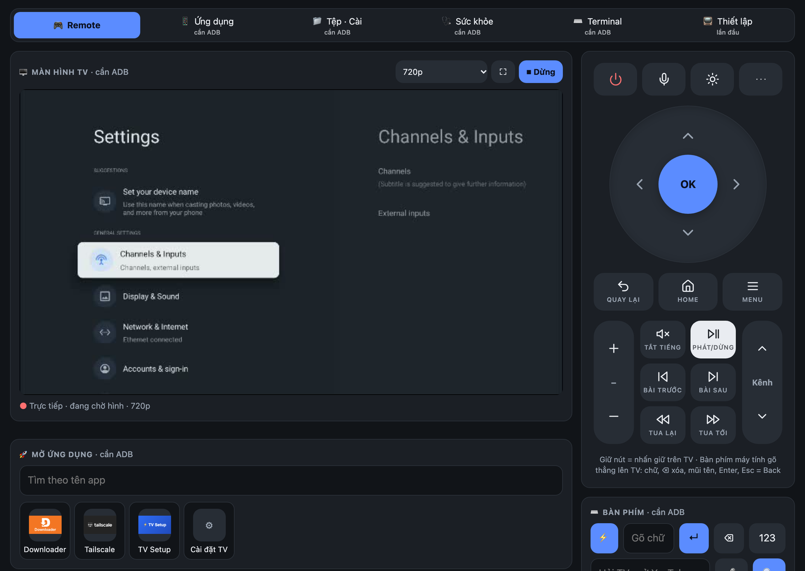
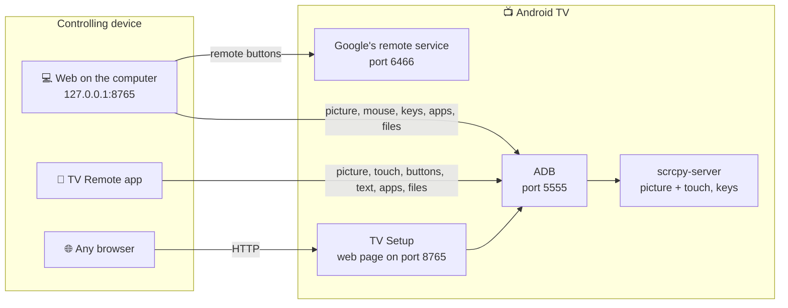

# tv-remote

[Tiếng Việt](README.md) · **English**

Control an Android TV / Google TV from a phone or a computer: remote buttons, the live TV picture with touch, typing, talking to the TV, managing apps and files, installing APKs, TV health, a terminal. Every connection goes straight to the TV with no server in between; from another network, use Tailscale.

Tested for real on a Sony BRAVIA (Android 9). Other brands are untested. Samsung (Tizen) and LG (webOS) do not work.

<table>
<tr>
<td align="center"><br><sub>Phone app</sub></td>
<td align="center"><br><sub>Page served by the TV</sub></td>
<td align="center"><br><sub>Web on the computer</sub></td>
</tr>
</table>

## Pick how to use it

| You have | Use | Get it from |
|---|---|---|
| An Android phone | The **TV Remote** app | `tv-remote.apk` in [Releases](https://github.com/HoangTran0410/tv-remote/releases) |
| Any browser, iPhone included | The **TV Setup** app installed on the TV, then open `http://<TV IP>:8765` | `tv-setup.apk` in [Releases](https://github.com/HoangTran0410/tv-remote/releases) |
| A computer (Mac, Windows, Linux) | The **web on the computer** | Download the repo, double-click `start-mac.command` / `start-windows.cmd` |

All three share one control layout and the same parts: Remote, Apps, Files, Install APK, Health, Terminal. The web on the computer adds the mouse, the computer keyboard and adding a new TV.

## Prepare the TV (once, with the TV's own remote)

Menu names below are Sony's; other brands differ slightly.

1. **Turn on Developer options:** Settings → Device Preferences → About → **Build** → press OK 7 times.
2. **Turn on ADB:** Settings → Device Preferences → Developer options → **ADB debugging** (some TVs say "USB debugging").
3. **Recommended, remote wake:** Settings → Network & Internet → **Remote start**. Without it the TV cannot be turned back on remotely once it is fully off.

The first time each device connects, the TV asks "Allow USB debugging?": tick **Always allow**, then OK. Someone has to be at the TV for this.

<details>
<summary>Where to find the TV's IP</summary>

- On the TV: Settings → Network & Internet → the connected Wi-Fi name → **IP address** (like `192.168.1.88`).
- The Tailscale IP (like `100.x.x.x`): open the Tailscale app on the TV, or see [login.tailscale.com/admin/machines](https://login.tailscale.com/admin/machines).
- The TV Setup app also shows both IPs on the TV.
</details>

## 1. Android phone app: TV Remote

1. Install `tv-remote.apk` from [Releases](https://github.com/HoangTran0410/tv-remote/releases).
2. Open the app, tap **Scan Wi-Fi** and pick the TV, or type the TV's IP.

- **TV picture:** the eye button turns it on and off; touching the picture touches the TV. While watching, the top bar has the quality button (240p to 960p) and full screen. With the picture off the TV spends no extra CPU.
- **Buttons:** a tap is one press, a hold is a long press on the TV. The `⋯` button shows the less used keys: Input, TV settings, Info, Guide, Live TV, Subtitles, Stop, Screenshot. The phone's volume keys change the TV's volume too.
- **Typing:** ⚡ switches between live typing and type-then-send; `123` opens the number pad.
- **Talk to the TV:** tap the mic and speak, for example "open YouTube"; hold the mic to open the Assistant on the TV.
- **Manage the TV:** the grid button opens Apps (with names and icons), Files, Install APK, Health, Terminal.
- **Updates:** the app tells you when a new version exists and installs it in place.

## 2. Page served by the TV: TV Setup

Works from any browser, with nothing to install on the phone or computer.

1. Put `tv-setup.apk` on the TV (USB or the Downloader app) and install it.
2. Open **TV Setup** on the TV and choose "Always allow" when the TV asks.
3. On a phone or computer, open the address the app shows on the TV: `http://<TV IP>:8765`.
4. Enter the **6-digit code** the TV shows. That device gets straight in from then on.

- The page has Remote, Apps, Files, Install, Health, Terminal. The eye button shows the TV picture; one browser at a time can watch.
- It starts again by itself when the TV boots.
- **TV history:** the TV Setup app records every 5 minutes (which app is open, RAM, CPU, storage) and keeps it on the TV; all three clients show it under Health → History. Nothing else has to stay on.
- On the TV, the app also offers **Optimize TV** / **Undo**, opening Tailscale, **Update**, turning the web remote on and off, and **Unpair all devices**.
- The connection is plain HTTP, not encrypted. **Do not expose port 8765 to the Internet**; away from home, go through Tailscale.
- It needs the TV's ADB on port 5555. Some newer Google TVs that only have pairing-code "Wireless debugging" may not work.

## 3. Web on the computer

Needs Python 3.10 or newer, `adb` and `ffmpeg` (macOS: `brew install android-platform-tools ffmpeg`; Windows: the installer fetches `adb`, and for ffmpeg run `winget install Gyan.FFmpeg`).

1. Download the repo (git clone or the zip).
2. Double-click **`start-mac.command`** / **`start-windows.cmd`** (Linux: `./start-linux.sh`). The first run installs what it needs.
3. The browser opens `http://127.0.0.1:8765`. On the **TV** tab: **Scan network** or type the IP, then follow the steps, each ticked when done: ADB → Tailscale (optional) → Pair the remote (type the 6-character code the TV shows) → Save.

After that, just double-click the start file. Closing the window stops it; nothing keeps running on the computer.

| Tab | What it does |
|---|---|
| **Remote** | Buttons, volume, wake, the live screen, click/drag/scroll on the picture, type straight onto the TV, open apps and links |
| **Apps** | Open, stop, uninstall apps |
| **Files** | Browse TV storage and USB; download, upload, rename, delete, install `.apk` |
| **Download / Install** | Download a file from a link to the TV, install APKs, Optimize TV |
| **Health** | Now: CPU, RAM, storage, Wi-Fi, top CPU processes, Free up RAM. History: TV time per day, most used apps, RAM/CPU/storage charts |
| **Terminal** | Run shell commands on the TV, 30 seconds each at most |
| **TV** | Saved TVs, network scan, first-time setup, switching TVs |

**When ADB is closed**, only the buttons, power, step-by-step volume and wake remain. Lost: the live screen, mouse, keyboard, apps, files, installing APKs. The page says so and has a "Try again" button.

<details>
<summary>Usage notes</summary>

- Live view has two modes: *light* (the default) and *sharp* (720p, which slows the TV noticeably).
- Protected video (Netflix and the like) shows as black.
- The TV's on-screen keyboard cannot be clicked with the mouse; type on the computer keyboard. For accented text, type in the "Keyboard" box.
- Command line: `app/web/cli/tv-new.sh <IP>` (Windows: `tv-new.cmd`) runs the same add-a-TV steps.
</details>

## From another network (Tailscale)

1. Install **Tailscale** on the TV (Google Play, or the button in the web on the computer / TV Setup) and on the controlling device.
2. Open Tailscale on the TV: it shows a code. Enter it in the [Tailscale admin page](https://login.tailscale.com/admin/machines) → **Add device**. Nobody has to type an account on the TV.
3. On that page, open the TV's ⋯ menu → **Disable key expiry**, or the TV is signed out after about 180 days.
4. Use the TV's `100.x.x.x` IP instead of the home one.

<details>
<summary>The person at home only has the TV remote, the helper is far away</summary>

The person at the TV: install Tailscale from Google Play on the TV, open it and read the code to the helper; turn on ADB debugging; choose "Always allow" when the TV asks. The helper enters the code in their own Tailscale account, then connects to the TV's `100.x` IP.
</details>

## When the TV is off

- **Standby (network still up):** Power or Wake is enough, over Tailscale too.
- **Fully off (network down):** only a Wake-on-LAN packet reaches the TV, and it must be sent from **inside the home network**. The phone app can send it when on the home Wi-Fi. The web on the computer can ask a machine at home to send it over SSH: add `relay_user` and `relay_host` to the TV's entry in `tvs.json`.
- Holding the power key on the TV's own remote opens the full power-off menu; press it briefly if you want to wake the TV remotely later.
- **After the TV restarts:** Tailscale rejoins by itself if Optimize TV was run. If ADB does not reopen, turn "ADB debugging" off and on.

## Optimize TV (optional)

The **⚡ Optimize TV** button on the Install tab of all three (and in the TV Setup app on the TV itself); **Undo** puts everything back. Safe to run again.

- Keeps Tailscale alive through standby and restarts.
- Turns off transition animations.
- Installs FLauncher and turns off Google's home screen, which uses a lot of CPU.
- Disables unused system apps (the list is written for Sony BRAVIA; missing packages are skipped).

If the TV later shows no home screen: Settings → Apps → System apps → **Android TV Home** → Enable.

## Troubleshooting

| Symptom | What to do |
|---|---|
| Cannot connect | Same network as the TV? ADB debugging on? Right IP? Look at the TV for a permission dialog |
| **ADB: waiting for the TV** | Choose "Always allow" on the TV, then "Try again" |
| **ADB: port closed** | The TV is off, or just restarted: turn "ADB debugging" off and on |
| Buttons do nothing (web on the computer) | The remote is not paired (the **TV** tab), or two windows are open for the same TV |
| Choppy picture, slow TV | Pick a lower quality; turn the picture off when not needed |
| Cannot connect from far away | Are both devices in the same Tailscale account and online? |
| Android calls the app "harmful" on install | Play Protect warns about unknown apps that can install APKs. The source is in this repo; choose "Install anyway" if you trust it |

## Security

- ADB over the network has no password: any device the TV has "Always allowed" has full control of it. Use it only on networks you trust and over Tailscale. To revoke: Developer options → Revoke USB debugging authorizations.
- `cert.pem` / `key.pem` (web on the computer) are the pairing key. **Whoever has `key.pem` can control the TV.** They are never committed to git.
- The web on the computer listens on `127.0.0.1` only. The page on the TV listens on the home network and requires the pairing code.
- Install APKs only from sources you trust.

## Technical details

<details>
<summary>How it works</summary>



- **The phone app and TV Setup** speak the ADB protocol themselves and push `scrcpy-server` to the TV for H.264 video and for touch and key input. TV Setup connects to the TV's own ADB (`127.0.0.1:5555`).
- **Picture on the TV's page:** H.264 over `/api/video`, played in the browser by JMuxer (MSE).
- **Web on the computer, remote buttons:** the Android TV Remote v2 protocol (`androidtvremote2`), ports 6466/6467. Opening apps and links goes through ADB because this TV ignores the protocol's launch command.
- **Web on the computer, live view:** H.264 from the TV → ffmpeg → MJPEG (`/api/stream`). Light mode uses scrcpy-server capped at 960 px (about 0.7 of the TV's 4 CPU cores); `?q=hd` uses `screenrecord` at 720p (about 1.8 cores).
- **Accented text:** put on the TV's clipboard, then pasted.
- **Volume:** calls `AudioService.setStreamVolume` directly (Android 9), falls back to `media volume`, and without ADB presses step by step.
- **App names and icons:** all three ask the TV's own system. TV Setup asks directly; the phone app and the web on the computer copy the phone app's APK to `/data/local/tmp` and start its `Meta` class with `app_process`. The web on the computer caches the result in `.cache/apps`.
- **ADB still off:** the phone app and the computer web can still send keys after pairing with the 6-character code the TV shows (Android TV Remote protocol, ports 6466/6467). The picture, apps and files need ADB.
- **History:** TV Setup writes to `/sdcard/Android/data/dev.tvremote.setup/files/stats/` (`usage.json` for 90 days, `samples.jsonl` for about 30); the remotes read it over ADB and draw it with `app/shared/web/stats.js`. Usage access is granted through ADB.
- **Power (both apps):** the SLEEP (223) / WAKEUP (224) keys instead of POWER, so repeating a press never flips the state.
</details>

<details>
<summary>For people changing the code</summary>

```
start-mac.command, start-windows.cmd, start-linux.sh   run the web on the computer
app/web/      web on the computer: server.py (aiohttp, 127.0.0.1 only), static/ (UI), cli/ (command line)
app/android/  the TV Remote app (Kotlin)            app/tv/   the TV Setup app (Kotlin) + the page the TV serves
app/shared/   shared by both apps: ADB, the control session, TV management, updates; web/index.html
dev/          release.sh (build the APKs + create the GitHub release), gen_icons.py (one icon set for all three)
docs/         screenshots for the README
VERSION, CHANGELOG.md
tvs.json, cert.pem, key.pem, *.jks, venv/, .cache/      your machine's own data, never committed
```

- **Building the apps:** open `app/` in Android Studio, or run `app/android/build.sh`, `app/tv/build.sh` (JDK 17 and the Android SDK).
- **Versions:** three numbers, each bumped only when its part changes: `VERSION` (the release and the web), `app/android/VERSION`, `app/tv/VERSION`. Every release carries `versions.json`, so an unchanged app is not offered an update. `dev/release.sh` stops if an app's code changed without a bump.
- **Keep the three in sync:** any change to the controls goes into the phone app, the page on the TV and the web on the computer.
- **Credits:** [scrcpy](https://github.com/Genymobile/scrcpy) v5.0.1 (Apache-2.0), [JMuxer](https://github.com/samirkumardas/jmuxer) 2.1.0 (MIT), [androidtvremote2](https://github.com/tronikos/androidtvremote2).
</details>

Changes per release: [CHANGELOG.md](CHANGELOG.md).
