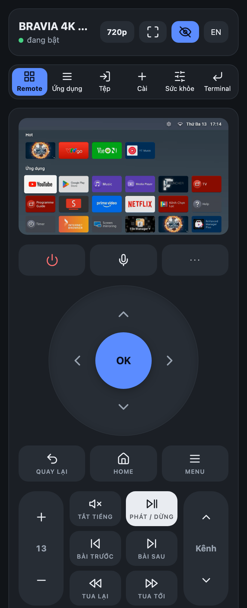
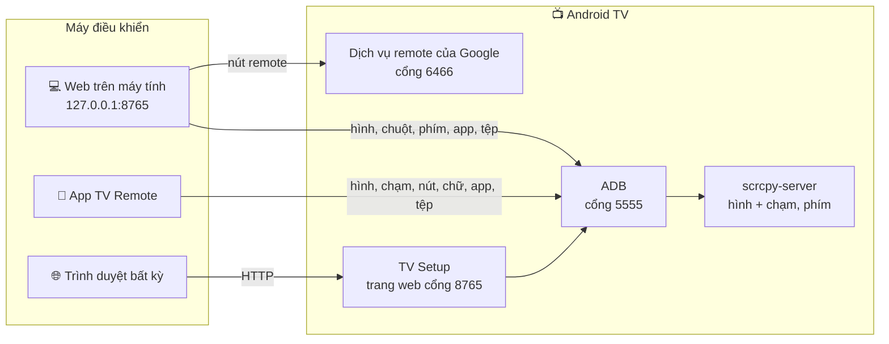

# tv-remote

**Tiếng Việt** · [English](README.en.md)

Điều khiển Android TV / Google TV từ điện thoại hoặc máy tính: nút remote, xem hình TV trực tiếp và chạm lên hình, gõ chữ, nói với TV, quản lý app và tệp, cài APK, xem sức khỏe TV, terminal. Mọi kết nối đi thẳng tới TV, không qua máy chủ nào; ở khác mạng thì dùng Tailscale.

Đã chạy thật với Sony BRAVIA (Android 9). TV hãng khác chưa thử. Samsung (Tizen) và LG (webOS) không dùng được.

<table>
<tr>
<td align="center"><br><sub>App điện thoại</sub></td>
<td align="center"><br><sub>Trang do TV phục vụ</sub></td>
<td align="center"><br><sub>Web trên máy tính</sub></td>
</tr>
</table>

## Chọn cách dùng

| Bạn có | Dùng | Lấy ở đâu |
|---|---|---|
| Điện thoại Android | App **TV Remote** | `tv-remote.apk` ở [Releases](https://github.com/HoangTran0410/tv-remote/releases) |
| Bất kỳ trình duyệt nào, kể cả iPhone | App **TV Setup** cài trên TV, rồi mở `http://<IP của TV>:8765` | `tv-setup.apk` ở [Releases](https://github.com/HoangTran0410/tv-remote/releases) |
| Máy tính (Mac, Windows, Linux) | **Web trên máy tính** | Tải repo, bấm đúp `start-mac.command` / `start-windows.cmd` |

Cả ba có cùng bố cục điều khiển và cùng các phần: Remote, Ứng dụng, Tệp, Cài APK, Sức khỏe, Terminal. Riêng web trên máy tính có thêm chuột, bàn phím máy tính và thêm TV mới.

## Chuẩn bị TV (một lần, bằng remote của TV)

Tên menu dưới đây là trên Sony; hãng khác khác chút ít.

1. **Bật Tùy chọn nhà phát triển:** Cài đặt → Tùy chọn thiết bị → Giới thiệu → **Bản dựng** → bấm OK 7 lần.
2. **Bật ADB:** Cài đặt → Tùy chọn thiết bị → Tùy chọn nhà phát triển → **Gỡ lỗi ADB** (có TV ghi "Gỡ lỗi USB").
3. **Nên bật đánh thức từ xa:** Cài đặt → Mạng và Internet → **Khởi động từ xa**. Thiếu bước này thì không bật lại được TV từ xa khi nó đã tắt hẳn.

Lần đầu mỗi máy kết nối, TV hỏi "Cho phép gỡ lỗi USB?": tích **Luôn cho phép** rồi OK. Cần một người ở cạnh TV cho việc này.

<details>
<summary>Xem IP của TV ở đâu</summary>

- Trên TV: Cài đặt → Mạng và Internet → bấm tên Wi-Fi đang kết nối → **Địa chỉ IP** (dạng `192.168.1.88`).
- IP Tailscale (dạng `100.x.x.x`): mở app Tailscale trên TV, hoặc xem ở [login.tailscale.com/admin/machines](https://login.tailscale.com/admin/machines).
- App TV Setup cũng hiện cả hai IP ngay trên TV.
</details>

## 1. App điện thoại Android: TV Remote

1. Cài `tv-remote.apk` từ [Releases](https://github.com/HoangTran0410/tv-remote/releases).
2. Mở app, bấm **Quét Wi-Fi** rồi chọn TV, hoặc gõ IP của TV.

- **Hình TV:** nút con mắt bật/tắt; chạm lên hình là chạm lên TV. Khi đang xem, thanh trên có nút chất lượng (240p đến 960p) và toàn màn hình. Tắt hình thì TV không tốn thêm CPU.
- **Nút bấm:** chạm = bấm một lần, giữ = nhấn giữ trên TV. Nút `⋯` mở thêm phím ít dùng: Ngõ vào, Cài đặt TV, Thông tin, Lịch phát, TV, Phụ đề, Dừng, Chụp màn hình. Nút âm lượng của điện thoại cũng chỉnh âm lượng TV.
- **Gõ chữ:** nút ⚡ đổi giữa gõ tới đâu TV nhận tới đó và gõ xong rồi gửi; nút `123` mở bàn phím số.
- **Nói với TV:** bấm micro rồi nói, ví dụ "mở YouTube"; giữ micro để mở Assistant trên TV.
- **Quản lý TV:** nút ô lưới mở Ứng dụng (có tên và logo), Tệp, Cài APK, Sức khỏe, Terminal.
- **Cập nhật:** app tự báo khi có bản mới và cài ngay trong app.

## 2. Trang do TV phục vụ: TV Setup

Dùng được từ mọi trình duyệt, không cần cài gì trên điện thoại hay máy tính.

1. Đưa `tv-setup.apk` lên TV (USB hoặc app Downloader) và cài.
2. Mở **TV Setup** trên TV, chọn "Luôn cho phép" khi TV hỏi.
3. Trên điện thoại hoặc máy tính, mở địa chỉ app hiện trên TV: `http://<IP của TV>:8765`.
4. Nhập **mã 6 số** TV hiện ra. Từ đó thiết bị ấy vào thẳng.

- Trang có đủ Remote, Ứng dụng, Tệp, Cài, Sức khỏe, Terminal. Nút con mắt bật hình TV; mỗi lúc một trình duyệt xem được hình.
- Trang tự chạy lại khi TV khởi động.
- **Lịch sử dùng TV:** app TV Setup tự ghi 5 phút một lần (app nào đang mở, RAM, CPU, bộ nhớ) và lưu ngay trên TV; cả ba nơi xem lại ở Sức khỏe → Lịch sử. Không cần máy nào khác bật.
- Trên TV, app còn có: **Tối ưu TV** / **Hoàn tác**, mở Tailscale, **Cập nhật**, bật/tắt remote qua web, **Hủy ghép mọi thiết bị**.
- Kết nối là HTTP thường, không mã hóa. **Đừng mở cổng 8765 ra Internet**; ở ngoài nhà hãy đi qua Tailscale.
- Cần TV mở ADB ở cổng 5555. Một số Google TV đời mới chỉ có "Gỡ lỗi không dây" kiểu ghép mã có thể không dùng được.

## 3. Web trên máy tính

Cần Python 3.10 trở lên, `adb` và `ffmpeg` (macOS: `brew install android-platform-tools ffmpeg`; Windows: bộ cài tự tải `adb`, thiếu ffmpeg thì `winget install Gyan.FFmpeg`).

1. Tải repo về (git clone hoặc tải zip).
2. Bấm đúp **`start-mac.command`** / **`start-windows.cmd`** (Linux: `./start-linux.sh`). Lần đầu nó tự cài các gói cần thiết.
3. Trình duyệt mở `http://127.0.0.1:8765`. Ở tab **TV**: **Quét mạng** hoặc gõ IP, rồi làm theo các bước có dấu ✓: ADB → Tailscale (tùy chọn) → Ghép nút remote (gõ mã 6 ký tự TV hiện) → Lưu.

Từ đó chỉ cần bấm đúp file start. Đóng cửa sổ là dừng; không có gì chạy ngầm trên máy tính.

| Tab | Làm được gì |
|---|---|
| **Remote** | Nút bấm, âm lượng, đánh thức, xem màn hình, bấm/kéo/cuộn chuột lên hình, gõ bàn phím thẳng lên TV, mở app và link |
| **Ứng dụng** | Mở, dừng, gỡ app |
| **Tệp** | Duyệt bộ nhớ TV và USB; tải về, gửi lên, đổi tên, xóa, cài `.apk` |
| **Tải / Cài** | Tải file từ link về TV, cài APK, Tối ưu TV |
| **Sức khỏe** | Hiện tại: CPU, RAM, bộ nhớ, Wi-Fi, tiến trình tốn CPU nhất, Giải phóng RAM. Lịch sử: thời gian dùng TV theo ngày, app dùng nhiều, biểu đồ RAM/CPU/bộ nhớ |
| **Terminal** | Chạy lệnh shell trên TV, mỗi lệnh tối đa 30 giây |
| **TV** | TV đã lưu, quét mạng, cài đặt lần đầu, đổi TV |

**Khi ADB đóng**, chỉ còn nút bấm, nguồn, âm lượng từng nấc và đánh thức. Mất: xem màn hình, chuột, bàn phím, app, tệp, cài APK. Trang web ghi rõ điều này và có nút "Thử kết nối lại".

<details>
<summary>Lưu ý khi dùng</summary>

- Xem trực tiếp có hai chế độ: *nhẹ* (mặc định) và *nét* (720p, làm TV chậm hơn rõ rệt).
- Video có bản quyền (Netflix...) hiện màu đen.
- Bàn phím ảo trên TV không bấm được bằng chuột; hãy gõ bằng bàn phím máy tính. Chữ có dấu thì gõ trong ô "Bàn phím".
- Dòng lệnh: `app/web/cli/tv-new.sh <IP>` (Windows: `tv-new.cmd`) làm đúng các bước thêm TV.
</details>

## Dùng khi khác mạng (Tailscale)

1. Cài **Tailscale** trên TV (Google Play, hoặc nút trong web máy tính / TV Setup) và trên máy điều khiển.
2. Mở Tailscale trên TV: TV hiện một mã. Nhập mã ở [trang quản trị Tailscale](https://login.tailscale.com/admin/machines) → **Add device**. Không phải gõ tài khoản trên TV.
3. Ở trang đó, mở menu ⋯ của TV → **Disable key expiry**, nếu không khoảng 180 ngày sau TV bị đăng xuất.
4. Dùng IP `100.x.x.x` của TV thay cho IP trong nhà.

<details>
<summary>Người ở nhà chỉ có remote TV, người hỗ trợ ở xa</summary>

Người ở cạnh TV: cài Tailscale từ Google Play trên TV, mở lên và đọc mã cho người hỗ trợ; bật Gỡ lỗi ADB; bấm "Luôn cho phép" khi TV hỏi. Người hỗ trợ nhập mã vào tài khoản Tailscale của mình rồi kết nối tới IP `100.x` của TV.
</details>

## Khi TV tắt

- **Chế độ chờ (còn mạng):** nút Nguồn hoặc Đánh thức là đủ, kể cả qua Tailscale.
- **Tắt hẳn (mất mạng):** chỉ gói Wake-on-LAN gọi được TV, và gói này phải gửi từ **trong mạng nhà**. App điện thoại gửi được khi ở đúng Wi-Fi nhà. Web máy tính nhờ được một máy ở nhà gửi giúp qua SSH: thêm `relay_user`, `relay_host` vào mục của TV trong `tvs.json`.
- Giữ lâu nút nguồn trên remote của TV sẽ mở menu tắt hẳn; muốn bật lại từ xa thì chỉ bấm ngắn.
- **Sau khi TV khởi động lại:** Tailscale tự vào lại nếu đã chạy Tối ưu TV. Nếu ADB không tự mở, tắt rồi bật lại "Gỡ lỗi ADB".

## Tối ưu TV (tùy chọn)

Nút **⚡ Tối ưu TV** ở tab Cài của cả ba nơi (và ngay trong app TV Setup trên TV); **Hoàn tác** trả lại như cũ. Chạy lại bao nhiêu lần cũng được.

- Giữ Tailscale sống qua chế độ chờ và khởi động lại.
- Tắt hiệu ứng chuyển cảnh.
- Cài FLauncher và tắt màn hình chính của Google, vốn chiếm nhiều CPU.
- Tắt app hệ thống không dùng (danh sách viết cho Sony BRAVIA; gói không có thì bỏ qua).

Nếu sau này TV không hiện màn hình chính: Cài đặt → Ứng dụng → Ứng dụng hệ thống → **Android TV Home** → Bật.

## Gặp lỗi

| Hiện tượng | Cách xử lý |
|---|---|
| Không kết nối được | Cùng mạng với TV chưa? Đã bật Gỡ lỗi ADB chưa? IP đúng chưa? Nhìn TV xem có hộp hỏi cho phép không |
| **ADB: chờ TV cho phép** | Trên TV chọn "Luôn cho phép", rồi bấm "Thử kết nối lại" |
| **ADB: cổng đóng** | TV đang tắt, hoặc vừa khởi động lại: tắt rồi bật lại "Gỡ lỗi ADB" |
| Bấm nút không ăn (web máy tính) | Chưa ghép nút remote (tab **TV**), hoặc đang mở hai cửa sổ cho cùng một TV |
| Hình giật, TV chậm | Chọn chất lượng thấp hơn; tắt hình khi không cần |
| Ở xa không kết nối được | Hai máy có cùng tài khoản Tailscale và đều đang bật không? |
| Android báo app "có hại" khi cài | Play Protect cảnh báo app lạ có quyền cài APK. Mã nguồn ở ngay repo này; chọn "Vẫn cài" nếu bạn tin |

## Bảo mật

- ADB qua mạng không có mật khẩu: máy nào đã được TV "Luôn cho phép" là có toàn quyền trên TV. Chỉ dùng trong mạng bạn tin và qua Tailscale. Thu hồi: Tùy chọn nhà phát triển → Thu hồi quyền gỡ lỗi USB.
- `cert.pem` / `key.pem` (web máy tính) là chìa khóa ghép với TV. **Ai có `key.pem` là điều khiển được TV.** Hai file này không được đưa lên git.
- Web máy tính chỉ nghe ở `127.0.0.1`. Trang trên TV nghe trong mạng nhà và đòi ghép mã.
- Chỉ cài APK từ nguồn bạn tin.

## Chi tiết kỹ thuật

<details>
<summary>Cách hoạt động</summary>



- **App điện thoại và TV Setup** tự nói giao thức ADB, đẩy `scrcpy-server` lên TV để lấy hình H.264 và gửi chạm, phím. TV Setup nối vào ADB của chính TV (`127.0.0.1:5555`).
- **Hình trên trang của TV:** H.264 đi qua `/api/video`, trình duyệt phát bằng JMuxer (MSE).
- **Web máy tính, nút remote:** giao thức Android TV Remote v2 (`androidtvremote2`), cổng 6466/6467. Mở app và link đi qua ADB vì TV này bỏ qua lệnh mở app của giao thức.
- **Web máy tính, xem trực tiếp:** H.264 từ TV → ffmpeg → MJPEG (`/api/stream`). Chế độ nhẹ dùng scrcpy-server giới hạn 960 px (khoảng 0,7 trên 4 nhân CPU của TV); `?q=hd` dùng `screenrecord` 720p (khoảng 1,8 nhân).
- **Chữ có dấu:** đưa vào clipboard của TV rồi dán.
- **Âm lượng:** gọi thẳng `AudioService.setStreamVolume` (Android 9), không được thì `media volume`, không có ADB thì bấm từng nấc.
- **Tên và logo app:** cả ba nơi đều hỏi hệ thống của TV. TV Setup hỏi trực tiếp; app điện thoại và web máy tính chép APK của app điện thoại lên `/data/local/tmp` rồi chạy lớp `Meta` trong đó bằng `app_process`. Web máy tính lưu lại ở `.cache/apps`.
- **TV chưa bật ADB:** app điện thoại và web máy tính vẫn bấm phím được sau khi ghép bằng mã 6 ký tự hiện trên TV (giao thức Android TV Remote, cổng 6466/6467). Xem hình, ứng dụng, tệp thì cần ADB.
- **Lịch sử:** TV Setup ghi vào `/sdcard/Android/data/dev.tvremote.setup/files/stats/` (`usage.json` 90 ngày, `samples.jsonl` khoảng 30 ngày); các remote đọc qua ADB và vẽ bằng `app/shared/web/stats.js`. Quyền xem app đang mở (usage access) được cấp qua ADB.
- **Nguồn (hai app):** phím SLEEP (223) / WAKEUP (224) thay cho phím POWER, nên bấm lặp không bị đảo trạng thái.
</details>

<details>
<summary>Dành cho người sửa code</summary>

```
start-mac.command, start-windows.cmd, start-linux.sh   chạy web trên máy tính
app/web/      web trên máy tính: server.py (aiohttp, chỉ 127.0.0.1), static/ (giao diện), cli/ (dòng lệnh)
app/android/  app TV Remote (Kotlin)                app/tv/   app TV Setup (Kotlin) + trang web do TV phục vụ
app/shared/   dùng chung của hai app: ADB, phiên điều khiển, quản lý TV, cập nhật; web/index.html
dev/          release.sh (build APK + tạo GitHub release), gen_icons.py (một bộ icon cho cả ba nơi)
docs/         ảnh chụp cho README
VERSION, CHANGELOG.md
tvs.json, cert.pem, key.pem, *.jks, venv/, .cache/      dữ liệu riêng của máy bạn, không đưa lên git
```

- **Build app:** mở `app/` bằng Android Studio, hoặc chạy `app/android/build.sh`, `app/tv/build.sh` (cần JDK 17 và Android SDK).
- **Phiên bản:** ba số, mỗi số chỉ tăng khi phần của nó đổi: `VERSION` (bản phát hành và web), `app/android/VERSION`, `app/tv/VERSION`. Mỗi bản phát hành kèm `versions.json`, nên app không đổi thì không bị mời cập nhật. `dev/release.sh` dừng lại nếu code một app đã đổi mà quên tăng số.
- **Giữ ba nơi đồng bộ:** sửa hay thêm gì ở phần điều khiển thì làm ở cả app điện thoại, trang trên TV và web máy tính.
- **Ghi công:** [scrcpy](https://github.com/Genymobile/scrcpy) v5.0.1 (Apache-2.0), [JMuxer](https://github.com/samirkumardas/jmuxer) 2.1.0 (MIT), [androidtvremote2](https://github.com/tronikos/androidtvremote2).
</details>

Thay đổi từng bản: [CHANGELOG.md](CHANGELOG.md).
