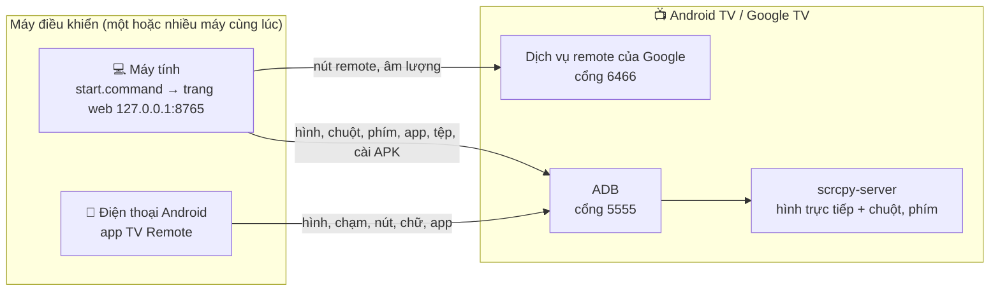
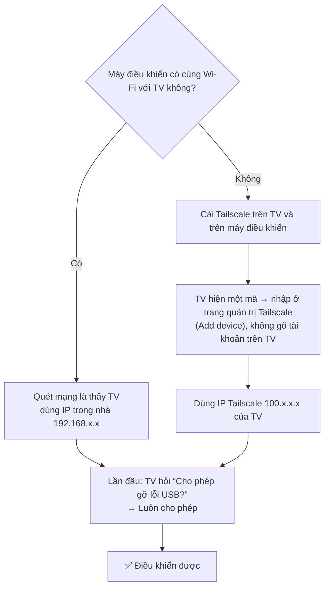
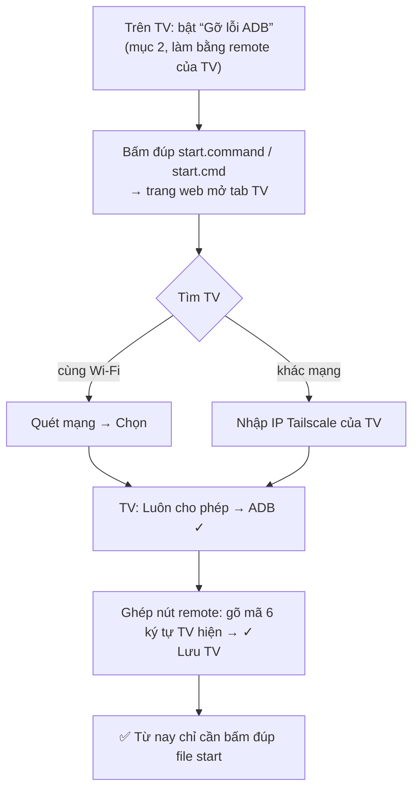
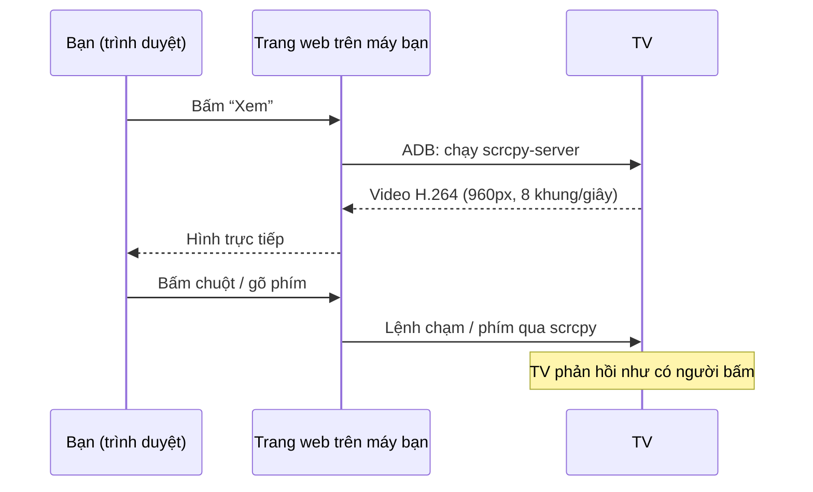

# tv-remote

**Tiếng Việt** · [English](README.en.md)

Điều khiển Android TV / Google TV từ máy tính qua một trang web chạy ngay trên máy bạn: bấm nút remote, xem màn hình TV trực tiếp, bấm chuột và gõ phím lên TV, mở/gỡ app, duyệt tệp, cài APK, đánh thức TV. Dùng được từ xa (khác mạng) nhờ Tailscale.

Đã chạy thật với Sony BRAVIA (Android 9) từ macOS và Windows 11. TV hãng khác chưa thử.

---

## Nhìn nhanh: nó hoạt động thế nào

**Ai nói chuyện với ai**



Mọi kết nối đi thẳng từ máy của bạn tới TV, qua Wi-Fi trong nhà hoặc qua Tailscale. Không có máy chủ nào ở giữa.

**Cùng mạng hay khác mạng?**



**Cài lần đầu (máy tính)**



**Xem màn hình và bấm chuột lên TV**



---

## 1. Cần có gì

**TV**
- Android TV hoặc Google TV (Sony, TCL, Xiaomi, Chromecast with Google TV...). TV Samsung (Tizen) và LG (webOS) **không** dùng được.
- TV đang nối Wi-Fi hoặc dây mạng.
- Không cần cài sẵn app nào. Tailscale và launcher sẽ được cài tự động ở bước 3.

**Máy tính** (macOS, Windows hoặc Linux)
- Python 3.10 trở lên.
- `adb` và `ffmpeg`. Trên Windows bộ cài tự tải `adb`; trên macOS: `brew install android-platform-tools ffmpeg`.
- Tailscale đã đăng nhập, nếu muốn điều khiển khi không ở cùng mạng với TV.

**Tài khoản Tailscale** (miễn phí, [tailscale.com](https://tailscale.com)) – chỉ cần khi điều khiển từ xa. Cùng mạng Wi-Fi với TV thì không cần.

**Một người ở cạnh TV trong lần cài đầu tiên** (khoảng 2 phút) để bật "Gỡ lỗi ADB" và bấm "Cho phép". Bước này không script hay app nào làm thay được.

---

## 2. Việc cần làm trên TV (một lần, làm bằng remote của TV)

Tên menu khác nhau chút ít tùy hãng; dưới đây là trên Sony.

1. **Bật Tùy chọn nhà phát triển:** Cài đặt → Tùy chọn thiết bị → Giới thiệu → kéo xuống **Bản dựng** (Build) → bấm OK **7 lần** tới khi hiện "Bạn đã là nhà phát triển".
2. **Bật ADB:** Cài đặt → Tùy chọn thiết bị → Tùy chọn nhà phát triển → bật **Gỡ lỗi ADB** (có TV ghi "Gỡ lỗi USB" / "USB debugging").
3. **(Nên làm) Bật đánh thức từ xa:** Cài đặt → Mạng và Internet → **Khởi động từ xa** = Bật. Không có cái này thì không bật TV từ xa được khi nó đã tắt.

### Xem IP của TV
- Trên TV: Cài đặt → Mạng và Internet → bấm vào tên Wi-Fi đang kết nối → dòng **Địa chỉ IP** (dạng `192.168.1.88`).
- Hoặc mở trang quản trị của router, xem danh sách thiết bị đang kết nối.
- IP Tailscale (dạng `100.x.x.x`, dùng khi ở xa): mở app Tailscale trên TV, hoặc xem ở [login.tailscale.com/admin/machines](https://login.tailscale.com/admin/machines).

---

## 3. Cài trên máy tính và thêm TV

1. Tải mã nguồn về (git clone hoặc tải zip rồi giải nén).
2. **Bấm đúp một file để chạy:**
   - macOS / Linux: **`start.command`** (lần đầu nó tự tạo môi trường Python và cài gói).
   - Windows: **`start.cmd`** (lần đầu nó tự chạy `install-windows.cmd`: cài gói, tải `adb`; nếu báo thiếu ffmpeg: `winget install Gyan.FFmpeg`).
3. Trình duyệt mở `http://127.0.0.1:8765`. Lần đầu chưa có TV nào nên trang mở sẵn tab **TV**:
   - Bấm **Quét mạng** để tìm TV trong cùng Wi-Fi (và các thiết bị Android trong Tailscale của bạn), hoặc gõ IP của TV rồi bấm **Chọn**.
   - Mục **Cài đặt lần đầu** hiện từng bước kèm nút bấm, bước nào xong thì có dấu ✓:
     1. **ADB** – TV hiện hộp "Cho phép gỡ lỗi USB?" → tích **Luôn cho phép từ máy tính này** → OK.
     2. **Tailscale** – bấm *Cài Tailscale* (bản chính thức, có kiểm checksum), rồi *Mở Tailscale trên TV*: trang chuyển sang xem màn hình TV, TV hiện **một mã** (và mã QR). Không cần gõ tài khoản trên TV: mở [trang quản trị Tailscale](https://login.tailscale.com/admin/machines) → **Add device** → nhập mã đó (hoặc quét QR bằng điện thoại). Xong thì mở menu ⋯ của TV trong trang đó → **Disable key expiry**, nếu không khoảng 180 ngày sau TV bị đăng xuất. Chỉ dùng trong cùng Wi-Fi thì bỏ qua bước này.
     3. **Ghép nút remote** – bấm *Ghép*, TV hiện mã 6 ký tự, gõ mã vào trang.
     4. **Lưu** – đặt tên và lưu. Nếu TV đã có IP Tailscale, từ nay trang kết nối qua IP đó nên dùng được cả khi không ở nhà.
     5. **Tối ưu TV** – tùy chọn, xem mục 6.

Từ đó về sau chỉ cần bấm đúp `start.command` / `start.cmd`. Có nhiều TV thì đổi qua lại trong tab **TV**. Đóng cửa sổ là dừng; không có gì chạy ngầm trên máy tính.

> Máy tính phải kết nối được tới TV: cùng Wi-Fi, hoặc cả hai cùng trong một tài khoản Tailscale. Luồng cài mới hoàn toàn (bước 2–3 trên một TV chưa có gì) chưa được chạy thử trọn vẹn; quét mạng, chọn TV, lưu, đổi TV và các bước còn lại đã chạy trên macOS, và phần dòng lệnh đã chạy trên Windows.
>
> Thích dùng dòng lệnh: `scripts/tv-new.sh <IP>` (Windows: `scripts\tv-new.cmd <IP>`) làm đúng các bước trên.

---

## 4. Chỉ có điện thoại, không có máy tính thì sao?

Trang web này cần một máy tính để chạy (nó dùng Python, `adb`, `ffmpeg`), nên **chỉ với điện thoại thì không chạy được công cụ này**. Nhưng có hai trường hợp vẫn xử lý được:

**A. Người ở nhà chỉ có điện thoại, người hỗ trợ ở xa có máy tính** (trường hợp hay gặp nhất)

Người ở cạnh TV làm, chỉ cần remote TV và điện thoại:
1. Trên TV mở **Google Play** → tìm và cài **Tailscale**.
2. Mở Tailscale trên TV → TV hiện một mã (và mã QR) → đọc mã cho người hỗ trợ; họ nhập ở trang quản trị Tailscale (*Add device*) nên không ai phải gõ tài khoản trên TV. TV vào **tài khoản Tailscale của người hỗ trợ** (hoặc tài khoản riêng rồi chia sẻ thiết bị cho người hỗ trợ trong trang quản trị Tailscale).
3. Bật **Gỡ lỗi ADB** như mục 2.

Người hỗ trợ ở xa, trên máy tính đã bật Tailscale:
4. Mở trang web, tab **TV** → **Quét mạng** (TV hiện ra với nhãn "qua Tailscale") → **Chọn**, rồi làm theo các bước.
5. Nhờ người ở nhà bấm **Luôn cho phép → OK** khi TV hỏi, và đọc giúp mã 6 ký tự.

**B. Chỉ muốn điều khiển TV bằng điện thoại khi ở cùng Wi-Fi**

Không cần công cụ này: dùng app **Google TV** (Android/iPhone) → nút *Remote*. Nó không xem được màn hình TV, không cài được app và không dùng được từ xa.

*(Chạy công cụ này ngay trên điện thoại Android bằng Termux về lý thuyết có thể được, nhưng chưa thử nên không hướng dẫn ở đây.)*

---

**C. Không có cả điện thoại lẫn máy tính ở cạnh TV: app TV Setup**

`tvapp/tv-setup.apk` là một app nhỏ cài thẳng lên TV. Sau khi bật "Gỡ lỗi ADB" (mục 2), mở app, chọn "Luôn cho phép" khi TV hỏi, rồi dùng remote bấm:
- **⚡ Tối ưu TV** / **Hoàn tác** – giống mục 6, chạy ngay trên TV.
- **Tailscale** – mở trang cài Tailscale trong Google Play, hoặc mở Tailscale để lấy mã thêm TV nếu đã cài.
- **Cập nhật** – tải bản TV Setup mới nhất từ GitHub Releases và cài luôn (qua ADB của chính TV, app tự đóng rồi mở lại là bản mới). Mỗi lần mở, app cũng tự báo nếu có bản mới.

App cũng hiện IP trong nhà và IP Tailscale của TV để đọc cho người hỗ trợ. Đưa APK lên TV bằng USB, hoặc bằng app Downloader trên TV. App này mới chạy thử trên Sony BRAVIA Android 9; nó cần TV mở ADB ở cổng 5555, nên các TV đời mới chỉ có "Gỡ lỗi không dây" kiểu ghép mã (một số Google TV Android 12+) có thể không dùng được.

---

**D. Điều khiển bằng điện thoại Android: app TV Remote**

`phoneapp/tv-remote.apk` là app remote cho điện thoại Android, không cần máy tính và không cần dòng lệnh. Cài APK, mở lên rồi:
- **Cùng Wi-Fi với TV:** bấm *Quét Wi-Fi* và chọn TV, hoặc gõ IP của TV.
- **Khác mạng:** bật Tailscale trên cả điện thoại và TV, gõ IP `100.x` của TV.

Lần đầu TV hỏi "Cho phép gỡ lỗi USB?": tích **Luôn cho phép** rồi OK. App hiện hình trực tiếp của TV (chạm vào hình = bấm trên TV), các nút điều khiển (giữ nút = nhấn giữ), ô gõ chữ, danh sách app, và dùng được nút âm lượng của điện thoại. TV chỉ cần bật "Gỡ lỗi ADB" (mục 2). Nhiều máy điều khiển cùng lúc được, nhưng mỗi máy đang xem hình làm TV tốn thêm CPU.

**TV đang tắt:** bấm nút nguồn (đỏ) cạnh tên TV để đánh thức. Nếu TV còn giữ mạng (chế độ chờ) thì app bật màn hình lên, kể cả qua Tailscale. Nếu TV tắt cả mạng thì chỉ gói Wake-on-LAN mới gọi được nó, và gói này chỉ tới TV khi điện thoại ở đúng Wi-Fi nhà TV (TV phải bật "Khởi động từ xa"); ở mạng khác thì dùng nút Đánh thức trên web ở máy tính, nó nhờ một máy ở nhà gửi giúp. Nút ⚙️ (góc trên bên phải) để đổi Tiếng Việt / English.

**Cập nhật:** app tự hỏi GitHub xem có bản mới không mỗi lần mở (tắt được trong ⚙️) và hiện nút xanh "Có bản mới"; bấm vào là tải và cài, Android sẽ hỏi xác nhận (lần đầu phải cho phép app "cài ứng dụng không rõ nguồn gốc"). File APK của mọi phiên bản nằm ở [Releases](https://github.com/HoangTran0410/tv-remote/releases), thay đổi từng bản xem [CHANGELOG.md](CHANGELOG.md).

---

## 5. Dùng hằng ngày

Bấm đúp `start.command` / `start.cmd` → trình duyệt mở `http://127.0.0.1:8765` với TV dùng lần trước.

| Tab | Làm được gì |
|---|---|
| **Remote** | Nút điều khiển (giữ nút = nhấn giữ), thanh âm lượng, đánh thức TV, xem màn hình trực tiếp, bấm/kéo/cuộn chuột lên hình, gõ bàn phím máy tính thẳng lên TV, mở app, mở link |
| **Ứng dụng** | Danh sách app có tên và logo; mở, dừng, gỡ |
| **Tệp** | Duyệt bộ nhớ TV và USB; tải về, gửi lên (kéo thả), đổi tên, xóa, mở tệp trên TV, cài file `.apk` |
| **Tải / Cài** | Tải file từ link về TV, cài APK từ link hoặc từ máy, nút **Tối ưu TV** |
| **TV** | TV đã lưu, quét mạng tìm TV, các bước cài đặt lần đầu, đổi qua lại giữa các TV |

Hai đèn ở góc trên cho biết tình trạng: **TV** (kết nối remote) và **ADB**.

**Khi ADB đóng thì mất gì?** Chỉ còn: nút điều khiển, nguồn, tắt tiếng, âm lượng (chỉnh từng nấc), đánh thức. Mất: xem màn hình, chuột, bàn phím, mở app/link, danh sách app, tệp, cài APK. Trang web ghi rõ điều này và có nút "Thử kết nối lại".

**Lưu ý**
- Xem trực tiếp có hai chế độ: *nhẹ* (mặc định, ~8 khung/giây) và *nét* (720p, làm TV chậm hơn rõ rệt vì TV phải tự nén video).
- Video có bản quyền (Netflix...) hiện màu đen khi xem qua đây.
- Bàn phím ảo trên TV không bấm được bằng chuột; hãy gõ bằng bàn phím máy tính. Gõ tiếng Việt có dấu thì gõ trong ô "Bàn phím".

---

## 6. Tối ưu TV (tùy chọn)

Nút **⚡ Tối ưu TV** trên web, hoặc `scripts/tv-setup.sh` (Windows: `scripts\tv-setup.cmd`). Chạy lại bao nhiêu lần cũng được, không gỡ cài đặt gì; **Hoàn tác** / `tv-setup.sh undo` trả lại như cũ.

- Giữ Tailscale sống qua standby và khởi động lại.
- Giảm hiệu ứng chuyển cảnh còn một nửa.
- Cài FLauncher (màn hình chính chỉ có lưới app) và tắt màn hình chính của Google, vốn chiếm nhiều CPU.
- Tắt app hệ thống không dùng. Danh sách này viết cho **Sony BRAVIA**; TV hãng khác thì các gói không có sẽ được bỏ qua (thêm gói của hãng đó vào `EXTRA` trong `scripts/tv_setup.py`).

Người ở nhà sẽ thấy màn hình chính đổi khác. Nếu sau này TV không hiện màn hình chính mà ADB cũng mất: Cài đặt → Ứng dụng → Ứng dụng hệ thống → **Android TV Home** → Bật.

---

## 7. Khi TV tắt, mất điện, khởi động lại

- **Standby nhẹ:** nút **Đánh thức** hoặc **Nguồn** trên web là đủ.
- **Tắt hẳn / standby sâu:** TV rớt Wi-Fi nên Tailscale không gọi tới được. Cần một máy **trong cùng mạng nhà** gửi gói Wake-on-LAN; Địa chỉ MAC của TV được ghi lại khi bạn lưu TV. Để gửi qua một máy ở nhà bằng SSH, thêm `relay_user`, `relay_host` (và `relay_cmd` nếu cần) vào mục của TV đó trong `tvs.json`. Máy đó phải luôn bật, có Tailscale và SSH.
- **Sau khi khởi động lại:** Tailscale tự vào lại mạng nếu đã chạy "Tối ưu TV". Cổng ADB có tự mở lại hay không tùy firmware (chưa kiểm chứng trên TV này); nếu không, chỉ mất các chức năng cần ADB, người ở nhà tắt/bật lại "Gỡ lỗi ADB" là được.
- Trong trang quản trị Tailscale nên **tắt hạn key** (Disable key expiry) cho TV, nếu không vài tháng sau TV sẽ bị đăng xuất.

---

## 8. Gặp lỗi

| Hiện tượng | Cách xử lý |
|---|---|
| Bước ADB không qua | TV và máy tính có cùng mạng không? Đã bật Gỡ lỗi ADB chưa? Nhìn TV xem có hộp hỏi cho phép không. IP đúng chưa? |
| Đèn **ADB: chờ TV cho phép** | Trên TV chọn "Luôn cho phép" rồi bấm "Thử kết nối lại" trên web |
| Đèn **ADB: cổng đóng** | TV đang tắt/standby sâu, hoặc vừa khởi động lại và chưa mở cổng: tắt rồi bật lại "Gỡ lỗi ADB" |
| Bấm nút không ăn, đèn **TV: mất kết nối** | Chưa ghép: tab **TV** → bước Ghép nút remote; hoặc đang mở hai cửa sổ remote cho cùng một TV (chỉ một cái điều khiển được) |
| Xem trực tiếp giật, TV chậm | Dùng chế độ "Trực tiếp · nhẹ"; dừng xem khi không cần |
| Ở xa không kết nối được | Máy tính và TV có cùng tài khoản Tailscale và đều đang bật không? |

---

## 9. Bảo mật

- `cert.pem` / `key.pem` là "chìa khóa" ghép máy tính với TV. **Ai có `key.pem` là điều khiển được TV.** Hai file này không được đưa lên git.
- Trang web chỉ nghe ở `127.0.0.1` (chỉ máy bạn mở được) và từ chối yêu cầu từ trang web khác.
- ADB qua mạng không có mật khẩu: bất kỳ máy nào đã được TV "Luôn cho phép" đều có toàn quyền trên TV. Chỉ bật trong mạng bạn tin tưởng và qua Tailscale. Thu hồi: Tùy chọn nhà phát triển → Thu hồi quyền gỡ lỗi USB.
- Chỉ cài APK từ nguồn bạn tin.

---

## 10. Dành cho người sửa code

```
start.command, start.cmd, install-windows.cmd   bấm đúp để chạy (đây là tất cả những gì cần ở thư mục gốc)
app/       server.py   trang web + API (aiohttp, chỉ 127.0.0.1)      web/         giao diện: index.html, style.css, js/ (i18n.js = bản tiếng Anh)
           adbtools.py app, tệp, cài đặt qua adb                      appmeta.py   tên + logo app, đọc thẳng từ APK trên TV
           tvconfig.py danh sách TV đã lưu (tvs.json)                 tvtools.py   tìm adb / ffmpeg, đường dẫn chung
scripts/   tv_new.py, tv_setup.py   thêm TV, tối ưu TV bằng dòng lệnh (.sh / .cmd là vỏ gọi vào đây)
           pair.py ghép remote · tvctl.py dòng lệnh (info | key HOME | app <gói|link>) · wake.py Wake-on-LAN
tvapp/     app Android TV "TV Setup" (Java thuần, build.sh không cần Gradle) + tv-setup.apk đã build
phoneapp/  app remote cho điện thoại Android (Java thuần, build.sh không cần Gradle) + tv-remote.apk đã build
shared/    code Java dùng chung của hai app: kiểm tra bản mới trên GitHub Releases
VERSION, CHANGELOG.md, scripts/release.sh   số phiên bản chung, nhật ký thay đổi, lệnh phát hành (build APK + tạo GitHub release)
vendor/    scrcpy-server-v5.0.1 (Genymobile/scrcpy, Apache-2.0, checksum ghim trong server.py)
tvs.json, cert.pem, key.pem, .cache/, tools/   dữ liệu riêng của máy bạn, không đưa lên git
```

- **Nút remote:** giao thức Android TV Remote v2 (`androidtvremote2`), cổng 6466/6467. TV này bỏ qua lệnh mở app của giao thức, nên mở app/link đi qua ADB.
- **Xem trực tiếp:** H.264 từ TV → ffmpeg → MJPEG multipart (`/api/stream`). Chế độ nhẹ dùng scrcpy-server giới hạn 8 fps / 960 px (đo được khoảng 0,7 trên 4 nhân CPU của TV); `?q=hd` dùng `screenrecord` 720p (khoảng 1,8 nhân). Lỗi thì trang tự chuyển sang ảnh chụp.
- **Chuột và bàn phím:** kênh điều khiển của scrcpy-server (không bật video nên không tốn công nén). Chữ có dấu được đưa vào clipboard của TV rồi dán bằng Ctrl+V.
- **Âm lượng:** gọi thẳng `AudioService.setStreamVolume` (chỉ Android 9, mã giao dịch khác nhau theo phiên bản), không được thì dùng `media volume`, không có ADB thì bấm từng nấc.
- **Tên và logo app:** đọc từng đoạn của file APK trên TV (thư mục zip, manifest, bảng tài nguyên, icon) thay vì kéo cả file; icon chỉ có dạng vector thì lấy từ trang Google Play. Lưu ở `.cache/apps`.
