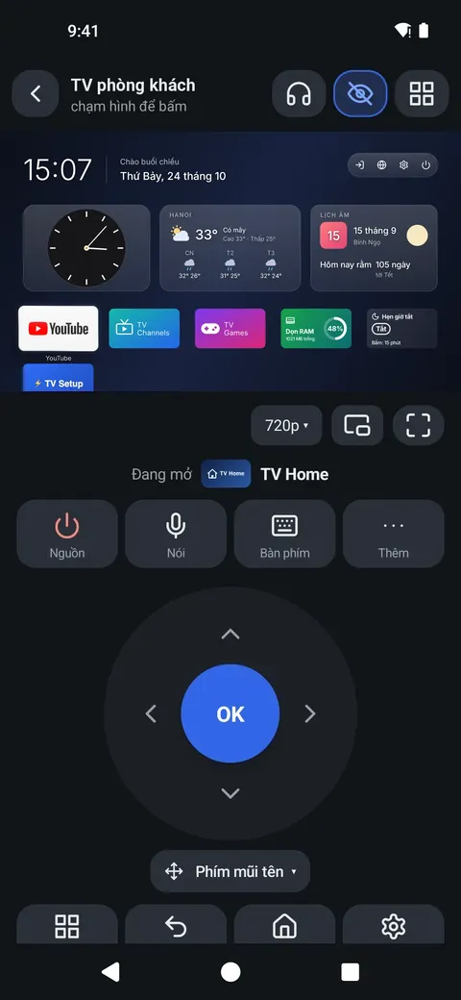
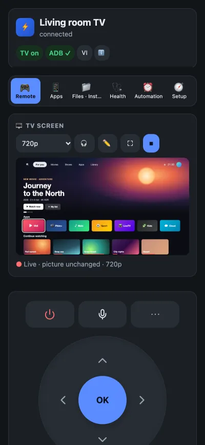
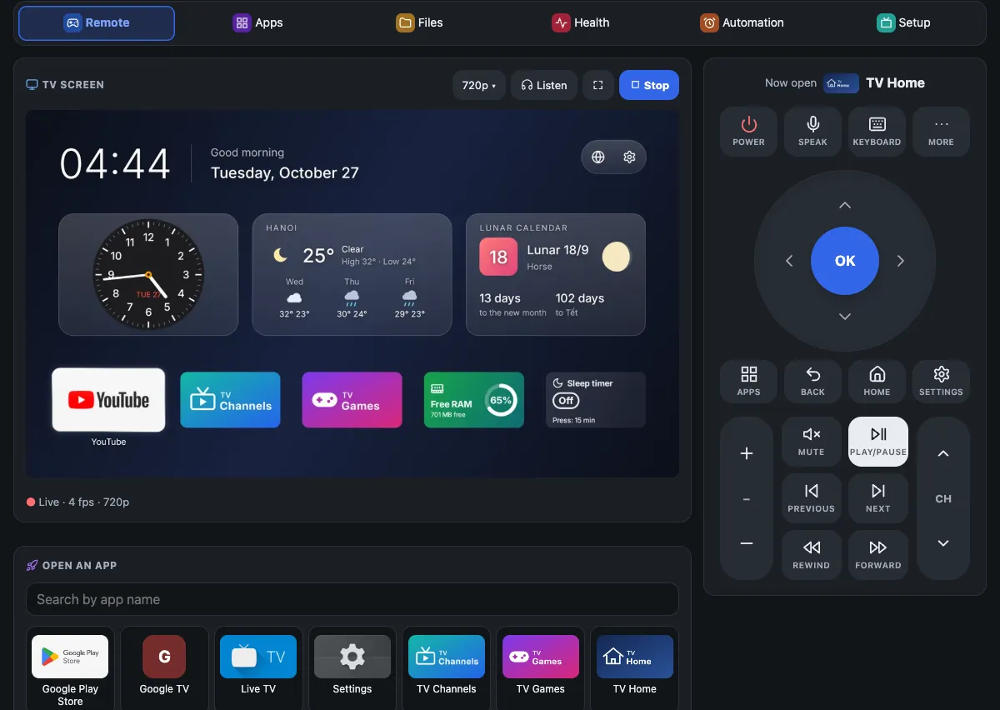
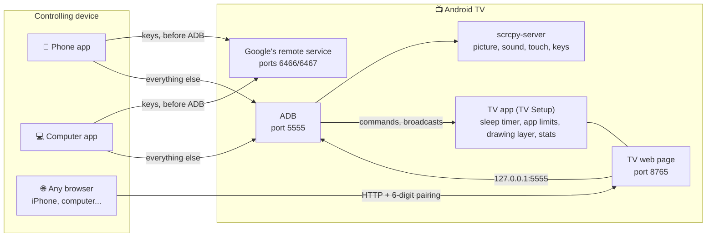
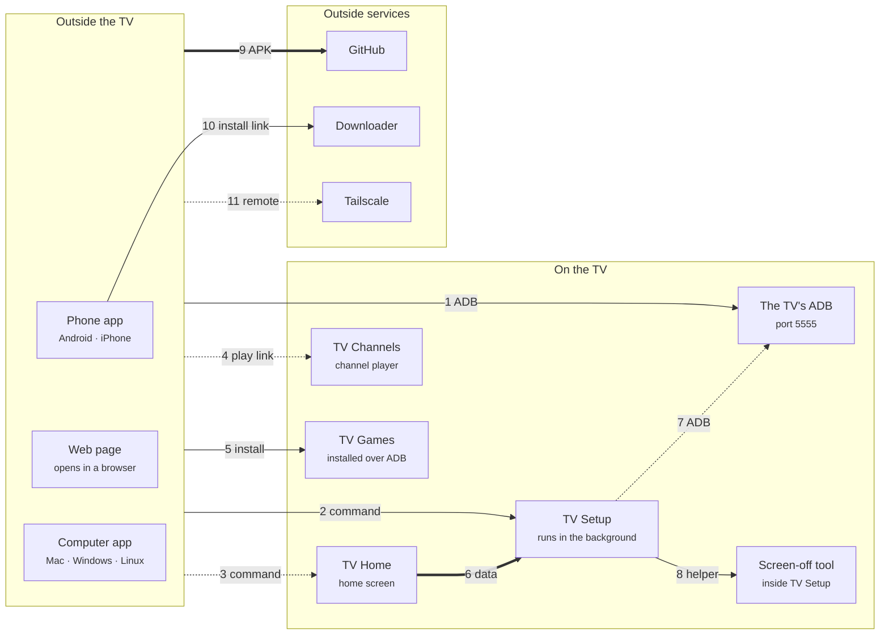
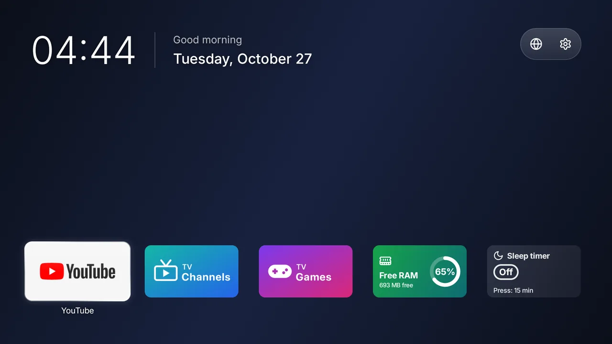
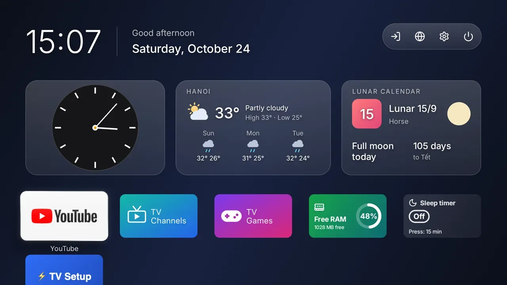
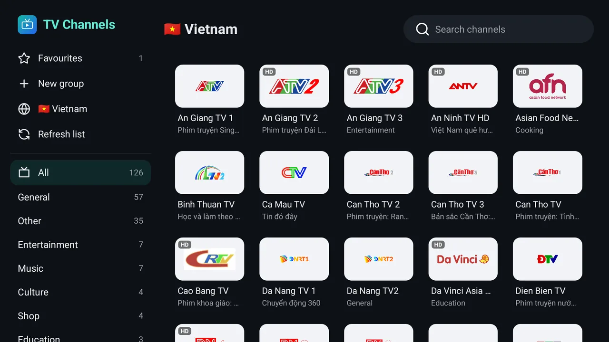
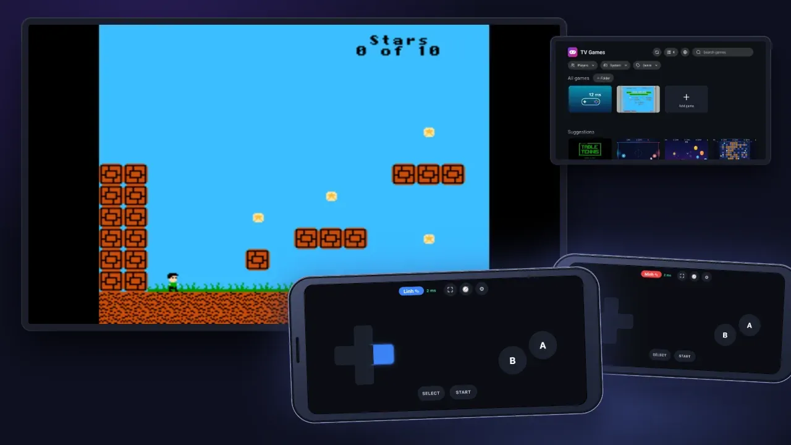
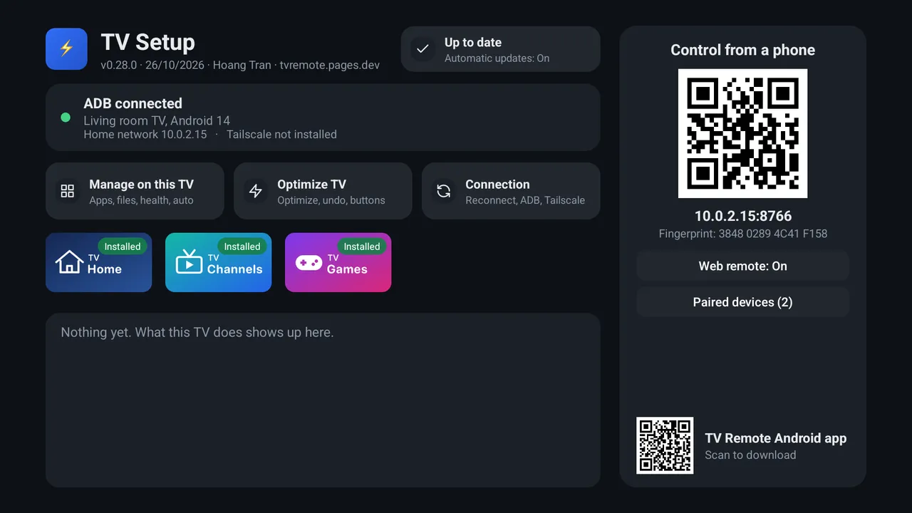

# TV Remote

**Your TV remote on your phone or computer. No server, no account, no cable.**

[Tiếng Việt](README.vi.md) · 🌐 [tvremote.pages.dev](https://tvremote.pages.dev) (Vietnamese and English) · 📖 [User guide](https://tvremote.pages.dev/guide?lang=en)

Control an **Android TV / Google TV** (plus **LG**, **Samsung**, **Roku** and **VIDAA** TVs) straight from an Android phone, a Mac / Windows / Linux computer, or any browser, iPhone included. Everything goes directly to the TV over your Wi-Fi.

<table>
<tr>
<td align="center"><br><sub>Phone app</sub></td>
<td align="center"><br><sub>TV web page</sub></td>
<td align="center"><br><sub>Computer app</sub></td>
</tr>
</table>

Tested for real on a Sony BRAVIA (Android 9). Other brands are untested; LG, Samsung, Roku and VIDAA are **beta**.

---

## Table of contents

- [What you get](#what-you-get)
- [Three apps and a web page](#three-apps-and-a-web-page)
- [More apps for the TV](#more-apps-for-the-tv)
- [Quick start](#quick-start)
- [Away from home](#away-from-home)
- [Undo](#undo)
- [Tested TVs](#tested-tvs)
- [Troubleshooting](#troubleshooting)
- [Questions people ask](#questions-people-ask)
- [Security](#security)
- [For developers](#for-developers)

---

## What you get

- **A remote** with arrows, volume, channels, apps, typing and voice.
- **The TV's picture on your device**, with touch and sound. Draw on the TV's screen or send it a message.
- **Now playing**, the TV's clipboard, a screen that goes off while the music plays on (and back on from the app), and a dimmer or blue light filter over every app.
- **Apps, files and health** (what runs, how much memory, the TV's own internet speed) on the TV, managed from your phone.
- **Sleep timer, bedtime, app limits, volume limits and apps locked with a PIN** that run on the TV, so they work with every other device off.
- **Scenes** (several steps in one tap), widget and Quick Settings tiles, game controller, Home Assistant and Siri Shortcuts.
- **TV Home**, a home screen without ads, set up from your phone or computer: favourite apps, hidden apps, your own background, widgets (system stats, most used apps and limits, month calendar with lunar days, lunar calendar, sleep timer, weather, a pinned note) (the background, clock and motion can also be changed on the TV itself). Or pick another launcher from the gallery.
- **TV Channels**, free TV channels on the TV from iptv-org's public lists and VieON's free channels, with the programme guide (VN): by country and category, favourites and your own groups, pinned to the home screen, opened by name from the phone ("open channel VTV1").
- **TV Games**, retro and web games on the TV with phones as pads (the QR on the TV, no ADB needed).
- **Optional extras on the TV** ("Optimize TV"): faster, lighter, and fully undoable.

Every feature, with screenshots: [tvremote.pages.dev](https://tvremote.pages.dev/?lang=en).

## Three apps and a web page

Pick the one that fits what you have. They share one code base, so they behave alike.

| You have | Use | Get it |
|---|---|---|
| An Android phone | **Phone app** (*TV Remote*) | [tv-remote.apk](https://github.com/HoangTran0410/tv-remote/releases/latest/download/tv-remote.apk) or Downloader code **`2973135`** |
| An iPhone, or any browser | **TV web page**: install the **TV app** on the TV, open `http://<TV IP>:8765` | [tv-setup.apk](https://github.com/HoangTran0410/tv-remote/releases/latest/download/tv-setup.apk) or Downloader code **`2397346`** |
| A Mac, Windows or Linux computer | **Computer app** (*TV Remote*, about 20 MB, nothing else to install) | [Downloads](#computer-app-downloads) |

The **TV app** is shown on the TV as *TV Setup*. It also runs the timers and limits.

<details>
<summary><b>What each can do</b></summary>

| | Phone app | TV web page | Computer app |
|---|---|---|---|
| Remote, the TV's picture and touch, draw, picture or message on the TV | ✓ | ✓ | ✓ |
| Now playing, the TV's clipboard, screen off while it keeps playing, dim the screen | ✓ | ✓ | ✓ |
| Volume limits by time of day, sleep timer, bedtime, app limits, PIN lock | ✓ | ✓ | ✓ |
| Listen to the TV | ✓, screen off too | ✓, while the page is open | ✓, high quality |
| Apps, Files, Health, Automation, Setup | ✓ | ✓ | ✓ |
| *Sharpest* picture quality | | | ✓ |
| Several TVs | ✓ | only that TV | ✓ |
| Turn on a TV that is fully off (Wake-on-LAN) | ✓ | | ✓ |
| Keys before the TV has allowed ADB | ✓ | | ✓ |
| Infrared remote (phone's IR blaster, no network, no TV picked) | ✓ | | |
| Widget, Quick Settings tiles, the phone's volume keys | ✓ | | |
| Game controller | ✓ | ✓ | ✓ |
| Link for Home Assistant, Shortcuts (Siri) | | ✓ | ✓ |
| Nothing to install on the controlling device | | ✓ | |
| LG, Samsung, Roku, VIDAA TVs | ✓ | | ✓ |

**LG, Samsung, Roku, VIDAA** (beta): found by the network scan and controlled without ADB. The first time, choose Allow on the TV (VIDAA: type the 4-digit code).

| | LG | Samsung | Roku | VIDAA |
|---|:-:|:-:|:-:|:-:|
| Keys, typing, apps, power on, scenes | ✓ | ✓ | ✓ | ✓ |
| Inputs | ✓ | | ✓ | ✓ |
| Volume to a number | ✓ | | | ✓ |
| YouTube links, screen off | ✓ | | | |

The picture, files, health and timers need Android TV.
</details>

<details>
<summary><b>How the parts connect</b></summary>

No server in between: everything goes straight to the TV.



ADB is Android's own debug bridge. The apps speak it themselves and push `scrcpy-server` to the TV for H.264 video, sound, touch and keys. Before ADB is on, the Phone app and the Computer app can still send keys through the Android TV Remote protocol (ports 6466/6467).
</details>

## How the apps fit together

Each arrow is a link between two apps: what one needs from the other, and how. Solid: the app tells you what is missing; dashed: only partly; thick: it stays quiet. The same map with the logos, a table of every link and how each app is installed: [tvremote.pages.dev/apps](https://tvremote.pages.dev/apps).

<!-- apps-map:start -->

<!-- apps-map:end -->

## More apps for the TV

Free, no ads, each on its own: install only the ones you want, from the phone or computer app (TV tab) or with Downloader. More may come.

| App | Downloader code | File |
|---|---|---|
| TV Home | **`4356026`** | [tv-home.apk](https://github.com/HoangTran0410/tv-remote/releases/latest/download/tv-home.apk) |
| TV Channels | **`8135635`** | [tv-channels.apk](https://github.com/HoangTran0410/tv-remote/releases/latest/download/tv-channels.apk) |
| TV Games | **`2294968`** | [tv-games.apk](https://github.com/HoangTran0410/tv-remote/releases/latest/download/tv-games.apk) |

### 🏠 TV Home

<table>
<tr>
<td align="center" width="50%"><br><sub>TV Home, clean</sub></td>
<td align="center" width="50%"><br><sub>TV Home with widgets</sub></td>
</tr>
</table>

A home screen instead of Google TV's: no ads, no suggested rows, 0.2 MB.

- A clock, three round icons (inputs, network, settings) in one glass capsule, then one grid of apps with your favourites first. Hide the ones the kids should not see.
- Widgets if you want them: system (memory, storage, IP), weather, lunar calendar, month calendar, most used apps and limits, sleep timer, a note.
- Your own wallpaper or photo, 12/24-hour clock, how much it moves.
- Arranged from the phone or computer (TV tab → 🏠 → *Customize TV Home*) or on the TV with its remote.
- *Optimize TV* makes it the home screen for you; *Back to the TV's own* undoes it.

### 📺 TV Channels

<p align="center"><br><sub>TV Channels</sub></p>

Plays free TV channels on the TV.

- Channels from iptv-org's public lists, by country and category, plus VieON's free channels with the programme guide (Vietnam).
- Favourites, your own groups, channels pinned to the home screen. A dead stream falls to the next one.
- Opened by name from the phone: type or say "open channel VTV1".
- Search a channel by name in every country (first row of the side list); the chosen country's channels come first.
- Programme reminders: OK on a coming programme in the guide sets a 🔔; 2 minutes before, a card (OK = watch, Back = dismiss) shows in TV Channels and over other apps; nothing when the screen is off.
- Own language in the side list (*Language*): follow the TV, Tiếng Việt or English.
- Favourites and groups managed from the phone, computer or the TV's web page (*Manage channels*: search, ☆, groups, reorder), not only with the D-pad.
- Installed from the phone or computer (TV tab → 📺 card → *Install TV Channels*).

### 🎮 TV Games

<p align="center"><br><sub>TV Games</sub></p>

Plays retro and web games on the TV, with phones as pads.

- Retro games (libretro cores) and web games; free homebrew suggested in the app.
- Up to 4 phones as pads: scan the QR on the TV, no ADB and no TV Setup needed.
- Card and board games (Tiến lên, Color Cards, Tycoon, Ludo…) ported from [gamehub24](https://gamehub24.pages.dev): each player's hand on their own phone.
- Installed, opened and updated from the phone or computer app: **TV** tab → **TV games** card (needs ADB for the install only; says so when the latest release has no `tv-games.apk` yet).

## Quick start

**You need:** an Android TV / Google TV on the same Wi-Fi as your phone or computer, and its own remote for the first few minutes.

**1. On the TV, turn on ADB** (once; menu names are Sony's, others differ a little)

Settings → Device Preferences (Google TV, Chromecast: System) → About → press OK on **Build** (“Android TV OS build”) seven times → go back → Developer options in the same list → **ADB debugging** (some TVs say "USB debugging"). Recommended: Settings → Network & Internet → **Remote start**, so the TV can be woken later.

> ADB cannot be turned on (an operator box hides Settings)? Skip to step 2 with the Downloader route: TV Setup opens the right place for you. The Computer app has **Turn ADB on for me**, and the Phone app a similar assistant.

**2. Install the app you picked**

- **Phone app:** install `tv-remote.apk`, open it, tap **Scan Wi-Fi** and pick the TV (or type its IP).
- **Computer app:** download, unzip, open (see [Downloads](#computer-app-downloads)), pick the TV from the list.
- **TV web page / iPhone:** install TV Setup on the TV ([steps below](#install-tv-setup-with-downloader)), scan the QR code it shows with the phone's camera, type the **6-digit code** from the TV.

**3. Allow it on the TV**

The first time, the TV asks **"Allow USB debugging?"**: tick **Always allow**, then OK. Someone has to be at the TV for this; the apps show "Look at the TV" until it is done.

That's it. A ready TV opens straight on the Remote tab.

<details>
<summary><b>Install TV Setup with Downloader</b> (only the TV's remote needed)</summary>

1. On the TV open the **Play Store**, install **Downloader** (by AFTVnews, orange icon).
2. Open Downloader. If it asks for access to files, choose **Allow**.
3. Type the code **`2397346`** and choose **Go**.
4. Choose **Install**. If it says installs from this source are not allowed: allow Downloader, press Back, choose Install again.
5. Open **TV Setup**. If ADB is still off, it explains how and opens Developer options for you.
6. Scan its **QR code** with the phone's camera and type the 6-digit code. Done.

The phone app is `2973135` the same way; TV Home `4356026`, TV Channels `8135635`, TV Games `2294968`. The codes always point at the latest release.

<p align="center"></p>

Good to know:

- **iPhone:** in Safari tap Share → Add to Home Screen for an icon that opens like an app.
- **No phone or computer at hand?** On the TV choose **Manage on this TV** for Apps, Files, Health, Automation and Setup, driven by the TV's remote.
- TV Setup starts again by itself when the TV boots.
- It needs the TV's ADB on port 5555. Some newer Google TVs that only offer pairing-code "Wireless debugging" may not work.
</details>

<details id="computer-app-downloads">
<summary><b>Computer app downloads</b></summary>

| Computer | Download |
|---|---|
| Mac (Apple chip and Intel) | [TV-Remote-mac.zip](https://github.com/HoangTran0410/tv-remote/releases/latest/download/TV-Remote-mac.zip) |
| Windows 10 / 11 | [TV-Remote-windows-x64.zip](https://github.com/HoangTran0410/tv-remote/releases/latest/download/TV-Remote-windows-x64.zip) |
| Linux x64 / arm64 | [TV-Remote-linux-x64.tar.gz](https://github.com/HoangTran0410/tv-remote/releases/latest/download/TV-Remote-linux-x64.tar.gz) · [arm64](https://github.com/HoangTran0410/tv-remote/releases/latest/download/TV-Remote-linux-arm64.tar.gz) |

- **Mac:** drag **TV Remote** into Applications and open it. If the Mac says the developer is "unverified": System Settings → Privacy & Security → **Open Anyway** (first time only).
- **Windows:** run **`TV Remote.exe`**. If Windows says "protected your PC": **More info → Run anyway**.
- **Linux:** run `tv-remote/bin/tv-remote`. The window needs `libwebkit2gtk-4.1-0`; without it the app opens in the browser.
- It updates itself: it looks for a new version, downloads it quietly and offers **Update**. Saved TVs and pairing stay.
- Closing the window stops the app. It listens on `127.0.0.1` only.
</details>

<details>
<summary><b>The TV asks again while you are away</b> (it forgot a device; Android 11+ forgets one after 7 days unused)</summary>

- **Automatic:** the Phone app and Computer app, whenever they have ADB, fetch a "pass" from TV Setup. The next time the TV asks, TV Setup presses Allow, nobody needed at the TV. It presses only when **the key code in the question matches the asking device's own**, and shows a notice on the TV each time.
- **By hand:** any page that has ADB shows a "The TV is asking..." bar with the code and **Allow / Decline**. Allow only if the code matches the one the app showed.
- A device that never connected still needs someone at the TV. That is on purpose.
</details>

<details>
<summary><b>Where is the TV's IP?</b></summary>

- On the TV: Settings → Network & Internet → your Wi-Fi name → **IP address** (like `192.168.1.88`).
- The TV Setup app shows it on the TV too, and the Tailscale one (`100.x.x.x`).
</details>

## Away from home

Use **Tailscale**; never open the TV to the Internet. Once, while on the TV's Wi-Fi:

1. Open the **Setup** tab → **Install and sign in to Tailscale** (on the TV: the **Tailscale** button in TV Setup).
2. Wait about half a minute. The TV downloads the official Tailscale (checksum checked), installs it and starts it.
3. Press **Open the Tailscale sign-in page** (or scan the QR code), sign in to your Tailscale account (free) and press **Connect**. Nothing is typed on the TV.
4. Recommended: in the [Tailscale admin console](https://login.tailscale.com/admin/machines) choose the TV's menu → **Disable key expiry**, or it signs out after about 180 days.
5. Install Tailscale on your phone or computer (same account) and use the TV's `100.x.x.x` IP.

The TV must be on to be reached. A TV in **standby** wakes with one press, over Tailscale too. A TV **fully off** only wakes from a Wake-on-LAN packet sent from inside the home network (both the Phone app and the Computer app send it when on that network).

## Undo

| What you changed | How to go back |
|---|---|
| **Optimize TV** (animations off, TV Home as the home screen, apps turned off) | **Undo** in the same box. Nothing was uninstalled, apps were only paused (never one holding a saved Wi-Fi network or the HDMI inputs). If the TV shows no home screen: Settings → Apps → System apps → **Android TV Home** → Enable |
| Allowed devices | Developer options → **Revoke USB debugging authorizations**, or **Unpair all** in TV Setup |
| The TV web page | Turn the web remote off in TV Setup |
| The apps | Uninstall them like any app. The Computer app keeps its data in your user folder |

Optimize TV is optional. It is on the Setup tab of all three, and in TV Setup on the TV. After a firmware update TV Setup turns the apps it had switched off back off (and TV Home back on as Home); Undo stops that.

## Tested TVs

Only the Sony BRAVIA (Android 9) was tried by us, on a real TV. The rest are **reported working by owners** (through [cleanyourtv](https://github.com/Gathin23/cleanyourtv) issues), not re-tested by us.

| Kind | Brands | Source |
|---|---|---|
| TVs | Sony BRAVIA | ours |
| TVs | TCL, Xiaomi / Mi TV, Hisense (Google TV), Philips (Google TV), OnePlus, BenQ, CHiQ, RCA, SANYO, Toshiba, Insignia, Thomson | owners |
| Boxes | Chromecast with Google TV, NVIDIA Shield, Mi Box S, Mi TV Stick | owners |
| Boxes | Fire TV Stick / Fire TV Edition: remote and ADB work, Optimize TV cannot change Home | owners |
| Projectors | XGIMI, Epson | owners |

TCL China has no Developer options: Settings → About, press Up, Down, Left, Right (again each time). A TV with only Wireless debugging (no port 5555) is found and paired with its 6-digit code.

## Troubleshooting

Things that bit us, so they don't bite you.

| Symptom | What to do |
|---|---|
| Cannot connect | The app checks the network and the TV's ports and gives one reason with its fix (TV off or at a new address, ADB off, not allowed yet, another network, a VPN in the way, wrong clock). By hand: same network? ADB on? Right IP? Look at the TV for a dialog |
| **ADB: waiting for the TV** | Choose "Always allow" on the TV. Closed it by mistake? The apps ask again a few times; on the web press "Retry connection" |
| **ADB: port closed** | The TV is off or just restarted: turn "ADB debugging" off and on |
| Buttons do nothing (Computer app) | The remote is not paired (the **Setup** tab), or two windows are open for the same TV |
| The TV web page asks for the 6-digit code again | "Unpair all" was pressed, or the browser cleared the page's data: enter a new code |
| Tailscale gives no sign-in link | The TV's screen must be on (not standby) and online. Press the button again, or open Tailscale on the TV and scan its QR code |
| Choppy picture, slow TV | Pick a lower quality; turn the picture off when not needed |
| Cannot connect from far away | Are both devices in the same Tailscale account and online? |
| Netflix and the like show black | Protected video cannot be mirrored. Keys, volume and sound still work |
| Android calls the app "harmful" | Play Protect warns about an app outside the Play Store that can install APKs, and **blocks** one that declares an accessibility service when it comes from a browser or Downloader ("blocked to protect your device… financial fraud", only an "I understand" button). From this version TV Setup declares none (its two key services live in a small add-on, *TV Setup Keys*, which TV Setup puts on the TV itself over ADB), so Downloader installs it. On an older version: install TV Setup from the Phone or Computer app (over ADB, no block), or switch off Play Protect scanning for a minute (Play Store → profile → Play Protect → Settings). The source is in this repo; choose "Install anyway" if you trust it |
| The TV got something wrong | About → **Send the log** (keys are blanked) |

## Questions people ask

**Do I need a server or an account?**
No. The apps talk directly to the TV. Tailscale needs a free account only if you want to reach the TV away from home.

**Is it safe? Can it break the TV?**
It uses the same debug bridge as developing an Android app, after one explicit "Allow" on the TV. Optimize TV only pauses apps and **Undo** brings them back; nothing is uninstalled.

**Does it work on an iPhone?**
Yes, through the TV web page: install TV Setup on the TV, open its address in Safari. There is no iPhone app.

**Does it work without ADB?**
For keys, yes: the Phone app and Computer app pair with the 6-character code the TV shows. The picture, apps, files and timers need ADB.

**Which TVs?**
Android TV / Google TV is the main target. LG, Samsung, Roku and VIDAA are beta (keys, typing, apps, power on, scenes).

**Can I use it with Home Assistant or Siri?**
Yes: Settings → **Home Assistant · Shortcuts** gives a link with its own token. Home network only. See the [guide](https://tvremote.pages.dev/guide?lang=en).

**Where are the step-by-step instructions?**
In the [user guide](https://tvremote.pages.dev/guide?lang=en), with search. Changes per release: [CHANGELOG.md](CHANGELOG.md).

## Security

- **ADB over the network has no password.** Any device the TV has "Always allowed" has full control. Use it on networks you trust, and over Tailscale away from home.
- **Never expose port 8765 to the Internet.** The TV web page is plain HTTP on the home network and asks for the 6-digit code shown on the TV.
- The Computer app listens on `127.0.0.1` only, with a new key each time it starts. Its `keys` folder (Mac: `~/Library/Application Support/TV Remote`, Windows: `%APPDATA%\TV Remote`, Linux: `~/.local/share/tv-remote`) holds the pairing keys: **whoever has those files can control the TV.**
- TV Setup presses "Allow USB debugging?" only for a device whose key code matches, and shows a notice each time.
- A shared QR code gives what the sharer picked: **Full access**, **Remote only** or **View only**.
- Install APKs only from sources you trust. Releases are checked against signed checksums before an app updates itself.

## For developers

Code names, layout, tests and releases: [AGENTS.md](AGENTS.md). Short version:

| Folder | What |
|---|---|
| `app/shared/web/` | The one web UI (Computer app, TV web page, the Phone app's Manage screen) |
| `app/shared/src/` | The Kotlin core: ADB, picture and sound, each brand's remote, `/api` |
| `app/android/`, `app/desktop/`, `app/tv/` | Phone app, Computer app, TV app |
| `dev/`, `docs/` | Dev tools ([dev/README.md](dev/README.md)); the site ([docs/README.md](docs/README.md)) |

```bash
node --test app/shared/tests/ app/games/tests/                        # web tests (page, web games)
cd app/gradle && ./gradlew :shared:testDebugUnitTest                  # Kotlin tests
cd app/gradle && ./gradlew :desktop:installDist                       # build the Computer app
dev/test/emu.sh                                                            # emulators + build + install
```

Needs JDK 17, the Android SDK, Node.js and Python 3. Why some code looks odd: [dev/DECISIONS.md](dev/DECISIONS.md).

Credits: [scrcpy](https://github.com/Genymobile/scrcpy) (Apache-2.0), [JMuxer](https://github.com/samirkumardas/jmuxer) (MIT), [webview](https://github.com/webview/webview) (MIT), [JNA](https://github.com/java-native-access/jna) (Apache-2.0); the table games follow [gamehub24](https://gamehub24.pages.dev).

## License

[MIT](LICENSE)

<!-- aio-desktop:start -->
### 🖥️ AIO Desktop

Find this app and many more free tools & games in **[AIO Desktop](https://fbaio.org/#/desktop)**, a Windows/macOS-style web desktop by Social AIO. [▶ Open AIO Desktop](https://fbaio.org/#/desktop)
<!-- aio-desktop:end -->
