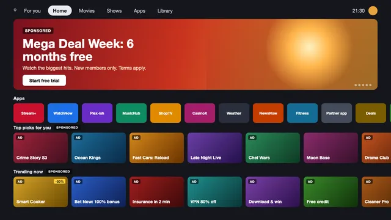
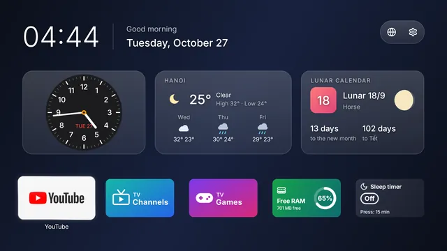
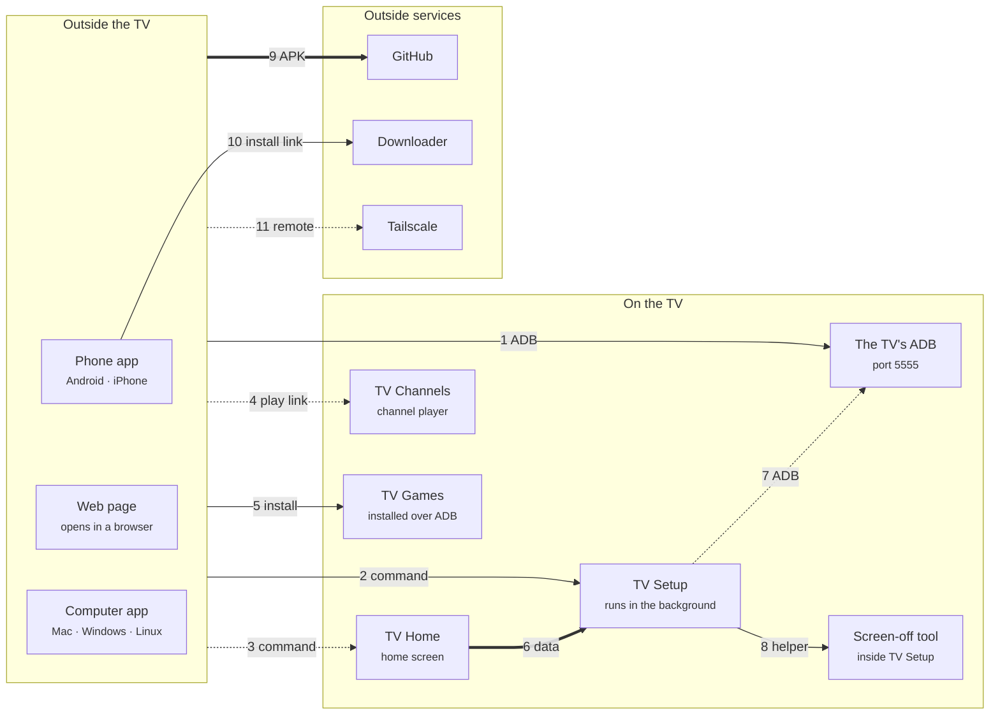

<h1 align="center">TV Remote</h1>

  <b>Your TV remote on your phone or computer. No server, no account, no cable.</b> 
  Android TV / Google TV · LG · Samsung · Roku · VIDAA &nbsp;·&nbsp; no root &nbsp;·&nbsp; every change undoable

  <a href="#get-it">Get it</a> ·
  <a href="#quick-start">Quick start</a> ·
  <a href="#features">Features</a> ·
  <a href="#more-apps-for-the-tv">More apps</a> ·
  <a href="https://tvremote.pages.dev/guide?lang=en">User guide</a> ·
  <a href="CHANGELOG.md">Changelog</a> ·
  <a href="README.vi.md">Tiếng Việt</a>

  
  
  
  
  

<table>
<tr>
<td align="center"> Phone app</td>
<td align="center"> TV web page</td>
<td align="center"> Computer app</td>
</tr>
</table>

Everything goes straight from your device to the TV: no cloud, no sign-up. Every feature with screenshots: [tvremote.pages.dev](https://tvremote.pages.dev/?lang=en).

## Get it

| You have | Use | Download | Downloader code |
|---|---|---|---|
| An Android phone | **Phone app** (*TV Remote*) | [tv-remote.apk](https://github.com/HoangTran0410/tv-remote/releases/latest/download/tv-remote.apk) | **`2973135`** |
| An iPhone, or any browser | **TV web page**: install the **TV app** (*TV Setup*) on the TV, open `http://<TV IP>:8765` | [tv-setup.apk](https://github.com/HoangTran0410/tv-remote/releases/latest/download/tv-setup.apk) | **`2397346`** |
| A Mac | **Computer app** (*TV Remote*, about 20 MB) | [TV-Remote-mac.zip](https://github.com/HoangTran0410/tv-remote/releases/latest/download/TV-Remote-mac.zip) | |
| Windows 10 / 11 | **Computer app** | [TV-Remote-windows-x64.zip](https://github.com/HoangTran0410/tv-remote/releases/latest/download/TV-Remote-windows-x64.zip) | |
| Linux | **Computer app** | [x64](https://github.com/HoangTran0410/tv-remote/releases/latest/download/TV-Remote-linux-x64.tar.gz) · [arm64](https://github.com/HoangTran0410/tv-remote/releases/latest/download/TV-Remote-linux-arm64.tar.gz) | |
| Optional, on the TV | TV Home · TV Channels · TV Games | [tv-home.apk](https://github.com/HoangTran0410/tv-remote/releases/latest/download/tv-home.apk) · [tv-channels.apk](https://github.com/HoangTran0410/tv-remote/releases/latest/download/tv-channels.apk) · [tv-games.apk](https://github.com/HoangTran0410/tv-remote/releases/latest/download/tv-games.apk) | **`4356026`** · **`8135635`** · **`2294968`** |

Codes go in the **Downloader** app on the TV and always point at the latest release.

## Quick start

1. **Turn on ADB on the TV** (once): Settings → About → press OK on **Build** 7 times → Developer options → **ADB debugging**. [Step by step](https://tvremote.pages.dev/guide?lang=en#prep-tv) · provider boxes (FPT, Viettel…): [read this first](https://tvremote.pages.dev/guide?lang=en#prep-tv).
2. **Open the app** and pick the TV ([phone](https://tvremote.pages.dev/guide?lang=en#install-phone) · [computer](https://tvremote.pages.dev/guide?lang=en#install-pc) · [iPhone / browser](https://tvremote.pages.dev/guide?lang=en#web-iphone): install [TV Setup](https://tvremote.pages.dev/guide?lang=en#install-tv), scan its QR).
3. **On the TV choose "Always allow"** when it asks [Allow USB debugging?](https://tvremote.pages.dev/guide?lang=en#allow-usb)

No ADB? The Phone and Computer apps still send keys after pairing with the code the TV shows.

## Features

| Feature | What it does | Guide |
|---|---|---|
| 🎮 **Remote** | Arrows, volume, channels, apps, typing, voice; holds keys like the real remote | [→](https://tvremote.pages.dev/guide?lang=en#remote) |
| 📺 **The TV's picture** | On your device, with touch and sound; listen with the phone's screen off | [→](https://tvremote.pages.dev/guide?lang=en#picture) |
| ✏️ **On the TV's screen** | Draw, send a photo or a message; now playing; the TV's clipboard; dim or blue light filter | [→](https://tvremote.pages.dev/guide?lang=en#draw) |
| 🔒 **For kids** | Sleep timer, bedtime, app limits, volume limits, PIN-locked apps: they run on the TV itself | [→](https://tvremote.pages.dev/guide?lang=en#limits) |
| 📱 **Manage the TV** | Apps, files, health (memory, the TV's own internet speed), several TVs at once | [→](https://tvremote.pages.dev/guide?lang=en#apps) |
| ⚡ **Optimize TV** | Faster and lighter: animations off, ad-filled home screen and unused apps paused; **Undo** puts it all back | [→](https://tvremote.pages.dev/guide?lang=en#optimize) |
| ⌨️ **Test remote keys** | Every key the TV gets, live: name, code, which remote, press or hold, remapped or not | [→](https://tvremote.pages.dev/guide?lang=en#keyfix) |
| 🎬 **Scenes and links** | Several steps in one tap, widget, Quick Settings tiles, Home Assistant, Siri Shortcuts, your own Telegram bot | [→](https://tvremote.pages.dev/guide?lang=en#scenes) |
| 🌍 **Away from home** | Through Tailscale, set up with one button, nothing typed on the TV | [→](https://tvremote.pages.dev/guide?lang=en#away) |
| 📡 **Other brands** | LG, Samsung, Roku, VIDAA (beta): keys, typing, apps, power on, scenes | [→](https://tvremote.pages.dev/guide?lang=en#brands) |

<b>What each app can do</b>

**Phone app** and **Computer app** (both *TV Remote*), **TV app** (*TV Setup* on the TV), **TV web page** (what TV Setup serves on port 8765, any browser after a 6-digit code; also on the TV as *Manage on this TV*).

| | Phone app | TV web page | Computer app |
|---|---|---|---|
| Remote, the TV's picture and touch, draw, picture or message on the TV | ✓ | ✓ | ✓ |
| Now playing, the TV's clipboard, screen off while it keeps playing, dim the screen | ✓ | ✓ | ✓ |
| Volume limits by time of day, sleep timer, bedtime, app limits, PIN lock | ✓ | ✓ | ✓ |
| Listen to the TV | ✓, screen off too | ✓, while the page is open | ✓, high quality |
| Apps, Files, Health, Automation, Setup | ✓ | ✓ | ✓ |
| *Sharpest* picture quality | | | ✓ |
| Several TVs | ✓ | only that TV | ✓ |
| Turn on a TV that is fully off (Wake-on-LAN) | ✓ | | ✓ |
| Keys before the TV has allowed ADB | ✓ | | ✓ |
| Infrared remote (phone's IR blaster, no network) | ✓ | | |
| Widget, Quick Settings tiles, the phone's volume keys | ✓ | | |
| Game controller | ✓ | ✓ | ✓ |
| Link for Home Assistant, Shortcuts (Siri) | | ✓ | ✓ |
| Telegram bot | needs TV Setup | set up here | needs TV Setup |
| Nothing to install on the controlling device | | ✓ | |
| LG, Samsung, Roku, VIDAA TVs | ✓ | | ✓ |

## More apps for the TV

Free, no ads, each on its own: install from the phone or computer app (TV tab), or with the Downloader codes above.

<table>
<tr>
<td align="center" width="50%"> Before: Google TV's home screen</td>
<td align="center" width="50%"> After: TV Home</td>
</tr>
</table>

| App | What it is | Guide |
|---|---|---|
| 🏠 **TV Home** | A home screen with no ads and no suggested rows (0.2 MB): your apps, widgets, wallpapers, themes, set up from the phone | [→](https://tvremote.pages.dev/guide?lang=en#home) |
| 📺 **TV Channels** | Free TV channels from everywhere (iptv-org, VieON), programme guide, reminders, favourites | [→](https://tvremote.pages.dev/guide?lang=en#channels) |
| 🎮 **TV Games** | Retro and web games, up to 4 phones as pads; card and board games with each hand on its own phone | [→](https://tvremote.pages.dev/guide?lang=en#games) |

<b>How the apps fit together</b>

Each arrow is a link between two apps. Solid: the app tells you what is missing; dashed: only partly; thick: it stays quiet. With logos and a table of every link: [tvremote.pages.dev/apps](https://tvremote.pages.dev/apps).

<!-- apps-map:start -->

<!-- apps-map:end -->

## Tested on

| Kind | Brands | Source |
|---|---|---|
| TVs | Sony BRAVIA (Android 9) | tested by us |
| TVs | TCL, Xiaomi / Mi TV, Hisense (Google TV), Philips (Google TV), OnePlus, BenQ, CHiQ, RCA, SANYO, Toshiba, Insignia, Thomson | owners ([cleanyourtv](https://github.com/Gathin23/cleanyourtv)) |
| Boxes | Chromecast with Google TV, NVIDIA Shield, Mi Box S, Mi TV Stick, Fire TV (Optimize TV cannot change Home) | owners |
| Projectors | XGIMI, Epson | owners |
| Other brands | LG, Samsung, Roku, VIDAA | beta, not tested on a real TV |

## Help

| Need | Go to |
|---|---|
| Something does not work | [Troubleshooting](https://tvremote.pages.dev/guide?lang=en#faq-fix) · the app's own check names the cause and the fix |
| The TV asks "Allow USB debugging?" again | [Why and what to do](https://tvremote.pages.dev/guide?lang=en#allow-usb) |
| Every topic, with search | [User guide](https://tvremote.pages.dev/guide?lang=en) |
| A bug or an idea | [Issues](https://github.com/HoangTran0410/tv-remote/issues) |

**Security:** ADB over the network has no password, so use it on networks you trust and Tailscale away from home. **Never open port 8765 to the Internet.** Only a device paired with the code shown on the TV, or one the TV already allowed, can control it; **Unpair all** in TV Setup takes every one back.

**Privacy:** one anonymous note a day (TV model, Android and app version, what worked) and app errors with IPs, names and keys removed; never your IP, apps, account or Wi-Fi name. Off in Settings → Send anonymous stats. [Details](https://tvremote.pages.dev/guide?lang=en#privacy).

## For developers

Code names, layout, rules and tests: [AGENTS.md](AGENTS.md) · how it works, build, run and test: [dev/README.md](dev/README.md) · why some code looks odd: [dev/DECISIONS.md](dev/DECISIONS.md) · the site: [docs/README.md](docs/README.md) · TV Home themes: [THEMES.md](THEMES.md).

**Add a language:** its files in `app/shared/i18n/` (copy `en.json` and `apps/en/`) plus one line in `langs.json`; no code changes. `node --test app/shared/tests/` says what is missing.

Credits: [scrcpy](https://github.com/Genymobile/scrcpy) (Apache-2.0), [JMuxer](https://github.com/samirkumardas/jmuxer) (MIT), [webview](https://github.com/webview/webview) (MIT), [JNA](https://github.com/java-native-access/jna) (Apache-2.0), [cleanyourtv](https://github.com/Gathin23/cleanyourtv) (Optimize TV's lists); the table games follow [gamehub24](https://gamehub24.pages.dev). License: [MIT](LICENSE).

<!-- aio-desktop:start -->
### 🖥️ AIO Desktop

Find this app and many more free tools & games in **[AIO Desktop](https://fbaio.org/#/desktop)**, a Windows/macOS-style web desktop by Social AIO. [▶ Open AIO Desktop](https://fbaio.org/#/desktop)
<!-- aio-desktop:end -->
