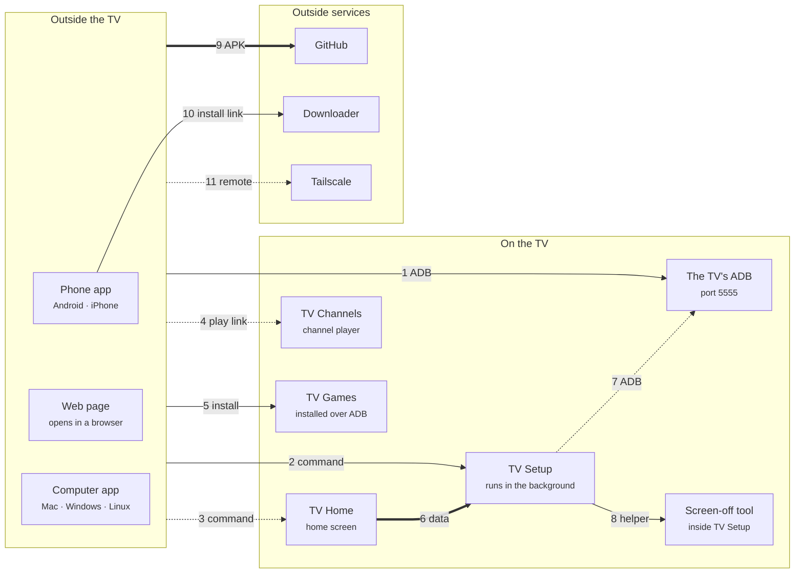
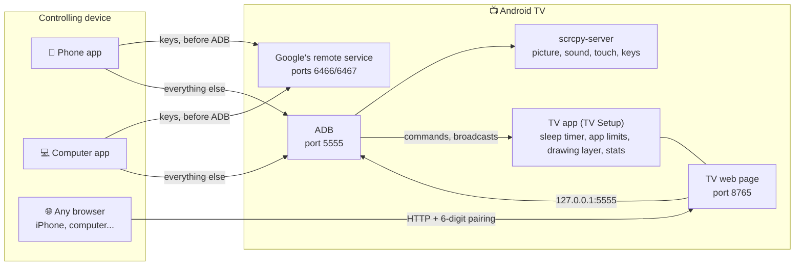
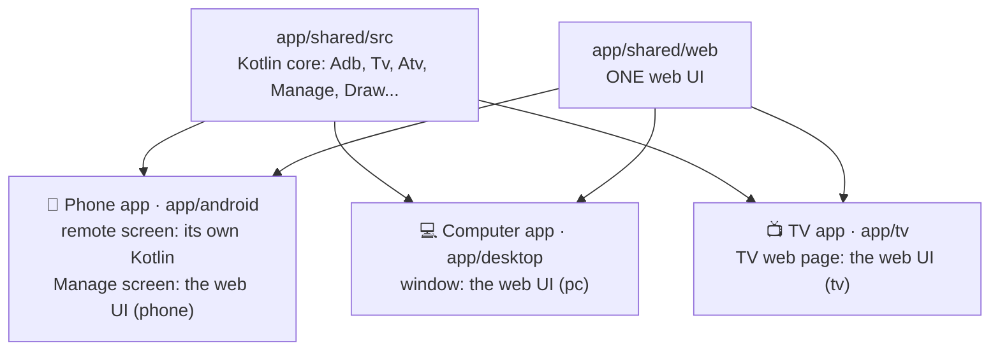

# TV Remote

**Your TV remote on your phone or computer. No server, no account, no cable.**

[Tiếng Việt](README.vi.md) · 🌐 [tvremote.pages.dev](https://tvremote.pages.dev) (Vietnamese and English) · 📖 [User guide](https://tvremote.pages.dev/guide?lang=en)

Control an **Android TV / Google TV** (plus **LG**, **Samsung**, **Roku** and **VIDAA** TVs) straight from an Android phone, a Mac / Windows / Linux computer, or any browser, iPhone included. Everything goes directly to the TV over your Wi-Fi.

<table>
<tr>
<td align="center"><br><sub>Phone app</sub></td>
<td align="center"><br><sub>TV web page</sub></td>
<td align="center"><br><sub>Computer app</sub></td>
</tr>
</table>

Tested for real on a Sony BRAVIA (Android 9). Other brands are untested; LG, Samsung, Roku and VIDAA are **beta** (VIDAA: not tested on a real TV).

**Jump to:** [Get it](#get-it) · [How the apps fit](#how-the-apps-fit-together) · [More apps](#more-apps-for-the-tv) · [Quick start](#quick-start) · [Guides](#guides) · [Help](#help) · [For developers](#for-developers)

## What you get

- **A remote** with arrows, volume, channels, apps, typing and voice; **the TV's picture** on your device, with touch and sound.
- **Draw or send a message** on the TV's screen, **now playing**, the TV's clipboard, screen off while the music plays, dimmer or blue light filter.
- **Apps, files and health** (memory, the TV's own internet speed), managed from your phone.
- **Sleep timer, bedtime, app limits, volume limits, PIN-locked apps**: they run on the TV, so they work with every other device off.
- **Scenes**, widget and Quick Settings tiles, game controller, Home Assistant and Siri Shortcuts, your own Telegram bot.
- **TV Home** (ad-free home screen), **TV Channels** (free channels), **TV Games** (retro and web games, phones as pads): see [More apps](#more-apps-for-the-tv).
- **Optimize TV**: faster, lighter, fully undoable.

Every feature, with screenshots: [tvremote.pages.dev](https://tvremote.pages.dev/?lang=en).

## Get it

| You have | Use | Download | Downloader code |
|---|---|---|---|
| An Android phone | **Phone app** (*TV Remote*) | [tv-remote.apk](https://github.com/HoangTran0410/tv-remote/releases/latest/download/tv-remote.apk) | **`2973135`** |
| An iPhone, or any browser | **TV web page**: install the **TV app** (*TV Setup*) on the TV, open `http://<TV IP>:8765` | [tv-setup.apk](https://github.com/HoangTran0410/tv-remote/releases/latest/download/tv-setup.apk) | **`2397346`** |
| A Mac | **Computer app** (*TV Remote*, about 20 MB) | [TV-Remote-mac.zip](https://github.com/HoangTran0410/tv-remote/releases/latest/download/TV-Remote-mac.zip) | |
| Windows 10 / 11 | **Computer app** | [TV-Remote-windows-x64.zip](https://github.com/HoangTran0410/tv-remote/releases/latest/download/TV-Remote-windows-x64.zip) | |
| Linux | **Computer app** | [x64](https://github.com/HoangTran0410/tv-remote/releases/latest/download/TV-Remote-linux-x64.tar.gz) · [arm64](https://github.com/HoangTran0410/tv-remote/releases/latest/download/TV-Remote-linux-arm64.tar.gz) | |
| Optional, on the TV | TV Home · TV Channels · TV Games | [tv-home.apk](https://github.com/HoangTran0410/tv-remote/releases/latest/download/tv-home.apk) · [tv-channels.apk](https://github.com/HoangTran0410/tv-remote/releases/latest/download/tv-channels.apk) · [tv-games.apk](https://github.com/HoangTran0410/tv-remote/releases/latest/download/tv-games.apk) | **`4356026`** · **`8135635`** · **`2294968`** |

The codes (in the **Downloader** app on the TV) always point at the latest release. The three apps share one code base, so they behave alike.

## How the apps fit together

Each arrow is a link between two apps: what one needs from the other, and how. Solid: the app tells you what is missing; dashed: only partly; thick: it stays quiet. The same map with the logos, a table of every link and how each app is installed: [tvremote.pages.dev/apps](https://tvremote.pages.dev/apps).

<!-- apps-map:start -->

<!-- apps-map:end -->

## More apps for the TV

Free, no ads, each on its own: install only the ones you want, from the phone or computer app (TV tab) or with Downloader (codes above).

### 🏠 TV Home

<table>
<tr>
<td align="center" width="50%"><br><sub>TV Home, clean</sub></td>
<td align="center" width="50%"><br><sub>TV Home with widgets</sub></td>
</tr>
</table>

A home screen instead of Google TV's: no ads, no suggested rows, 0.2 MB.

- A clock, three round icons (inputs, network, settings) in one glass capsule, then one grid of apps with your favourites first. Hide the ones the kids should not see.
- Widgets if you want them: system (memory, storage, IP), weather, lunar calendar, month calendar, most used apps and limits, sleep timer, a note.
- Your own wallpaper or photo, 12/24-hour clock, how much it moves.
- Arranged from the phone or computer (TV tab → 🏠 → *Customize TV Home*) or on the TV with its remote. *Customize → Telegram* shows the QR that pairs your Telegram bot.
- *Optimize TV* makes it the home screen for you; *Back to the TV's own* undoes it.

### 📺 TV Channels

<p align="center"><br><sub>TV Channels</sub></p>

Plays free TV channels on the TV.

- iptv-org's public lists by country and category, plus VieON's free channels with the programme guide (Vietnam). A dead stream falls to the next one.
- Favourites, your own groups, channels pinned to the home screen; managed from the phone, computer or the TV's web page (*Manage channels*).
- Search by name in every country; open by name from the phone: type or say "open channel VTV1".
- Reminders: OK on a coming programme sets a 🔔; 2 minutes before, a card (OK = watch, Back = dismiss) shows, also over other apps. Language: follow the TV, Tiếng Việt or English.
- Install: TV tab → 📺 card → *Install TV Channels*.

### 🎮 TV Games

<p align="center"><br><sub>TV Games</sub></p>

Plays retro and web games on the TV, with phones as pads.

- Retro games (libretro cores) and web games; free homebrew suggested in the app.
- Up to 4 phones as pads: scan the QR on the TV, no ADB and no TV Setup needed.
- Card and board games (Tiến lên, Color Cards, Tycoon, Ludo…) ported from [gamehub24](https://gamehub24.pages.dev): each player's hand on their own phone.
- Installed, opened and updated from the phone or computer app: **TV** tab → **TV games** card (ADB for the install only).

## Quick start

**You need:** an Android TV / Google TV on the same Wi-Fi as your phone or computer, and its own remote for the first few minutes.

1. **On the TV, turn on ADB** (once; menu names are Sony's, others differ a little): Settings → Device Preferences (Google TV, Chromecast: System) → About → press OK on **Build** seven times → back → Developer options → **ADB debugging** ("USB debugging" on some). Recommended: Settings → Network & Internet → **Remote start**, so the TV can be woken later.
   Internet-provider boxes (FPT, Viettel…): don't press 7 times, the box may ask for a password or lock up. ADB can't be turned on? Skip to step 2 with the Downloader route: TV Setup opens the right place for you. The Computer app has **Turn ADB on for me**, the Phone app a similar assistant.
2. **Install the app you picked** ([Get it](#get-it)):
   - **Phone app:** open it, tap **Scan Wi-Fi**, pick the TV (or type its IP).
   - **Computer app:** unzip, open, pick the TV from the list.
   - **TV web page / iPhone:** install TV Setup on the TV (steps below), scan the QR it shows with the phone's camera, type the **6-digit code** from the TV.
3. **Allow it on the TV.** The first time the TV asks **"Allow USB debugging?"**: tick **Always allow**, then OK. Someone has to be at the TV for this; the apps show "Look at the TV" until it is done.

That's it. A ready TV opens straight on the Remote tab. Without ADB the Phone and Computer apps still send keys (pair with the 6-character code the TV shows).

<p align="center"></p>

<details>
<summary><b>Install TV Setup with Downloader</b> (only the TV's remote needed)</summary>

1. On the TV open the **Play Store**, install **Downloader** (by AFTVnews, orange icon).
2. Open Downloader. If it asks for access to files, choose **Allow**.
3. Type the code **`2397346`** and choose **Go** (no Downloader: `go.aftvnews.com/<code>` in a browser also works).
4. Choose **Install**. If it says installs from this source are not allowed: allow Downloader, press Back, choose Install again.
5. Open **TV Setup**. If ADB is still off, it explains how and opens Developer options for you.
6. Scan its **QR code** with the phone's camera and type the 6-digit code. Done.

The other codes work the same way: phone app `2973135`, TV Home `4356026`, TV Channels `8135635`, TV Games `2294968`.
</details>

<details>
<summary><b>Where is the TV's IP?</b></summary>

- On the TV: Settings → Network & Internet → your Wi-Fi name → **IP address** (like `192.168.1.88`).
- The Tailscale one (`100.x.x.x`): the Tailscale app on the TV, or [login.tailscale.com/admin/machines](https://login.tailscale.com/admin/machines).
- The TV Setup app shows both on the TV.
</details>

<details>
<summary><b>The TV asks again while you are away</b> (it forgot a device; Android 11+ forgets one after 7 days unused)</summary>

- **Automatic:** the Phone app and Computer app, whenever they have ADB, fetch a "pass" from TV Setup. The next time the TV asks, TV Setup presses Allow, nobody needed at the TV. It presses only when **the key code in the question matches the asking device's own**, and shows a notice on the TV each time.
- **By hand:** any page that has ADB shows a "The TV is asking..." bar with the code and **Allow / Decline**. Allow only if the code matches the one the app showed.
- A device that never connected still needs someone at the TV. That is on purpose.
</details>

## Guides

Open the one you need.

<details>
<summary><b>The apps compared</b> (what each can do, LG / Samsung / Roku / VIDAA)</summary>

Names used everywhere: **Phone app** and **Computer app** (both *TV Remote*), **TV app** (*TV Setup* on the TV: timers, app limits, drawing, stats, Tailscale), **TV web page** (what TV Setup serves on port 8765, any browser after a 6-digit code; also on the TV screen as *Manage on this TV*).

| | Phone app | TV web page | Computer app |
|---|---|---|---|
| Remote, the TV's picture and touch, draw, picture or message on the TV | ✓ | ✓ | ✓ |
| Now playing, the TV's clipboard, screen off while it keeps playing, dim the screen | ✓ | ✓ | ✓ |
| Volume limits by time of day, sleep timer, bedtime, app limits, PIN lock | ✓ | ✓ | ✓ |
| Listen to the TV | ✓, screen off too | ✓, while the page is open | ✓, high quality |
| Apps, Files, Health, Automation, Setup | ✓ | ✓ | ✓ |
| *Sharpest* picture quality | | | ✓ |
| Several TVs | ✓ | only that TV | ✓ |
| Turn on a TV that is fully off (Wake-on-LAN) | ✓ | | ✓ |
| Keys before the TV has allowed ADB | ✓ | | ✓ |
| Infrared remote (phone's IR blaster, no network) | ✓ | | |
| Widget, Quick Settings tiles, the phone's volume keys | ✓ | | |
| Game controller | ✓ | ✓ | ✓ |
| Link for Home Assistant, Shortcuts (Siri) | | ✓ | ✓ |
| Telegram bot | needs TV Setup | set up here | needs TV Setup |
| Nothing to install on the controlling device | | ✓ | |
| LG, Samsung, Roku, VIDAA TVs | ✓ | | ✓ |

**LG, Samsung, Roku, VIDAA** (beta, not tested on a real TV): found by the network scan and controlled without ADB. The first time, choose Allow on the TV (VIDAA: type the 4-digit code). The picture, files, health and timers need Android TV.

| | LG | Samsung | Roku | VIDAA (beta) |
|---|:-:|:-:|:-:|:-:|
| Keys, typing, apps, power on, scenes | ✓ | ✓ | ✓ | ✓ |
| Inputs | ✓ | | ✓ | ✓ |
| Volume to a number | ✓ | | | ✓ |
| YouTube links, screen off | ✓ | | | |

A clean home screen on a Samsung (Tizen), like TV Home: [arn0-tv](https://github.com/NelsonEU/arn0-tv) (a separate project, made for one Q70B, installed through Developer Mode).
</details>

<details>
<summary><b>Phone app</b></summary>

Install `tv-remote.apk`, open it, tap **Scan Wi-Fi**, pick the TV or type its IP. With no ADB on the TV it still sends keys after pairing, and walks you through installing TV Setup. The phone's volume keys set the TV's volume; the widget, Quick Settings tiles and shortcuts control the last TV without opening the app. It tells you about new versions.
</details>

<details>
<summary><b>TV web page</b> (any browser, iPhone included)</summary>

1. Install TV Setup on the TV: [Downloader code `2397346`](#quick-start), USB, or let the Phone / Computer app do it.
2. Open **TV Setup** on the TV, choose "Always allow" when the TV asks.
3. On the phone or computer open the address TV Setup shows (`http://<TV IP>:8765`; or scan its QR code).
4. Type the **6-digit code** from the TV. That device then goes straight in.

- **iPhone:** in Safari tap Share → Add to Home Screen for an icon that opens like an app (type the code once more).
- **No phone or computer at hand?** On the TV choose **Manage on this TV** (Apps, Files, Health, Automation, Setup, driven by the TV's remote).
- On the TV the app also has **Optimize TV / Undo**, **Tailscale**, **Update**, web remote on/off, **Unpair all**. It starts again by itself when the TV boots.
- Plain HTTP: **never open port 8765 to the Internet**; away from home use Tailscale.
- Needs the TV's ADB on port 5555. Some newer Google TVs that only offer pairing-code "Wireless debugging" may not work.
- Also installs on Android phones and tablets (one-column page), to control that device from another browser: ADB must be on port 5555 (phones usually only over a cable: `adb tcpip 5555` once, again after a restart). Optimize TV refuses non-TVs.
</details>

<details>
<summary><b>Computer app</b> (Mac, Windows, Linux)</summary>

One window, about 20 MB, nothing else to install (no Python, adb…).

- **Mac:** drag **TV Remote** into Applications and open it. If the Mac says the developer is "unverified": System Settings → Privacy & Security → **Open Anyway** (first time only).
- **Windows:** run **`TV Remote.exe`**. If Windows says "protected your PC": **More info → Run anyway**.
- **Linux:** run `tv-remote/bin/tv-remote`. The window needs `libwebkit2gtk-4.1-0`; without it the app opens in the browser.
- First run: pick the TV from the list (the first time it scans the network) or type the IP; choose Always allow on the TV. A ready TV opens on the Remote tab; otherwise the **Setup** tab lists the steps with ✓: ADB → Tailscale (optional) → pair the remote (6-character code) → Save. **📺 Change TV** goes back to the list.
- **Updates:** it looks for a new version, downloads it quietly and offers **Update** (**Later** installs it on close). Saved TVs, pairing and scenes stay. If it sits in a folder it cannot write to (Program Files, or Downloads on a Mac), the button says **Download new version**.
- Closing the window (or ⏻ in 🛠️ Settings) stops the app; nothing runs in the background. It listens on `127.0.0.1` only.
- **ADB closed:** only buttons, power, volume steps and wake work; the page says so and has **Retry connection**.
</details>

<details>
<summary><b>Features worth knowing</b></summary>

- **Picture quality** 240p to 960p (lower is lighter on TV and network); the Computer app adds *Sharpest* (slows the TV). *Screenshots* load one picture at a time. Netflix and the like show black (protected video).
- **▶️ Now playing:** what the TV plays (title, channel, artist), seek bar, pause or skip. Needs ADB; no bar if the app gives no length.
- **📋 TV's clipboard** (*Open on the TV* → *TV's clipboard*): read what the TV copied, or send text to paste into the field being typed in.
- **✏️ Draw on the TV** (button beside the picture; on the Phone app *Draw on TV* in More keys): strokes show on the TV over every app, gone after 10 minutes or 🗑. **💬 Message:** a line of big text on the TV. Needs TV Setup.
- **📲 Share** (More keys → *Share*): a QR opens the TV's remote in another phone's browser (scans once, 10 minutes; then it stays until removed in Paired devices; needs TV Setup; **Full access**, **Remote only** or **View only**), plus a QR for the Phone app. Over Tailscale the scanning phone must be on the TV's Wi-Fi.
- **Screen off / on** (*Sleep timer* → *Screen off / on*): the screen goes black, music keeps playing, keys and picture still work. **🔅 Dim** (same menu): Dark, Blue light filter, Yellow, Sepia, Night red or Blue over every app, 5-90%. Needs TV Setup.
- **🔒 PIN-lock apps** (Automation tab): opening a locked app asks for the PIN; leaving the app or standby locks again. **🔊 Volume limits:** time ranges with a maximum each (e.g. 22:00-06:00 at 30%); the TV lowers it again and says why. Not for TVs whose volume sits on an external speaker (HDMI). Needs TV Setup.
- **📱 Running apps** (Health tab): what runs, in the background, how much RAM; ⏹ Stop ends one (🔒 for the home screen, keyboard, Android's own parts, TV Remote, Tailscale). **🧹 RAM full notice** (Automation, off by default): at 80-95% the TV shows Clean RAM / View apps / Ignore. **⚡ Speed test** (Health → 📶 Network): the TV's own latency, download and upload.
- The TV's on-screen keyboard can't be clicked with a mouse: type on the computer's keyboard; accented text goes in the "Keyboard" box.
</details>

<details>
<summary><b>Away from home (Tailscale)</b></summary>

Never open the TV to the Internet; use **Tailscale**. Once, while on the TV's Wi-Fi:

1. **Setup** tab → **Install and sign in to Tailscale** (Phone app: grid button → Setup; on the TV: the **Tailscale** button in TV Setup).
2. Wait about half a minute. The TV downloads the official Tailscale (checksum checked), installs it, skips the VPN prompt, starts it and gets the sign-in link.
3. Press **Open the Tailscale sign-in page** (or scan the QR code), sign in to your Tailscale account (free), press **Connect**. Nothing is typed on the TV.
4. Recommended: in the [Tailscale admin console](https://login.tailscale.com/admin/machines) choose the TV's menu → **Disable key expiry**, or it signs out after about 180 days.
5. Install Tailscale on your phone or computer (same account) and use the TV's `100.x.x.x` IP. The Computer app's **Save** switches to it.

<p align="center"></p>

Why a link and not the account sent from the phone? Tailscale only accepts sign-in on its own web page (Google, Microsoft…) or a key from enterprise device management, which a home TV lacks. A link needs the fewest steps and gives no app your password.

**Someone at home has only the TV remote, a helper is far away:** at the TV, turn on ADB, install TV Setup (or have the helper install it through "Turn ADB on for me"), open it, press **Tailscale**. Photograph the QR and send it; the helper scans it with their signed-in phone, presses Connect and uses the TV's `100.x` IP.
</details>

<details>
<summary><b>When the TV is off</b></summary>

- **Standby (network on):** one press of Power or Wake is enough, over Tailscale too.
- **Fully off (no network):** only a Wake-on-LAN packet wakes it, sent from **inside the home network**. The Phone app and Computer app send it when on that network. Away, the Computer app can ask a machine at home over SSH: add `relay_user` and `relay_host` to the TV's entry in `tvs.json`.
- A long press of the TV remote's power key opens the full-off menu; to turn back on remotely only short-press.
- **After a restart:** Tailscale starts again if installed with the Tailscale button (or after Optimize TV). If ADB doesn't come back, turn "ADB debugging" off and on.
</details>

<details>
<summary><b>Game controller</b></summary>

Plug or pair the controller (Xbox, PlayStation, Bluetooth or USB) to **the device running the app**, not the TV; open the remote and press any button: "Controller connected". Holding arrows, volume or channel repeats.

| Button | On the remote | Watching the TV's picture |
|---|---|---|
| D-pad, left stick | Arrows | Arrows |
| A / B | OK / Back | Pad's A / B |
| X / Y | Play-pause / Mute | X / Y |
| LB / RB | Volume down / up | L1 / R1 |
| LT / RT | Channel down / up | Channel down / up |
| Start / Select | Home / Menu | Start / Select |

Watching the picture, a game on the TV sees a pad plugged into the TV (as laggy as the picture). While typing or in a dialog the pad sends nothing.
</details>

<details>
<summary><b>Home Assistant and Shortcuts (Siri)</b></summary>

Keys, apps and scenes from Home Assistant or the iPhone's Shortcuts, on the home network. 🛠️ Settings → **Home Assistant · Shortcuts** → **Allow** → copy the link. Its token is its own, not the pairing code; **New token** kills the old link. Home network only: never the Internet (away: Tailscale).

- TV web page (TV Setup): works at once on port 8765. Computer app: opens port `8766` (app port + 1) **only while on**, answering only `/api/hook`; a sleeping computer can't be called, so for a TV use TV Setup.
- One job per call: `key=HOME`, `scene=Movie night`, `app=com.netflix.ninja`, `text=...`, `volume=20` (or `up` / `down` / `mute`), `power=on|off|toggle`. `GET /api/hook/state` returns `{"on","volume","app"}`. 5 wrong tokens block that address for 1 minute.

Shortcuts: "Get contents of URL" with the copied link. Home Assistant (`configuration.yaml`, token in the `x-tvr-hook` header):

```yaml
rest_command:
  tv_key:
    url: "http://192.168.1.20:8766/api/hook"
    method: post
    headers:
      x-tvr-hook: "<token>"
    content_type: "application/json"
    payload: '{"key": "{{ key }}"}'
```

Then in an automation: `action: rest_command.tv_key` with `data: { key: HOME }`.
</details>

<details>
<summary><b>Optimize TV and Undo</b></summary>

The **⚡ Optimize TV** button on the Setup tab of all three (and in TV Setup on the TV) opens a box where you **choose what to do**; **Undo** puts it back. Run it as often as you like. Optional.

- **Animations off** (ticked).
- **TV Home as the home screen** (ticked): installs TV Home (0.2 MB) and turns off Google's "Android TV Home", which eats CPU. New Google TV interface and provider boxes (e.g. FPT) keep their home screen.
- **Turn off suggested apps** (ticked): unused system apps, a list for Sony BRAVIA and some Google apps; only those the TV has.
- **Turn off more apps** (not ticked): any app with an icon, with a name filter. Important apps (Settings, system UI, keyboard, Google Play Services, TV Setup, Tailscale…) are never listed.

After a firmware update TV Setup turns the apps it had switched off back off (and TV Home back on as Home); Undo stops that.

| What you changed | How to go back |
|---|---|
| **Optimize TV** | **Undo** in the same box. Nothing was uninstalled, apps were only paused (never one holding a saved Wi-Fi network or the HDMI inputs; the TV remembers the list in `/data/local/tmp/tvr-disabled.txt`). No home screen? Settings → Apps → System apps → **Android TV Home** → Enable |
| Allowed devices | Developer options → **Revoke USB debugging authorizations**, or **Unpair all** in TV Setup |
| The TV web page | Turn the web remote off in TV Setup |
| The apps | Uninstall them like any app. The Computer app keeps its data in your user folder |
</details>

## Help

<details>
<summary><b>Troubleshooting</b></summary>

| Symptom | What to do |
|---|---|
| Cannot connect | The app checks the network and the TV's ports and gives one reason with its fix (TV off or at a new address, ADB off, not allowed yet, another network, a VPN in the way, wrong clock). By hand: same network? ADB on? Right IP? Look at the TV for a dialog |
| **ADB: waiting for the TV** | Choose "Always allow" on the TV. Closed it by mistake? The apps ask again a few times; on the web press "Retry connection". Away from home: see "The TV asks again while you are away" |
| **ADB: port closed** | The TV is off or just restarted: turn "ADB debugging" off and on |
| Buttons do nothing (Computer app) | The remote is not paired (the **Setup** tab), or two windows are open for the same TV |
| The TV web page asks for the 6-digit code again | "Unpair all" was pressed, or the browser cleared the page's data: enter a new code |
| Tailscale gives no sign-in link | The TV's screen must be on (not standby) and online. Press the button again, or open Tailscale on the TV and scan its QR code |
| Choppy picture, slow TV | Pick a lower quality; turn the picture off when not needed |
| Cannot connect from far away | Are both devices in the same Tailscale account and online? |
| Netflix and the like show black | Protected video cannot be mirrored. Keys, volume and sound still work |
| Android calls the app "harmful" | Play Protect warns about an app outside the Play Store that can install APKs, and **blocks** one that declares an accessibility service when it comes from a browser or Downloader. TV Setup declares none now (its key services live in a small add-on, *TV Setup Keys*, which it puts on the TV itself over ADB), so Downloader installs it. On an older version: install TV Setup from the Phone or Computer app (over ADB, no block), or switch off Play Protect scanning for a minute (Play Store → profile → Play Protect → Settings). The source is in this repo; choose "Install anyway" if you trust it |
| The TV got something wrong | About → **Send the log** (keys are blanked) |
</details>

<details>
<summary><b>Tested TVs</b></summary>

Only the Sony BRAVIA (Android 9) was tried by us, on a real TV. The rest are **reported working by owners** (through [cleanyourtv](https://github.com/Gathin23/cleanyourtv) issues), not re-tested by us.

| Kind | Brands | Source |
|---|---|---|
| TVs | Sony BRAVIA | ours |
| TVs | TCL, Xiaomi / Mi TV, Hisense (Google TV), Philips (Google TV), OnePlus, BenQ, CHiQ, RCA, SANYO, Toshiba, Insignia, Thomson | owners |
| Boxes | Chromecast with Google TV, NVIDIA Shield, Mi Box S, Mi TV Stick | owners |
| Boxes | Fire TV Stick / Fire TV Edition: remote and ADB work, Optimize TV cannot change Home | owners |
| Projectors | XGIMI, Epson | owners |

TCL China has no Developer options: Settings → About, press Up, Down, Left, Right (again each time). A TV with only Wireless debugging (no port 5555) is found and paired with its 6-digit code.
</details>

<details>
<summary><b>Questions people ask</b></summary>

- **Do I need a server or an account?** No. The apps talk directly to the TV. Tailscale needs a free account only to reach the TV away from home.
- **Is it safe? Can it break the TV?** It uses the same debug bridge as developing an Android app, after one explicit "Allow" on the TV. Optimize TV only pauses apps and **Undo** brings them back; nothing is uninstalled.
- **iPhone?** Yes, through the TV web page: install TV Setup on the TV, open its address in Safari. There is no iPhone app.
- **Without ADB?** Keys, yes (pair with the 6-character code the TV shows). The picture, apps, files and timers need ADB.
- **Which TVs?** Android TV / Google TV is the main target. LG, Samsung, Roku and VIDAA are beta (keys, typing, apps, power on, scenes).
- **Home Assistant or Siri?** Yes, see the [guide](https://tvremote.pages.dev/guide?lang=en) and "Home Assistant and Shortcuts" above.
- **Step-by-step instructions?** The [user guide](https://tvremote.pages.dev/guide?lang=en), with search. Changes per release: [CHANGELOG.md](CHANGELOG.md).
</details>

<details>
<summary><b>Security</b></summary>

- **ADB over the network has no password.** Any device the TV has "Always allowed" has full control. Use it on networks you trust, and over Tailscale away from home. Revoke: Developer options → Revoke USB debugging authorizations.
- **Who may ask TV Setup to allow:** only a device paired with the 6-digit code (shown on the TV, so someone was at the TV) or one that already has ADB. The "pass" for ADB devices is handed over by a broadcast only ADB's shell can send, so other apps on the TV can't get it. Each allow checks the key code and shows a notice on the TV. **Unpair all** voids every pass.
- **Never expose port 8765 to the Internet.** The TV web page is plain HTTP on the home network and asks for the 6-digit code shown on the TV.
- The Computer app listens on `127.0.0.1` only, with a new key each start (its window and the browser it opens carry it). The one exception is the Home Assistant · Shortcuts port, open only while you turn it on, serving `/api/hook` with its own token. Its `keys` folder (Mac: `~/Library/Application Support/TV Remote`, Windows: `%APPDATA%\TV Remote`, Linux: `~/.local/share/tv-remote`) holds the pairing keys: **whoever has those files can control the TV.**
- **The owner** is whoever reaches the TV itself (Phone app, Computer app over ADB, Manage on this TV, a browser with the 6-digit code): full control. A shared QR code gives what the sharer picked: **Full access**, **Remote only** (keys, typing, picture, open apps, sleep timer, existing scenes; no install, files or Setup) or **View only** (picture and now playing). The owner changes each device in Setup → Paired devices.
- The Phone app asks before sending a file or link another app shares to the TV.
- Install APKs only from sources you trust. Releases are checked against signed checksums before an app updates itself.
</details>

## For developers

Code names, layout, tests and releases: [AGENTS.md](AGENTS.md). Dev tools: [dev/README.md](dev/README.md). Why some code looks odd: [dev/DECISIONS.md](dev/DECISIONS.md). The site: [docs/README.md](docs/README.md).

<details>
<summary><b>How it works</b></summary>

No server in between: everything goes straight to the TV.



In the code the three apps share one Kotlin core and one web UI. Only the Phone app's remote screen is its own Kotlin (for smoothness), so a change to the remote screen goes in two places: `app/shared/web` and `app/android`.



- **Phone app and TV Setup** speak ADB themselves and push `scrcpy-server` to the TV for H.264 video, touch and keys. TV Setup connects to the TV's own ADB (`127.0.0.1:5555`). On the TV web page the video goes through `/api/video` and plays with JMuxer (MSE).
- **Computer app** (`app/desktop`) shares the Kotlin core (ADB, scrcpy, remote protocol), runs on its own bundled Java; the window is the system's web view ([webview](https://github.com/webview/webview) via JNA). Before ADB: Android TV Remote v2 protocol, ports 6466/6467.
- **Accented text** goes into the TV's clipboard and is pasted. **Volume** calls `AudioService.setStreamVolume` (Android 9), else `media volume`, with no ADB it presses steps. **Power** uses SLEEP (223) / WAKEUP (224), not POWER, so repeated presses don't flip state.
- **App names and logos:** asked from the TV's system; TV Setup directly, the Phone and Computer apps copy the phone app's APK to `/data/local/tmp` and run its `Meta` class with `app_process` (the Computer app caches in `.cache/apps`).
- **History:** TV Setup writes to `/sdcard/Android/data/dev.tvremote.setup/files/stats/` (`usage.json` 90 days, `samples.jsonl` about 30); the remotes read it over ADB. Usage access is granted over ADB.
- **One-button Tailscale** (`Tailscale.kt`): downloads the APK from `pkgs.tailscale.com` and checks SHA-256, installs over ADB, `appops set com.tailscale.ipn ACTIVATE_VPN allow`, starts with the `CONNECT_VPN` broadcast; if not signed in it opens the app, presses "Log in" and reads the code under the QR with `uiautomator dump` (link `https://login.tailscale.com/a/<code>`).
</details>

<details>
<summary><b>Build, run, test</b></summary>

Needs JDK 17, the Android SDK (with Emulator and Command-line Tools), Node.js and Python 3. Mac and Linux run directly; Windows uses Git Bash.

```
app/shared/web/  THE web UI (Computer app, TV web page, the Phone app's Manage screen)
app/shared/src/  Kotlin core: ADB, picture and sound (scrcpy), each brand's remote, /api
app/desktop/     Computer app (Kotlin JVM; window = the system's web view)
app/android/     Phone app (remote screen in Kotlin, Manage screen = the web UI)
app/tv/          TV app (TV Setup) + TV web page
app/gradle/      Gradle build of all Kotlin (open it in Android Studio)
dev/  docs/      dev tools · the site
tvs.json, cert.pem, key.pem, *.jks, .cache/      your own data, never in git
```

| Task | Command |
|---|---|
| Web tests | `node --test app/shared/tests/ app/games/tests/` |
| Kotlin tests | `cd app/gradle && ./gradlew :shared:testDebugUnitTest :android:testDebugUnitTest :tv:testDebugUnitTest` |
| Build the Computer app | `cd app/gradle && ./gradlew :desktop:installDist` |
| Run it (window / browser) | `app/desktop/build/install/desktop/bin/desktop --window` · without `--window` it prints a link with the `?k=` key |
| Run a test copy (real TVs untouched) | `TVS_FILE=/tmp/x.json TVR_KEYS=/tmp/keys TVR_PASS=testtest app/desktop/build/install/desktop/bin/desktop --port 8769`, open `http://127.0.0.1:8769/?k=testtest` (curl: header `x-tvr-pass`) |
| Package for people | `./gradlew :desktop:packageApp` → `app/desktop/build/package/` |
| Android APKs | `app/android/build.sh`, `app/tv/build.sh` → `app/*/build/*.apk` |
| Emulators: create / start + build + install / install only / reset / stop | `dev/test/emu.sh create` · `emu.sh` · `emu.sh install` · `emu.sh reset` · `emu.sh stop` |

Editing `app/shared/web` needs only a page reload; Kotlin needs a rebuild. Inside the repo the app uses the repo's `tvs.json` and ADB keys in `.cache/keys`, apart from an installed copy. In the emulators the TV is `10.0.2.2` from the phone emulator and `127.0.0.1` from the Computer app (`10.0.2.15` on the virtual TV means nothing outside it); accept "Allow USB debugging?" in the TV emulator's window. They open only the ADB port, so the Android TV Remote pairing can't be tried there. Other checks: `dev/test/contrast.py`, `dev/shots/shots.py`.

**Versions:** six numbers, each bumped only when its part changes; `dev/release/release.sh` does it, builds and makes the GitHub release; notes go under `## Unreleased` in `CHANGELOG.md`. **Keep the three places in step:** a change to the controls goes in the Phone app, the TV web page and the Computer app; the remote's keys live once in `app/shared/web/remote.json`.

Credits: [scrcpy](https://github.com/Genymobile/scrcpy) (Apache-2.0), [JMuxer](https://github.com/samirkumardas/jmuxer) (MIT), [webview](https://github.com/webview/webview) (MIT), [JNA](https://github.com/java-native-access/jna) (Apache-2.0); the table games follow [gamehub24](https://gamehub24.pages.dev).
</details>

Changes per release: [CHANGELOG.md](CHANGELOG.md).

## License

[MIT](LICENSE)

<!-- aio-desktop:start -->
### 🖥️ AIO Desktop

Find this app and many more free tools & games in **[AIO Desktop](https://fbaio.org/#/desktop)**, a Windows/macOS-style web desktop by Social AIO. [▶ Open AIO Desktop](https://fbaio.org/#/desktop)
<!-- aio-desktop:end -->
