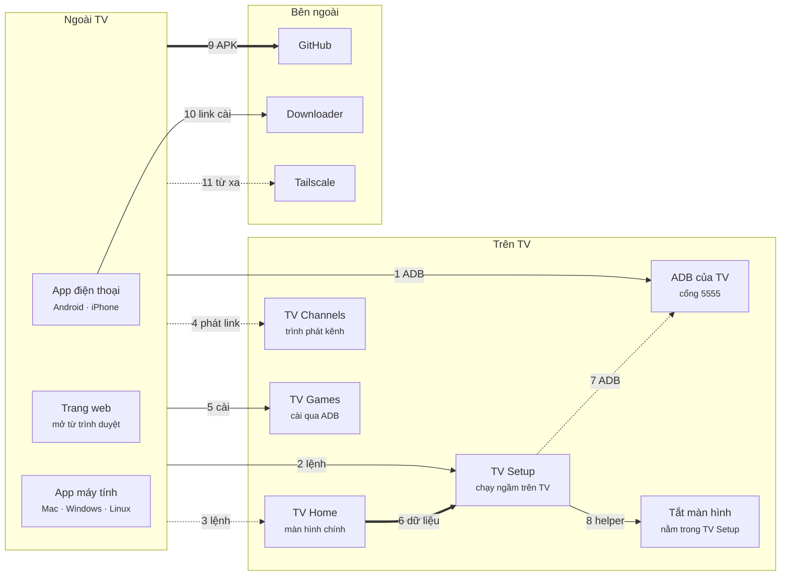
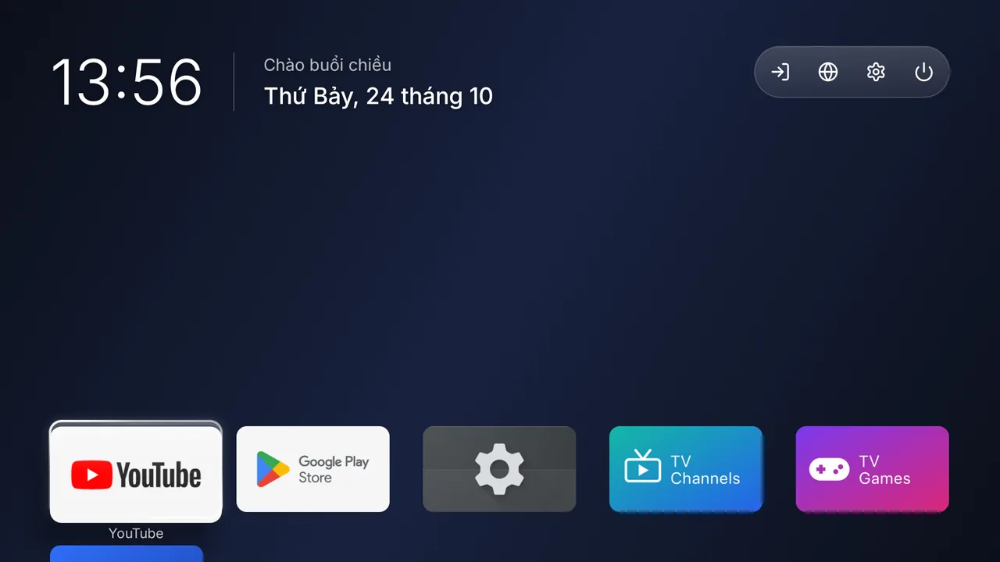
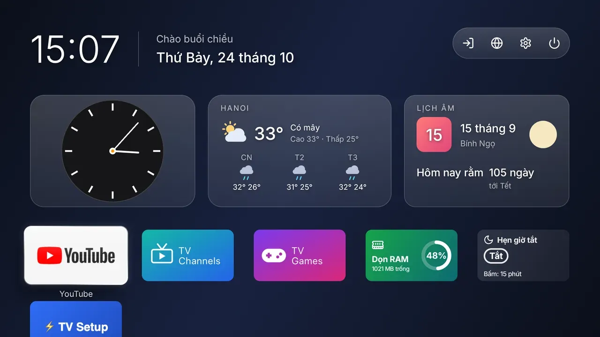
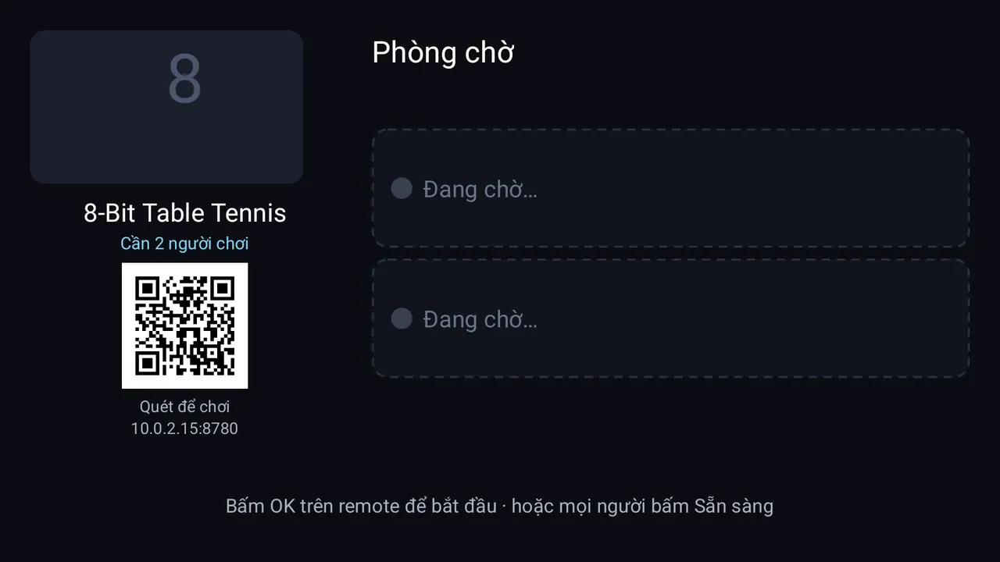
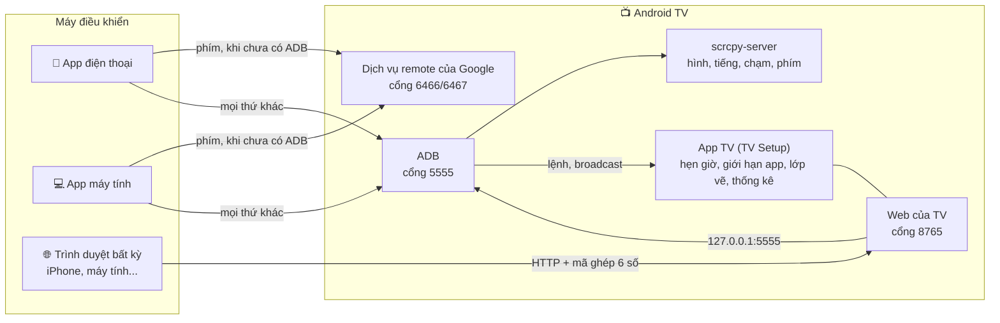
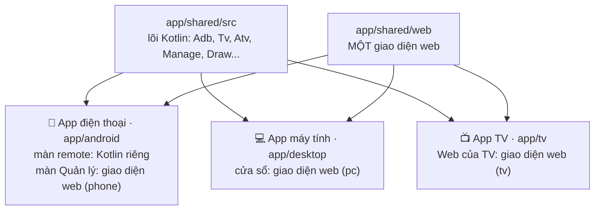

# tv-remote

**Tiếng Việt** · [English](README.md) · 🌐 [tvremote.pages.dev](https://tvremote.pages.dev) · 📖 [Hướng dẫn](https://tvremote.pages.dev/guide)

<!-- aio-desktop-badge:start -->
[](https://fbaio.org/#/desktop)
<!-- aio-desktop-badge:end -->

**Remote TV trên điện thoại hoặc máy tính. Không máy chủ, không tài khoản, không dây cáp.**

Điều khiển Android TV / Google TV (và TV LG, Samsung, Roku, Hisense / Toshiba VIDAA) từ điện thoại Android, máy tính Mac / Windows / Linux hoặc trình duyệt bất kỳ, kể cả iPhone. Mọi thứ đi thẳng tới TV qua Wi-Fi.

<table>
<tr>
<td align="center"><br><sub>App điện thoại</sub></td>
<td align="center"><br><sub>Web của TV</sub></td>
<td align="center"><br><sub>App máy tính</sub></td>
</tr>
</table>

Đã chạy thật với Sony BRAVIA (Android 9). TV hãng khác chưa thử. TV LG, Samsung, Roku, VIDAA: **thử nghiệm**, VIDAA chưa thử trên TV thật.

**Đi tới:** [Tải về](#tải-về) · [Các app nối nhau](#các-app-kết-nối-với-nhau-thế-nào) · [Thêm app](#thêm-app-cho-tv) · [Bắt đầu nhanh](#bắt-đầu-nhanh) · [Hướng dẫn](#hướng-dẫn) · [Trợ giúp](#trợ-giúp) · [Cho người sửa code](#cho-người-sửa-code)

## Bạn được gì

- **Remote** có mũi tên, âm lượng, kênh, app, gõ chữ, giọng nói; **hình TV** ngay trên máy bạn, có chạm và tiếng.
- **Vẽ hoặc nhắn** lên màn hình TV, **đang phát**, clipboard của TV, tắt màn hình vẫn nghe nhạc, giảm độ sáng hoặc lọc ánh sáng xanh.
- **Ứng dụng, tệp, sức khỏe** (RAM, tốc độ mạng của chính TV), quản lý từ điện thoại.
- **Hẹn giờ tắt, giờ đi ngủ, giới hạn app, giới hạn âm lượng, khóa app bằng PIN**: chạy ngay trên TV nên các máy khác tắt vẫn hoạt động.
- **Cảnh** (nhiều bước một chạm), widget và ô Cài đặt nhanh, tay cầm, Home Assistant và Phím tắt Siri, bot Telegram của bạn.
- **TV Home** (màn hình chính không quảng cáo), **TV Channels** (kênh miễn phí), **TV Games** (game retro và web, điện thoại làm tay cầm): xem [Thêm app](#thêm-app-cho-tv).
- **Tối ưu TV**: nhanh hơn, nhẹ hơn, hoàn tác được.

Mọi tính năng kèm ảnh chụp: [tvremote.pages.dev](https://tvremote.pages.dev).

## Tải về

| Bạn có | Dùng | Tải | Mã Downloader |
|---|---|---|---|
| Điện thoại Android | **App điện thoại** (*TV Remote*) | [tv-remote.apk](https://github.com/HoangTran0410/tv-remote/releases/latest/download/tv-remote.apk) | **`2973135`** |
| iPhone, hoặc trình duyệt bất kỳ | **Web của TV**: cài **App TV** (*TV Setup*) lên TV, mở `http://<IP của TV>:8765` | [tv-setup.apk](https://github.com/HoangTran0410/tv-remote/releases/latest/download/tv-setup.apk) | **`2397346`** |
| Mac | **App máy tính** (*TV Remote*, khoảng 20 MB) | [TV-Remote-mac.zip](https://github.com/HoangTran0410/tv-remote/releases/latest/download/TV-Remote-mac.zip) | |
| Windows 10 / 11 | **App máy tính** | [TV-Remote-windows-x64.zip](https://github.com/HoangTran0410/tv-remote/releases/latest/download/TV-Remote-windows-x64.zip) | |
| Linux | **App máy tính** | [x64](https://github.com/HoangTran0410/tv-remote/releases/latest/download/TV-Remote-linux-x64.tar.gz) · [arm64](https://github.com/HoangTran0410/tv-remote/releases/latest/download/TV-Remote-linux-arm64.tar.gz) | |
| Tùy chọn, trên TV | TV Home · TV Channels · TV Games | [tv-home.apk](https://github.com/HoangTran0410/tv-remote/releases/latest/download/tv-home.apk) · [tv-channels.apk](https://github.com/HoangTran0410/tv-remote/releases/latest/download/tv-channels.apk) · [tv-games.apk](https://github.com/HoangTran0410/tv-remote/releases/latest/download/tv-games.apk) | **`4356026`** · **`8135635`** · **`2294968`** |

Mã nhập trong app **Downloader** trên TV, luôn trỏ tới bản mới nhất. Ba nơi điều khiển dùng chung một mã nguồn nên hoạt động giống nhau.

## Các app kết nối với nhau thế nào

Mỗi mũi tên là một đường nối giữa hai app: app này cần gì ở app kia và đi bằng đường nào. Nét liền: app báo khi thiếu; nét đứt: báo một phần; nét đậm: không báo. Cùng sơ đồ có logo, bảng từng đường nối và cách cài mỗi app: [tvremote.pages.dev/apps](https://tvremote.pages.dev/apps).

<!-- apps-map:start -->

<!-- apps-map:end -->

## Thêm app cho TV

Miễn phí, không quảng cáo, app nào riêng app đó: chỉ cài app bạn cần, từ app điện thoại / máy tính (tab TV) hoặc bằng Downloader (mã ở trên).

### 🏠 TV Home

<table>
<tr>
<td align="center" width="50%"><br><sub>TV Home gọn</sub></td>
<td align="center" width="50%"><br><sub>TV Home có widget</sub></td>
</tr>
</table>

Là màn hình chính thay cho Google TV: không quảng cáo, không hàng gợi ý, 0,2 MB.

- Đồng hồ, ba biểu tượng tròn (nguồn vào, mạng, cài đặt) trong một viên kính, rồi một lưới app với app yêu thích đứng đầu. Ẩn app không muốn trẻ con thấy.
- Widget tùy chọn: hệ thống (RAM, bộ nhớ, IP), thời tiết, lịch âm, lịch tháng, app dùng nhiều và giới hạn, hẹn giờ tắt, ghi chú.
- Hình nền hoặc ảnh của bạn, đồng hồ 12/24 giờ, mức hiệu ứng.
- Chỉnh từ điện thoại / máy tính (tab TV → 🏠 → *Tùy chỉnh TV Home*) hoặc ngay trên TV bằng remote. *Tùy chỉnh → Telegram* hiện mã QR ghép bot Telegram của bạn.
- *Tối ưu TV* tự đặt nó làm màn hình chính; *Về launcher của TV* là trả lại như cũ.

### 📺 TV Channels

<p align="center"><br><sub>TV Channels</sub></p>

Xem kênh truyền hình miễn phí trên TV.

- Danh sách công khai của iptv-org theo nước, thể loại, cộng các kênh miễn phí của VieON, có lịch phát sóng (kênh VN). Kênh hỏng thì tự sang nguồn khác.
- Kênh yêu thích, nhóm tự tạo, ghim kênh ra màn hình chính; quản lý từ điện thoại, máy tính hoặc trang web của TV (*Quản lý kênh*).
- Tìm kênh theo tên ở mọi nước; mở kênh theo tên từ điện thoại: gõ hoặc nói "mở kênh VTV1".
- Nhắc chương trình: OK trên chương trình sắp chiếu thì có 🔔; trước giờ chiếu 2 phút hiện thẻ nhắc (OK = xem, Back = bỏ qua), cả khi đang ở app khác. Ngôn ngữ: theo TV, Tiếng Việt hoặc English.
- Cài: tab TV → 📺 *Kênh TV* → Cài.

### 🎮 TV Games

<p align="center"><br><sub>TV Games</sub></p>

Chơi game retro và game web trên TV, dùng điện thoại làm tay cầm.

- Game retro (libretro core) và game web; app gợi ý sẵn game homebrew miễn phí.
- Tối đa 4 điện thoại làm tay cầm: quét QR trên TV, không cần ADB hay TV Setup.
- Game bài và cờ (Tiến lên, Bài màu, Cờ tỷ phú, Cờ cá ngựa…) phỏng theo [gamehub24](https://gamehub24.pages.dev): bài của ai nằm trên điện thoại người đó.
- Cài, mở và cập nhật từ app điện thoại / máy tính: tab **TV** → thẻ **Game trên TV** (chỉ cần ADB để cài).

## Bắt đầu nhanh

**Cần có:** một Android TV / Google TV cùng Wi-Fi với điện thoại hoặc máy tính, và remote của chính TV trong vài phút đầu.

1. **Trên TV, bật ADB** (một lần; tên menu dưới đây là trên Sony, hãng khác hơi khác): Cài đặt → Tùy chọn thiết bị (Google TV, Chromecast: Hệ thống) → Giới thiệu → bấm OK 7 lần vào **Bản dựng** → quay lại → Tùy chọn nhà phát triển → **Gỡ lỗi ADB** (có TV ghi "Gỡ lỗi USB"). Nên bật: Cài đặt → Mạng và Internet → **Khởi động từ xa**, để sau này còn bật lại được TV từ xa.
   Box nhà mạng (FPT, Viettel…): đừng bấm 7 lần, box có thể đòi mật khẩu hoặc khóa máy. Không bật được ADB? Sang bước 2 bằng Downloader: TV Setup mở thẳng chỗ bật. App máy tính có nút **🧭 Bật ADB giúp tôi**, app điện thoại có trợ lý tương tự.
2. **Cài app bạn chọn** ([Tải về](#tải-về)):
   - **App điện thoại:** mở app, bấm **Quét Wi-Fi** rồi chọn TV, hoặc gõ IP.
   - **App máy tính:** giải nén, mở, chọn TV trong danh sách.
   - **Web của TV / iPhone:** cài TV Setup lên TV (các bước bên dưới), quét **mã QR** nó hiện bằng camera điện thoại, nhập **mã 6 số** hiện trên TV.
3. **Cho phép trên TV.** Lần đầu TV hỏi **"Cho phép gỡ lỗi USB?"**: tích **Luôn cho phép** rồi OK. Cần một người ở cạnh TV; app hiện màn "Nhìn lên TV" và tự đóng khi TV đã cho phép.

Xong. TV sẵn sàng thì vào thẳng tab Remote. Chưa có ADB thì app điện thoại và app máy tính vẫn bấm phím được (ghép bằng mã 6 ký tự TV hiện).

<p align="center"></p>

<details>
<summary><b>Cài TV Setup bằng mã Downloader</b> (chỉ cần remote của TV)</summary>

1. Trên TV mở **CH Play**, tìm và cài **Downloader** (của AFTVnews, biểu tượng màu cam).
2. Mở Downloader. Nó xin quyền truy cập tệp thì chọn **Cho phép**.
3. Ở ô nhập địa chỉ, gõ mã **`2397346`** rồi chọn **Go** (không có Downloader: mở `go.aftvnews.com/<mã>` trong trình duyệt cũng tải được).
4. TV hỏi cài đặt: chọn **Cài đặt**. TV báo chưa cho phép cài từ nguồn này: bật cho Downloader, bấm Quay lại, rồi chọn Cài đặt.
5. Mở **TV Setup**. Chưa bật Gỡ lỗi ADB thì app chỉ cách và mở thẳng Tùy chọn nhà phát triển.
6. Quét **mã QR** bằng camera điện thoại, nhập **mã 6 số** hiện trên TV. Xong.

Các mã khác dùng y hệt: app điện thoại `2973135`, TV Home `4356026`, TV Channels `8135635`, TV Games `2294968`.
</details>

<details>
<summary><b>Xem IP của TV ở đâu</b></summary>

- Trên TV: Cài đặt → Mạng và Internet → bấm tên Wi-Fi đang kết nối → **Địa chỉ IP** (dạng `192.168.1.88`).
- IP Tailscale (dạng `100.x.x.x`): mở app Tailscale trên TV, hoặc xem ở [login.tailscale.com/admin/machines](https://login.tailscale.com/admin/machines).
- App TV Setup cũng hiện cả hai IP ngay trên TV.
</details>

<details>
<summary><b>Khi không ở nhà mà TV lại hỏi</b> (TV quên máy này, Android 11+ tự thu hồi sau 7 ngày không dùng)</summary>

- **Tự động:** app điện thoại và app máy tính, mỗi lần đã kết nối được ADB, tự xin TV Setup một "thẻ". Lần sau TV hỏi, chúng nhờ TV Setup bấm cho phép, không cần ai ở TV. TV Setup chỉ bấm khi **mã khóa trong hộp hỏi trùng mã của chính máy đang xin**, và hiện thông báo trên TV mỗi lần.
- **Bấm tay:** trang nào đang có ADB hiện dải báo "TV đang hỏi... cho một thiết bị" kèm mã và nút **Cho phép / Từ chối**. Chỉ cho phép khi mã trùng với mã app TV Remote hiện lúc chờ.
- Máy chưa từng kết nối vẫn phải có người ở TV. Đó là chủ ý, để người lạ không vào được.
</details>

## Hướng dẫn

Mở mục bạn cần.

<details>
<summary><b>So sánh các app</b> (mỗi nơi làm được gì, TV LG / Samsung / Roku / VIDAA)</summary>

Tên gọi dùng khắp nơi: **App điện thoại** và **App máy tính** (đều tên *TV Remote*), **App TV** (*TV Setup* trên TV: hẹn giờ, giới hạn app, vẽ, thống kê, Tailscale), **Web của TV** (trang App TV phát ở cổng 8765, mở từ trình duyệt nào cũng được sau khi nhập mã 6 số; cũng hiện trên màn hình TV là *Quản lý trên TV*).

| | App điện thoại | Web của TV | App máy tính |
|---|---|---|---|
| Remote, xem và chạm hình TV, ✏️ vẽ, 🖼️ đưa ảnh, 💬 lời nhắn lên TV | ✓ | ✓ | ✓ |
| ▶️ Đang phát, 📋 clipboard của TV, tắt màn hình vẫn nghe, 🔅 giảm độ sáng | ✓ | ✓ | ✓ |
| 🔊 Giới hạn âm lượng theo giờ, hẹn giờ tắt, giờ đi ngủ, giới hạn app, 🔒 khóa app bằng PIN | ✓ | ✓ | ✓ |
| 🎧 Nghe tiếng TV | ✓, cả khi tắt màn hình | ✓, khi trang đang mở | ✓, chất lượng cao |
| Ứng dụng, Tệp, Sức khỏe, Tự động, Thiết lập | ✓ | ✓ | ✓ |
| Chất lượng hình *Nét nhất* | | | ✓ |
| Nhiều TV, đổi TV | ✓ | chỉ TV đó | ✓ |
| Bật TV khi đã tắt hẳn (Wake-on-LAN) | ✓ | | ✓ |
| Bấm phím khi TV chưa cho ADB | ✓ | | ✓ |
| Remote hồng ngoại (đèn IR của điện thoại, không cần mạng) | ✓ | | |
| Widget, ô Cài đặt nhanh, phím âm lượng của máy | ✓ | | |
| 🎮 Tay cầm chơi game | ✓ | ✓ | ✓ |
| Link cho Home Assistant, Phím tắt (Siri) | | ✓ | ✓ |
| Bot Telegram | cần TV Setup | cài đặt tại đây | cần TV Setup |
| Không cần cài gì trên máy điều khiển | | ✓ | |
| TV LG, Samsung, Roku, VIDAA | ✓ | | ✓ |

**TV LG, Samsung, Roku, VIDAA** (thử nghiệm, chưa thử trên TV thật): tìm thấy khi quét mạng, điều khiển không cần ADB. Lần đầu chọn Cho phép trên TV (VIDAA: gõ mã 4 số). Xem hình, tệp, sức khỏe, hẹn giờ cần Android TV.

| | LG | Samsung | Roku | VIDAA (thử nghiệm) |
|---|:-:|:-:|:-:|:-:|
| Phím, gõ chữ, mở app, bật TV, cảnh | ✓ | ✓ | ✓ | ✓ |
| Đổi nguồn vào | ✓ | | ✓ | ✓ |
| Âm lượng theo số | ✓ | | | ✓ |
| Link YouTube, tắt màn hình | ✓ | | | |

Muốn TV Samsung (Tizen) có màn hình chính gọn như TV Home: [arn0-tv](https://github.com/NelsonEU/arn0-tv) (dự án riêng, làm cho một TV Q70B, cài qua Developer Mode).
</details>

<details>
<summary><b>App điện thoại</b></summary>

Cài `tv-remote.apk`, mở app, bấm **Quét Wi-Fi** rồi chọn TV, hoặc gõ IP. TV chưa bật ADB thì app vẫn bấm phím được sau khi ghép mã, và dẫn từng bước tới khi cài xong TV Setup. Phím âm lượng của điện thoại chỉnh âm lượng TV; widget, ô Cài đặt nhanh và phím tắt điều khiển TV dùng gần nhất mà không cần mở app. App tự báo khi có bản mới.
</details>

<details>
<summary><b>Web của TV</b> (trình duyệt nào cũng được, kể cả iPhone)</summary>

1. Cài TV Setup lên TV: [mã Downloader `2397346`](#bắt-đầu-nhanh), USB, hoặc để app điện thoại / app máy tính cài giúp.
2. Mở **TV Setup** trên TV, chọn "Luôn cho phép" khi TV hỏi.
3. Trên điện thoại hoặc máy tính mở địa chỉ TV Setup hiện (`http://<IP của TV>:8765`; hoặc quét mã QR của nó).
4. Nhập **mã 6 số** TV hiện ra. Từ đó thiết bị ấy vào thẳng.

- **iPhone:** trong Safari bấm Chia sẻ → "Thêm vào MH chính" để có biểu tượng như một app (mở từ biểu tượng thì nhập mã ghép thêm một lần).
- **Không có điện thoại hay máy tính?** Trên TV chọn **Quản lý trên TV**: các tab Ứng dụng, Tệp, Sức khỏe, Tự động, Thiết lập hiện ngay trên TV, dùng remote của TV để chọn (Back để thoát).
- Trên TV, app còn có **Tối ưu TV** / **Hoàn tác**, **Tailscale**, **Cập nhật**, bật/tắt remote qua web, **Hủy ghép**. Trang tự chạy lại khi TV khởi động.
- HTTP thường, không mã hóa: **đừng mở cổng 8765 ra Internet**; ở ngoài nhà hãy đi qua Tailscale.
- Cần TV mở ADB ở cổng 5555. Một số Google TV đời mới chỉ có "Gỡ lỗi không dây" kiểu ghép mã có thể không dùng được.
- Cũng cài được trên điện thoại / máy tính bảng Android (giao diện một cột), để điều khiển chính máy đó từ trình duyệt khác: ADB phải mở cổng 5555 (điện thoại thường chỉ qua cáp: `adb tcpip 5555` một lần, khởi động lại thì làm lại). Tối ưu TV không chạy trên máy không phải TV.
</details>

<details>
<summary><b>App máy tính</b> (Mac, Windows, Linux)</summary>

Một app có cửa sổ riêng, khoảng 20 MB, không cần cài Python, adb hay gì thêm.

- **Mac:** kéo **TV Remote** vào Applications rồi mở. Mac báo “chưa xác minh nhà phát triển” thì vào Cài đặt hệ thống → Quyền riêng tư & Bảo mật → **Vẫn mở** (chỉ lần đầu).
- **Windows:** chạy **`TV Remote.exe`**. Windows hiện “đã bảo vệ PC của bạn” thì bấm **Thông tin bổ sung → Vẫn chạy**.
- **Linux:** chạy `tv-remote/bin/tv-remote`. Cửa sổ cần gói `libwebkit2gtk-4.1-0` (Ubuntu 22.04 trở lên thường có sẵn); thiếu thì app mở trong trình duyệt.
- Lần đầu: chọn TV trong danh sách (tự quét mạng lần đầu) hoặc gõ IP; chọn Luôn cho phép trên TV. TV sẵn sàng thì vào thẳng tab Remote; chưa thì tab **Thiết lập** liệt kê các bước có dấu ✓: ADB → Tailscale (tùy chọn) → ghép nút remote (mã 6 ký tự) → Lưu. Nút **📺 Đổi TV** quay về danh sách.
- **Cập nhật:** app tự tìm bản mới, tải sẵn rồi báo; **Cập nhật** là tự thay và mở lại, **Để sau** thì cài khi đóng app. TV, mã ghép và cảnh đã lưu giữ nguyên. App nằm ở thư mục không ghi được (Program Files, hoặc Tải về trên Mac) thì nút thành **Tải bản mới**.
- Đóng cửa sổ (hoặc ⏻ Tắt trong 🛠️ Cài đặt) là app dừng hẳn, không chạy ngầm. App chỉ nghe ở `127.0.0.1`.
- **Khi ADB đóng**, chỉ còn nút bấm, nguồn, âm lượng từng nấc và đánh thức; trang ghi rõ và có nút "Thử kết nối lại".
</details>

<details>
<summary><b>Tính năng nên biết</b></summary>

- **Chất lượng hình** 240p tới 960p (thấp thì nhẹ cho TV và mạng); App máy tính có thêm *Nét nhất* (làm TV chậm hơn). *Ảnh chụp* tải từng ảnh. Netflix... hiện màu đen (video có bản quyền).
- **▶️ Đang phát:** TV đang phát gì (tên, kênh, ca sĩ), thanh tua, tạm dừng hoặc qua bài. Cần ADB; app không báo thời lượng thì không có thanh tua.
- **📋 Clipboard của TV** (*Mở trên TV* → *Clipboard của TV*): xem chữ TV đang sao chép, hoặc gửi chữ lên TV và dán vào ô đang gõ.
- **✏️ Vẽ lên TV** (nút ✏️ cạnh hình; app điện thoại: *Vẽ lên TV* trong Thêm phím): nét vẽ hiện trên TV, đè lên mọi app, tự mất sau 10 phút hoặc bấm 🗑. **💬 Lời nhắn:** một câu chữ to trên TV. Cần TV Setup.
- **📲 Chia sẻ** (Thêm phím → *Chia sẻ*): mã QR cho điện thoại khác mở ngay remote của TV trên trình duyệt (quét được 1 lần trong 10 phút; sau đó dùng tới khi gỡ ở Thiết bị đã ghép; cần TV Setup; **Toàn quyền**, **Chỉ remote** hoặc **Chỉ xem**), và mã QR tải app điện thoại. Qua Tailscale thì điện thoại quét phải cùng Wi-Fi với TV.
- **Tắt / bật màn hình** (*Hẹn giờ tắt* → *Tắt / bật màn hình*): màn hình đen, nhạc vẫn phát, vẫn xem hình và bấm phím được. **🔅 Giảm độ sáng** (cùng menu): phủ màu Tối, Lọc xanh, Vàng, Nâu cổ, Đỏ đêm hoặc Xanh lên mọi app, độ mạnh 5–90%. Cần TV Setup.
- **🔒 Khóa app bằng PIN** (tab Tự động): mở app đã khóa thì TV hỏi PIN; sang app khác hoặc TV tắt là khóa lại. **🔊 Giới hạn âm lượng:** chọn khoảng giờ và mức tối đa (vd 22:00 – 06:00 tối đa 30%); ai tăng quá thì TV hạ lại và báo vì sao. TV mà âm lượng do loa ngoài giữ (qua HDMI) thì không giới hạn được. Cần TV Setup.
- **📱 App đang chạy** (tab Sức khỏe): app nào đang chạy, chạy ngầm, tốn bao nhiêu RAM; ⏹ Dừng để tắt một app (🔒 Cần giữ: màn hình chính, bàn phím, phần của Android, TV Remote, Tailscale). **🧹 Báo khi RAM đầy** (tab Tự động, mặc định tắt): RAM quá 80–95% thì TV hiện Dọn RAM / Xem app / Bỏ qua. **⚡ Đo tốc độ mạng** (Sức khỏe → 📶 Mạng): độ trễ, tải xuống, tải lên của chính TV.
- Bàn phím ảo trên TV không bấm được bằng chuột: gõ bằng bàn phím máy tính; chữ có dấu thì gõ trong ô "Bàn phím".
</details>

<details>
<summary><b>Dùng khi khác mạng (Tailscale)</b></summary>

Đừng mở TV ra Internet; dùng **Tailscale**. Làm một lần, lúc đang cùng Wi-Fi với TV:

1. Tab **Thiết lập** → **⚡ Cài và đăng nhập Tailscale** (app điện thoại: nút ô lưới → Thiết lập; trên TV: nút **Tailscale** trong TV Setup).
2. Chờ khoảng nửa phút: TV tự tải Tailscale bản chính thức (kiểm checksum), cài, bỏ qua hộp hỏi VPN, bật lên và lấy link đăng nhập.
3. Bấm **🔑 Mở trang đăng nhập Tailscale** (hoặc quét mã QR), đăng nhập tài khoản Tailscale (chưa có thì tạo miễn phí), bấm **Connect**. Không phải gõ gì trên TV.
4. Nên làm: ở [trang quản trị Tailscale](https://login.tailscale.com/admin/machines), menu ⋯ của TV → **Disable key expiry**, nếu không khoảng 180 ngày sau TV bị đăng xuất.
5. Cài Tailscale trên máy điều khiển (cùng tài khoản), rồi dùng IP `100.x.x.x` của TV. Nút **Lưu** của App máy tính tự chuyển sang IP này.

<p align="center"></p>

Vì sao không gửi thẳng tài khoản từ điện thoại sang TV? Tailscale chỉ nhận đăng nhập qua trang web của nó (Google, Microsoft...) hoặc khóa cấp qua phần mềm quản lý thiết bị doanh nghiệp, thứ TV gia đình không có. Gửi link là cách ít bước nhất mà không đưa mật khẩu cho app nào.

**Người ở nhà chỉ có remote TV, người hỗ trợ ở xa:** ở TV, bật Gỡ lỗi ADB, cài TV Setup (hoặc nhờ người hỗ trợ cài qua "Bật ADB giúp tôi"), mở TV Setup, bấm **Tailscale**. Chụp mã QR gửi cho người hỗ trợ; họ quét bằng điện thoại đã đăng nhập Tailscale, bấm Connect, rồi kết nối tới IP `100.x` của TV.
</details>

<details>
<summary><b>Khi TV tắt</b></summary>

- **Chế độ chờ (còn mạng):** nút Nguồn hoặc Đánh thức là đủ, kể cả qua Tailscale.
- **Tắt hẳn (mất mạng):** chỉ gói Wake-on-LAN gọi được TV, và phải gửi từ **trong mạng nhà**. App điện thoại và app máy tính tự gửi khi đang cùng mạng với TV. Ở xa, app máy tính nhờ được một máy ở nhà gửi giúp qua SSH: thêm `relay_user`, `relay_host` vào mục của TV trong `tvs.json`.
- Giữ lâu nút nguồn trên remote của TV mở menu tắt hẳn; muốn bật lại từ xa thì chỉ bấm ngắn.
- **Sau khi TV khởi động lại:** Tailscale tự chạy lại nếu đã cài bằng nút Tailscale (hoặc đã chạy Tối ưu TV). ADB không tự mở thì tắt rồi bật lại "Gỡ lỗi ADB".
</details>

<details>
<summary><b>Tay cầm chơi game</b></summary>

Nối tay cầm (Xbox, PlayStation, Bluetooth hay USB) vào **máy đang chạy app**, không phải vào TV, mở màn remote rồi bấm một nút bất kỳ: hiện "Đã nối tay cầm". Giữ mũi tên, âm lượng, kênh thì lặp lại.

| Nút | Đang ở remote | Đang xem hình TV |
|---|---|---|
| D-pad, cần trái | Mũi tên | Mũi tên |
| A / B | OK / Back | Nút A / B của tay cầm |
| X / Y | Phát-dừng / Tắt tiếng | Nút X / Y |
| LB / RB | Giảm / tăng âm lượng | Nút L1 / R1 |
| LT / RT | Lùi / tới kênh | Lùi / tới kênh |
| Start / Select | Home / Menu | Nút Start / Select |

Khi xem hình, game trên TV thấy như có tay cầm cắm vào TV (trễ bằng trễ của hình). Đang gõ chữ hay mở hộp thoại thì tay cầm không gửi gì.
</details>

<details>
<summary><b>Home Assistant và Phím tắt (Siri)</b></summary>

Bấm phím, mở app, chạy cảnh trên TV từ Home Assistant hay Phím tắt của iPhone, trong mạng nhà. Vào 🛠️ Cài đặt → **Home Assistant · Phím tắt** → **Cho dùng** → sao chép đường dẫn. Mã của nó riêng, không phải mã ghép; **Đổi mã mới** thì đường dẫn cũ hết dùng. Chỉ dùng trong nhà, đừng mở ra Internet (ở xa: Tailscale).

- Web của TV (TV Setup): dùng ngay cổng 8765. App máy tính: mở thêm cổng `8766` (cổng app + 1) **chỉ khi đang bật**, chỉ trả lời `/api/hook`. Máy tính ngủ thì không gọi được: cho TV thì dùng TV Setup.
- Mỗi lần gọi một việc: `key=HOME`, `scene=Xem phim`, `app=com.netflix.ninja`, `text=...`, `volume=20` (hay `up` / `down` / `mute`), `power=on|off|toggle`. `GET /api/hook/state` trả `{"on","volume","app"}`. Gọi sai mã 5 lần thì địa chỉ đó bị chặn 1 phút.

Phím tắt: “Lấy nội dung của URL” với đường dẫn đã sao chép. Home Assistant (`configuration.yaml`, mã đặt trong header `x-tvr-hook`):

```yaml
rest_command:
  tv_key:
    url: "http://192.168.1.20:8766/api/hook"
    method: post
    headers:
      x-tvr-hook: "<mã>"
    content_type: "application/json"
    payload: '{"key": "{{ key }}"}'
```

Rồi trong tự động hóa: `action: rest_command.tv_key` với `data: { key: HOME }`.
</details>

<details>
<summary><b>Tối ưu TV và Hoàn tác</b></summary>

Nút **⚡ Tối ưu TV** ở tab Thiết lập của cả ba nơi (và trong app TV Setup trên TV) mở hộp **chọn việc cần làm**; **Hoàn tác** trả lại như cũ. Chạy lại bao nhiêu lần cũng được. Không bắt buộc.

- **Tắt hiệu ứng chuyển cảnh** (tích sẵn).
- **Dùng TV Home làm màn hình chính** (tích sẵn): cài TV Home (0,2 MB) và tắt màn hình chính "Android TV Home" của Google, vốn chiếm nhiều CPU. TV giao diện Google TV mới và box nhà mạng (vd FPT) thì màn hình chính được giữ nguyên.
- **Tắt app đề xuất** (tích sẵn): app hệ thống không dùng, danh sách viết cho Sony BRAVIA và vài app Google; chỉ hiện những app TV đó có.
- **Tắt thêm app khác** (không tích sẵn): mọi app có biểu tượng trên TV, có ô lọc theo tên. App quan trọng (Cài đặt, giao diện hệ thống, bàn phím, Google Play Services, TV Setup, Tailscale...) không bao giờ có trong danh sách.

Sau khi TV cập nhật firmware, TV Setup tự tắt lại những app đã tắt mà bản cập nhật bật lại (và đặt lại TV Home làm màn hình chính); Hoàn tác thì dừng.

| Bạn đã đổi | Cách quay lại |
|---|---|
| **Tối ưu TV** | **Hoàn tác** trong cùng hộp. Không gỡ gì, chỉ tạm ngưng app (không bao giờ app giữ mạng Wi-Fi đã lưu hay cổng HDMI; TV nhớ danh sách ở `/data/local/tmp/tvr-disabled.txt`). TV không hiện màn hình chính: Cài đặt → Ứng dụng → Ứng dụng hệ thống → **Android TV Home** → Bật |
| Máy đã cho phép | Tùy chọn nhà phát triển → **Thu hồi quyền gỡ lỗi USB**, hoặc **Hủy ghép** trong TV Setup |
| Web của TV | Tắt remote qua web trong TV Setup |
| Các app | Gỡ như app thường. App máy tính giữ dữ liệu trong thư mục người dùng |
</details>

## Trợ giúp

<details>
<summary><b>Gặp lỗi</b></summary>

| Hiện tượng | Cách xử lý |
|---|---|
| Không kết nối được | App tự kiểm mạng và cổng của TV rồi nói một lý do kèm cách sửa (TV tắt hay đổi địa chỉ, ADB tắt, chưa cho phép, khác mạng, VPN chặn, đồng hồ sai). Tự xem: cùng mạng với TV chưa? Đã bật Gỡ lỗi ADB chưa? IP đúng chưa? Nhìn TV xem có hộp hỏi cho phép không |
| **ADB: chờ TV cho phép** | Trên TV chọn "Luôn cho phép". Lỡ đóng hộp hỏi (Back, Home, Hủy)? App tự hỏi lại vài lần; web thì bấm "Thử kết nối lại". Không ở nhà: xem "Khi không ở nhà mà TV lại hỏi" |
| **ADB: cổng đóng** | TV đang tắt, hoặc vừa khởi động lại: tắt rồi bật lại "Gỡ lỗi ADB" |
| Bấm nút không ăn (app máy tính) | Chưa ghép nút remote (tab **Thiết lập**), hoặc đang mở hai cửa sổ cho cùng một TV |
| Web của TV hỏi lại mã 6 số | Trên TV đã bấm "Hủy ghép", hoặc trình duyệt đã xóa dữ liệu trang: nhập mã mới |
| Tailscale không ra link đăng nhập | TV phải đang mở màn hình (không ở chế độ chờ) và có Internet. Bấm lại nút; vẫn không được thì mở Tailscale trên TV và quét mã QR nó hiện |
| Hình giật, TV chậm | Chọn chất lượng thấp hơn; tắt hình khi không cần |
| Ở xa không kết nối được | Hai máy có cùng tài khoản Tailscale và đều đang bật không? |
| Netflix... hiện màu đen | Video có bản quyền không chiếu được. Phím, âm lượng, tiếng vẫn chạy |
| Android báo app "có hại" khi cài | Play Protect cảnh báo app lạ có quyền cài APK, và **chặn hẳn** app khai báo dịch vụ trợ năng khi cài từ trình duyệt hoặc Downloader. Từ bản này TV Setup không khai báo dịch vụ nào (hai dịch vụ phím nằm trong app nhỏ *TV Setup Keys*, do TV Setup tự cài lên TV qua ADB) nên cài bằng Downloader được. Bản cũ: cài TV Setup từ App điện thoại hoặc App máy tính (qua ADB, không bị chặn), hoặc tắt quét của Play Protect một lát (Play Store → ảnh đại diện → Play Protect → Cài đặt). Mã nguồn ở ngay repo này; chọn "Vẫn cài" nếu bạn tin |
| TV làm sai | Giới thiệu → 📋 **Gửi nhật ký** (phím đã được che) |
</details>

<details>
<summary><b>TV đã thử</b></summary>

Chỉ Sony BRAVIA (Android 9) do ta tự thử trên TV thật. Còn lại là **chủ TV báo chạy được** (qua issue của [cleanyourtv](https://github.com/Gathin23/cleanyourtv)), ta chưa thử lại.

| Loại | Hãng | Nguồn |
|---|---|---|
| TV | Sony BRAVIA | ta thử |
| TV | TCL, Xiaomi / Mi TV, Hisense (Google TV), Philips (Google TV), OnePlus, BenQ, CHiQ, RCA, SANYO, Toshiba, Insignia, Thomson | chủ TV báo |
| Box | Chromecast with Google TV, NVIDIA Shield, Mi Box S, Mi TV Stick | chủ TV báo |
| Box | Fire TV Stick / Fire TV Edition: remote và ADB chạy, Tối ưu TV không đổi được Home | chủ TV báo |
| Máy chiếu | XGIMI, Epson | chủ TV báo |

TCL Trung Quốc không có Tùy chọn nhà phát triển: Cài đặt → Giới thiệu, bấm Lên, Xuống, Trái, Phải (mỗi lần cần lại). TV chỉ có Gỡ lỗi không dây (không có cổng 5555) được app tìm thấy và ghép bằng mã 6 số.
</details>

<details>
<summary><b>Câu hỏi thường gặp</b></summary>

- **Cần máy chủ hay tài khoản không?** Không. Các app nói chuyện thẳng với TV. Tailscale chỉ cần tài khoản miễn phí khi muốn điều khiển từ xa.
- **An toàn không? Có hỏng TV không?** Dùng cùng cầu nối gỡ lỗi mà dân lập trình app Android vẫn dùng, sau một lần "Cho phép" rõ ràng trên TV. Tối ưu TV chỉ tạm ngưng app và **Hoàn tác** bật lại hết; không gỡ gì.
- **iPhone?** Được, qua Web của TV: cài TV Setup lên TV, mở địa chỉ của nó trong Safari. Không có app iPhone.
- **Không có ADB?** Phím thì được (ghép bằng mã 6 ký tự TV hiện). Hình, ứng dụng, tệp, hẹn giờ cần ADB.
- **TV nào?** Android TV / Google TV là chính. LG, Samsung, Roku, VIDAA ở mức thử nghiệm (phím, gõ chữ, mở app, bật TV, cảnh).
- **Home Assistant, Siri?** Được, xem [hướng dẫn](https://tvremote.pages.dev/guide) và mục "Home Assistant và Phím tắt" ở trên.
- **Hướng dẫn từng bước?** Ở [hướng dẫn sử dụng](https://tvremote.pages.dev/guide), có tìm kiếm. Thay đổi từng bản: [CHANGELOG.md](CHANGELOG.md).
</details>

<details>
<summary><b>Bảo mật</b></summary>

- **ADB qua mạng không có mật khẩu:** máy nào đã được TV "Luôn cho phép" là có toàn quyền trên TV. Chỉ dùng trong mạng bạn tin và qua Tailscale. Thu hồi: Tùy chọn nhà phát triển → Thu hồi quyền gỡ lỗi USB.
- **Ai được nhờ TV Setup cho phép:** chỉ máy đã ghép mã 6 số (mã hiện trên màn hình TV, tức đã có người ở TV) hoặc máy đã có ADB. "Thẻ" cho máy có ADB được phát qua một broadcast chỉ lệnh shell của ADB gửi được, app khác trên TV không lấy được. Mỗi lần cho phép đều so mã khóa và hiện thông báo trên TV. **Hủy ghép** trên TV vô hiệu mọi thẻ.
- **Đừng mở cổng 8765 ra Internet.** Web của TV là HTTP thường trong mạng nhà và đòi mã 6 số hiện trên TV.
- App máy tính chỉ nghe ở `127.0.0.1`, mỗi lần mở có một khóa mới (cửa sổ app và trình duyệt nó mở tự mang khóa). Ngoại lệ duy nhất là cổng Home Assistant · Phím tắt, mở khi bạn bật, chỉ có `/api/hook` với mã riêng. Thư mục `keys` của app (Mac: `~/Library/Application Support/TV Remote`, Windows: `%APPDATA%\TV Remote`, Linux: `~/.local/share/tv-remote`) là chìa khóa ghép với TV: **ai có các file trong đó là điều khiển được TV.** Đừng gửi cho ai.
- **Chủ TV** là người với tới được chính TV: app điện thoại, app máy tính (qua ADB), Quản lý trên TV, và trình duyệt nhập mã 6 số hiện trên TV: toàn quyền. Người được chia sẻ bằng mã QR nhận quyền người chia sẻ chọn: **Toàn quyền**, **Chỉ remote** (phím, gõ chữ, hình, mở app, hẹn giờ tắt, chạy cảnh có sẵn; không cài gỡ, không tệp, không Thiết lập) hoặc **Chỉ xem** (hình TV và đang phát). Chủ TV đổi quyền từng thiết bị trong Thiết lập → Thiết bị đã ghép.
- App điện thoại hỏi trước khi gửi tệp hay đường link mà app khác chia sẻ sang lên TV.
- Chỉ cài APK từ nguồn bạn tin. Bản phát hành được kiểm theo checksum có chữ ký trước khi app tự cập nhật.
</details>

## Cho người sửa code

Tên gọi, bố cục, test và phát hành: [AGENTS.md](AGENTS.md). Công cụ: [dev/README.md](dev/README.md). Vì sao có đoạn code lạ: [dev/DECISIONS.md](dev/DECISIONS.md). Trang giới thiệu: [docs/README.md](docs/README.md).

<details>
<summary><b>Cách hoạt động</b></summary>

Không có máy chủ nào ở giữa: mọi thứ đi thẳng tới TV.



Trong code, ba app dùng chung một lõi Kotlin và một giao diện web. Riêng màn remote của App điện thoại viết bằng Kotlin cho mượt, nên sửa màn remote thì sửa ở hai chỗ: `app/shared/web` và `app/android`.



- **App điện thoại và TV Setup** tự nói giao thức ADB, đẩy `scrcpy-server` lên TV để lấy hình H.264 và gửi chạm, phím. TV Setup nối vào ADB của chính TV (`127.0.0.1:5555`). Trên Web của TV, hình đi qua `/api/video`, trình duyệt phát bằng JMuxer (MSE).
- **App máy tính** (`app/desktop`) dùng chung lõi Kotlin (ADB, scrcpy, giao thức remote), chạy trên Java riêng đóng gói kèm; cửa sổ là WebView của hệ điều hành ([webview](https://github.com/webview/webview), qua JNA). Chưa có ADB: giao thức Android TV Remote v2, cổng 6466/6467.
- **Chữ có dấu:** đưa vào clipboard của TV rồi dán. **Âm lượng:** gọi thẳng `AudioService.setStreamVolume` (Android 9), không được thì `media volume`, không có ADB thì bấm từng nấc. **Nguồn:** phím SLEEP (223) / WAKEUP (224) thay cho POWER, nên bấm lặp không bị đảo trạng thái.
- **Tên và logo app:** hỏi hệ thống của TV; TV Setup hỏi trực tiếp, app điện thoại và app máy tính chép APK của app điện thoại lên `/data/local/tmp` rồi chạy lớp `Meta` bằng `app_process` (app máy tính lưu ở `.cache/apps`).
- **Lịch sử:** TV Setup ghi vào `/sdcard/Android/data/dev.tvremote.setup/files/stats/` (`usage.json` 90 ngày, `samples.jsonl` khoảng 30 ngày); các remote đọc qua ADB. Quyền xem app đang mở được cấp qua ADB.
- **Tailscale một nút** (`Tailscale.kt`): tải APK từ `pkgs.tailscale.com` và kiểm SHA-256, cài qua ADB, `appops set com.tailscale.ipn ACTIVATE_VPN allow` để khỏi hộp hỏi VPN, bật bằng broadcast `CONNECT_VPN`; chưa đăng nhập thì mở app, bấm "Log in" và đọc mã dưới QR bằng `uiautomator dump` (link `https://login.tailscale.com/a/<mã>`).
</details>

<details>
<summary><b>Build, chạy, kiểm tra</b></summary>

Cần JDK 17, Android SDK (có Emulator và Command-line Tools), Node.js, Python 3. Mac và Linux chạy thẳng; Windows dùng Git Bash.

```
app/shared/web/  MỘT giao diện web cho cả ba nơi (App máy tính, Web của TV, màn Quản lý của App điện thoại)
app/shared/src/  lõi Kotlin dùng chung: ADB, hình và tiếng (scrcpy), remote theo hãng TV, /api
app/desktop/     App máy tính (Kotlin JVM; cửa sổ là WebView của hệ điều hành)
app/android/     App điện thoại (màn remote viết bằng Kotlin, màn Quản lý là giao diện web)
app/tv/          App TV (TV Setup) + Web của TV
app/gradle/      build Gradle cho mọi phần Kotlin (mở bằng Android Studio)
dev/  docs/      công cụ · trang giới thiệu
tvs.json, cert.pem, key.pem, *.jks, .cache/      dữ liệu riêng của máy bạn, không đưa lên git
```

| Việc | Lệnh |
|---|---|
| Test giao diện web | `node --test app/shared/tests/ app/games/tests/` |
| Test Kotlin | `cd app/gradle && ./gradlew :shared:testDebugUnitTest :android:testDebugUnitTest :tv:testDebugUnitTest` |
| Build App máy tính | `cd app/gradle && ./gradlew :desktop:installDist` |
| Chạy (cửa sổ / trình duyệt) | `app/desktop/build/install/desktop/bin/desktop --window` · bỏ `--window` thì in link có khóa `?k=` |
| Chạy bản thử, không đụng TV thật | `TVS_FILE=/tmp/x.json TVR_KEYS=/tmp/keys TVR_PASS=testtest app/desktop/build/install/desktop/bin/desktop --port 8769`, mở `http://127.0.0.1:8769/?k=testtest` (curl: header `x-tvr-pass`) |
| Đóng gói cho người dùng | `./gradlew :desktop:packageApp` → `app/desktop/build/package/` |
| APK Android | `app/android/build.sh`, `app/tv/build.sh` → `app/*/build/*.apk` |
| Máy ảo: tạo / bật + build + cài / chỉ cài / đưa về `10.0.2.2` / tắt | `dev/test/emu.sh create` · `emu.sh` · `emu.sh install` · `emu.sh reset` · `emu.sh stop` |

Sửa `app/shared/web` chỉ cần tải lại trang; sửa Kotlin thì build lại. Chạy trong repo, app dùng `tvs.json` và khóa ADB trong `.cache/keys` của repo, tách khỏi bản đã cài. Với máy ảo: TV ảo là **`10.0.2.2`** từ app điện thoại (máy ảo) và **`127.0.0.1`** từ app máy tính (`10.0.2.15` hiện trên TV ảo chỉ có nghĩa bên trong nó); lần đầu chọn Cho phép ở câu "Allow USB debugging?" trên cửa sổ TV ảo. Máy ảo chỉ mở cổng ADB nên phần ghép remote Android TV (không ADB) không thử được. Khác: `dev/test/contrast.py`, `dev/shots/shots.py`.

**Phiên bản:** sáu số, mỗi số chỉ tăng khi phần của nó đổi; `dev/release/release.sh` tự tăng, build và tạo GitHub release; ghi chú bản mới để dưới `## Unreleased` trong `CHANGELOG.md`. **Giữ ba nơi đồng bộ:** sửa gì ở phần điều khiển thì làm ở cả App điện thoại, Web của TV và App máy tính; các phím của màn remote nằm một chỗ: `app/shared/web/remote.json`.

Ghi công: [scrcpy](https://github.com/Genymobile/scrcpy) (Apache-2.0), [JMuxer](https://github.com/samirkumardas/jmuxer) (MIT), [webview](https://github.com/webview/webview) (MIT), [JNA](https://github.com/java-native-access/jna) (Apache-2.0); các game bài và cờ phỏng theo [gamehub24](https://gamehub24.pages.dev).
</details>

Thay đổi từng bản: [CHANGELOG.md](CHANGELOG.md).

## Giấy phép

[MIT](LICENSE)

<!-- aio-desktop:start -->
### 🖥️ AIO Desktop

Xem app này cùng nhiều công cụ, trò chơi miễn phí khác trong **[AIO Desktop](https://fbaio.org/#/desktop)**, màn kiểu Windows/macOS của Social AIO. [▶ Mở AIO Desktop](https://fbaio.org/#/desktop)
<!-- aio-desktop:end -->
