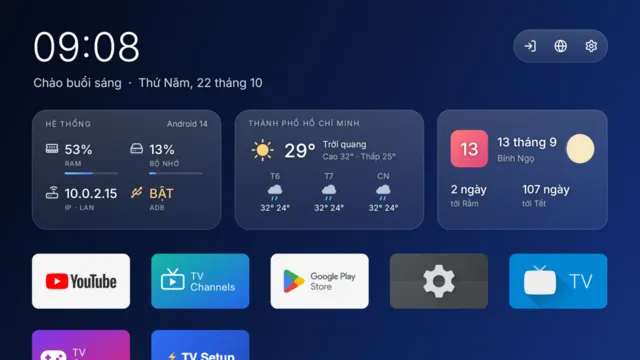
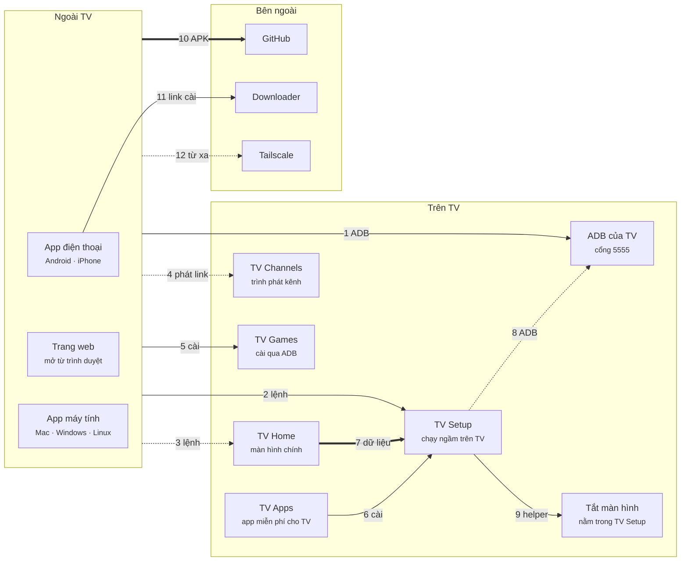

<h1 align="center">TV Remote</h1>

  <b>Remote TV trên điện thoại hoặc máy tính. Không máy chủ, không tài khoản, không dây cáp.</b> 
  Android TV / Google TV · LG · Samsung · Roku · VIDAA &nbsp;·&nbsp; không cần root &nbsp;·&nbsp; mọi thay đổi đều hoàn tác được

  <a href="#tải-về">Tải về</a> ·
  <a href="#bắt-đầu-nhanh">Bắt đầu nhanh</a> ·
  <a href="#tính-năng">Tính năng</a> ·
  <a href="#thêm-app-cho-tv">Thêm app</a> ·
  <a href="https://tvremote.pages.dev/guide">Hướng dẫn</a> ·
  <a href="CHANGELOG.md">Thay đổi</a> ·
  <a href="README.md">English</a>

  
  
  
  
  

<!-- aio-desktop-badge:start -->

<!-- aio-desktop-badge:end -->

<table>
<tr>
<td align="center"> App điện thoại</td>
<td align="center"> Web của TV</td>
<td align="center"> App máy tính</td>
</tr>
</table>

Mọi thứ đi thẳng từ máy bạn tới TV: không qua đám mây, không cần đăng ký. Mọi tính năng kèm ảnh chụp: [tvremote.pages.dev](https://tvremote.pages.dev).

## Tải về

| Bạn có | Dùng | Tải | Mã Downloader |
|---|---|---|---|
| Điện thoại Android | **App điện thoại** (*TV Remote*) | [tv-remote.apk](https://github.com/HoangTran0410/tv-remote/releases/latest/download/tv-remote.apk) | **`2973135`** |
| iPhone, hoặc trình duyệt bất kỳ | **Web của TV**: cài **App TV** (*TV Setup*) lên TV, mở `http://<IP của TV>:8765` | [tv-setup.apk](https://github.com/HoangTran0410/tv-remote/releases/latest/download/tv-setup.apk) | **`2397346`** |
| Mac | **App máy tính** (*TV Remote*, khoảng 20 MB) | [TV-Remote-mac.zip](https://github.com/HoangTran0410/tv-remote/releases/latest/download/TV-Remote-mac.zip) | |
| Windows 10 / 11 | **App máy tính** | [TV-Remote-windows-x64.zip](https://github.com/HoangTran0410/tv-remote/releases/latest/download/TV-Remote-windows-x64.zip) | |
| Linux | **App máy tính** | [x64](https://github.com/HoangTran0410/tv-remote/releases/latest/download/TV-Remote-linux-x64.tar.gz) · [arm64](https://github.com/HoangTran0410/tv-remote/releases/latest/download/TV-Remote-linux-arm64.tar.gz) | |
| Tùy chọn, trên TV | TV Home · TV Channels · TV Games · TV Apps | [tv-home.apk](https://github.com/HoangTran0410/tv-remote/releases/latest/download/tv-home.apk) · [tv-channels.apk](https://github.com/HoangTran0410/tv-remote/releases/latest/download/tv-channels.apk) · [tv-games.apk](https://github.com/HoangTran0410/tv-remote/releases/latest/download/tv-games.apk) · [tv-apps.apk](https://github.com/HoangTran0410/tv-remote/releases/latest/download/tv-apps.apk) | **`4356026`** · **`8135635`** · **`2294968`** · **`1082201`** |

Mã nhập trong app **Downloader** trên TV, luôn trỏ tới bản mới nhất.

## Bắt đầu nhanh

1. **Bật ADB trên TV** (một lần): Cài đặt → Giới thiệu → bấm OK vào **Bản dựng** 7 lần → Tùy chọn nhà phát triển → **Gỡ lỗi ADB**. [Từng bước](https://tvremote.pages.dev/guide#prep-tv) · box nhà mạng (FPT, Viettel…): [đọc trước](https://tvremote.pages.dev/guide#prep-tv).
2. **Mở app** và chọn TV ([điện thoại](https://tvremote.pages.dev/guide#install-phone) · [máy tính](https://tvremote.pages.dev/guide#install-pc) · [iPhone / trình duyệt](https://tvremote.pages.dev/guide#web-iphone): cài [TV Setup](https://tvremote.pages.dev/guide#install-tv), quét mã QR).
3. **Trên TV chọn "Luôn cho phép"** khi TV hỏi [Cho phép gỡ lỗi USB?](https://tvremote.pages.dev/guide#allow-usb)

Chưa có ADB? App điện thoại và app máy tính vẫn bấm phím được sau khi ghép bằng mã TV hiện.

## Tính năng

| Tính năng | Làm được gì | Hướng dẫn |
|---|---|---|
| 🎮 **Remote** | Mũi tên, âm lượng, kênh, app, gõ chữ, giọng nói; giữ phím như remote thật | [→](https://tvremote.pages.dev/guide#remote) |
| 📺 **Hình TV** | Ngay trên máy bạn, có chạm và tiếng; nghe tiếng TV cả khi tắt màn hình điện thoại | [→](https://tvremote.pages.dev/guide#picture) |
| ✏️ **Lên màn hình TV** | Vẽ, gửi ảnh hoặc lời nhắn; đang phát; clipboard của TV; giảm sáng, lọc ánh sáng xanh | [→](https://tvremote.pages.dev/guide#draw) |
| 🔒 **Cho trẻ em** | Hẹn giờ tắt, giờ đi ngủ, giới hạn app, giới hạn âm lượng, khóa app bằng PIN: chạy ngay trên TV | [→](https://tvremote.pages.dev/guide#limits) |
| 📱 **Quản lý TV** | Ứng dụng, tệp, sức khỏe (RAM, tốc độ mạng của chính TV), nhiều TV cùng lúc | [→](https://tvremote.pages.dev/guide#apps) |
| ⚡ **Tối ưu TV** | Nhanh, nhẹ hơn: tắt hiệu ứng, tạm dừng màn hình chính đầy quảng cáo và app không dùng; **Hoàn tác** trả lại hết | [→](https://tvremote.pages.dev/guide#optimize) |
| ⌨️ **Thử phím remote** | Mọi phím TV nhận được, trực tiếp: tên, mã, remote nào, nhấn hay giữ, có bị đổi không | [→](https://tvremote.pages.dev/guide#keyfix) |
| 🎬 **Cảnh và liên kết** | Nhiều bước một chạm, widget, ô Cài đặt nhanh, Home Assistant, Phím tắt Siri, bot Telegram của bạn | [→](https://tvremote.pages.dev/guide#scenes) |
| 🌍 **Khi khác mạng** | Qua Tailscale, cài bằng một nút, không gõ gì trên TV | [→](https://tvremote.pages.dev/guide#away) |
| 📡 **Hãng khác** | LG, Samsung, Roku, VIDAA (thử nghiệm): phím, gõ chữ, mở app, bật TV, cảnh | [→](https://tvremote.pages.dev/guide#brands) |

<b>Mỗi app làm được gì</b>

**App điện thoại** và **App máy tính** (đều tên *TV Remote*), **App TV** (*TV Setup* trên TV), **Web của TV** (trang TV Setup phát ở cổng 8765, mở từ trình duyệt nào cũng được sau khi nhập mã 6 số; cũng có trên TV là *Quản lý trên TV*).

| | App điện thoại | Web của TV | App máy tính |
|---|---|---|---|
| Remote, xem và chạm hình TV, ✏️ vẽ, 🖼️ đưa ảnh, 💬 lời nhắn lên TV | ✓ | ✓ | ✓ |
| ▶️ Đang phát, 📋 clipboard của TV, tắt màn hình vẫn nghe, 🔅 giảm độ sáng | ✓ | ✓ | ✓ |
| 🔊 Giới hạn âm lượng theo giờ, hẹn giờ tắt, giờ đi ngủ, giới hạn app, 🔒 khóa app bằng PIN | ✓ | ✓ | ✓ |
| 🎧 Nghe tiếng TV | ✓, cả khi tắt màn hình | ✓, khi trang đang mở | ✓, chất lượng cao |
| Ứng dụng, Tệp, Sức khỏe, Tự động, Thiết lập | ✓ | ✓ | ✓ |
| Chất lượng hình *Nét nhất* | | | ✓ |
| Nhiều TV, đổi TV | ✓ | chỉ TV đó | ✓ |
| Bật TV khi đã tắt hẳn (Wake-on-LAN) | ✓ | | ✓ |
| Bấm phím khi TV chưa cho ADB | ✓ | | ✓ |
| Remote hồng ngoại (đèn IR của điện thoại, không cần mạng) | ✓ | | |
| Widget, ô Cài đặt nhanh, phím âm lượng của máy | ✓ | | |
| 🎮 Tay cầm chơi game | ✓ | ✓ | ✓ |
| Link cho Home Assistant, Phím tắt (Siri) | | ✓ | ✓ |
| Bot Telegram | cần TV Setup | cài đặt tại đây | cần TV Setup |
| Không cần cài gì trên máy điều khiển | | ✓ | |
| TV LG, Samsung, Roku, VIDAA | ✓ | | ✓ |

## Thêm app cho TV

Miễn phí, không quảng cáo, cài riêng từng cái: từ app điện thoại hoặc máy tính (thẻ TV), hoặc bằng mã Downloader ở trên.

<table>
<tr>
<td align="center" width="50%"> Trước: màn hình chính của Google TV</td>
<td align="center" width="50%"> Sau: TV Home</td>
</tr>
</table>

| App | Là gì | Hướng dẫn |
|---|---|---|
| 🏠 **TV Home** | Màn hình chính không quảng cáo, không hàng gợi ý (0,2 MB): app của bạn, widget, hình nền, chủ đề, ghim kênh / video YouTube từ link, chỉnh từ điện thoại | [→](https://tvremote.pages.dev/guide#home) |
| 📺 **TV Channels** | Kênh truyền hình miễn phí khắp nơi (iptv-org, VieON), lịch phát sóng, nhắc giờ, kênh yêu thích | [→](https://tvremote.pages.dev/guide#channels) |
| 🎮 **TV Games** | Game retro và web, tối đa 4 điện thoại làm tay cầm; bài và cờ, bài của ai nằm trên điện thoại người đó | [→](https://tvremote.pages.dev/guide#games) |
| 📦 **TV Apps** | App miễn phí, mã nguồn mở cho TV (SmartTube, Kodi, VLC, Jellyfin…), kiểm đúng chữ ký nhà làm app, bấm một lần là cài | [→](https://tvremote.pages.dev/guide#tvapps) |

<b>Các app kết nối với nhau thế nào</b>

Mỗi mũi tên là một liên kết giữa hai app. Nét liền: app báo cho bạn khi thiếu; nét đứt: chỉ một phần; nét đậm: chạy âm thầm. Có logo và bảng mọi liên kết: [tvremote.pages.dev/apps](https://tvremote.pages.dev/apps).

<!-- apps-map:start -->

<!-- apps-map:end -->

## TV đã thử

| Loại | Hãng | Nguồn |
|---|---|---|
| TV | Sony BRAVIA (Android 9) | ta tự thử |
| TV | TCL, Xiaomi / Mi TV, Hisense (Google TV), Philips (Google TV), OnePlus, BenQ, CHiQ, RCA, SANYO, Toshiba, Insignia, Thomson | chủ TV báo ([cleanyourtv](https://github.com/Gathin23/cleanyourtv)) |
| Box | Chromecast with Google TV, NVIDIA Shield, Mi Box S, Mi TV Stick, Fire TV (Tối ưu TV không đổi được Home) | chủ TV báo |
| Máy chiếu | XGIMI, Epson | chủ TV báo |
| Hãng khác | LG, Samsung, Roku, VIDAA | thử nghiệm, chưa thử trên TV thật |

## Trợ giúp

| Cần | Xem |
|---|---|
| Có gì không chạy | [Gặp lỗi](https://tvremote.pages.dev/guide#faq-fix) · app tự kiểm tra, nói nguyên nhân và cách sửa |
| TV lại hỏi "Cho phép gỡ lỗi USB?" | [Vì sao và làm gì](https://tvremote.pages.dev/guide#allow-usb) |
| Mọi chủ đề, có tìm kiếm | [Hướng dẫn](https://tvremote.pages.dev/guide) |
| Báo lỗi, góp ý | [Issues](https://github.com/HoangTran0410/tv-remote/issues) |

**Bảo mật:** ADB qua mạng không có mật khẩu, nên chỉ dùng trong mạng tin cậy, khác mạng thì dùng Tailscale. **Không bao giờ mở cổng 8765 ra Internet.** Chỉ máy đã ghép bằng mã hiện trên TV, hoặc máy TV đã cho phép, mới điều khiển được; **Hủy ghép tất cả** trong TV Setup thu hồi hết.

**Quyền riêng tư:** mỗi ngày một ghi chú ẩn danh (model TV, bản Android và app, cái gì chạy được) và lỗi của app, đã xóa IP, tên, khóa; không bao giờ gửi IP, app đã cài, tài khoản, tên Wi-Fi. Tắt ở Cài đặt → Gửi thống kê ẩn danh. [Chi tiết](https://tvremote.pages.dev/guide#privacy).

## Cho người sửa code

Tên gọi, cấu trúc, quy tắc, kiểm tra: [AGENTS.md](AGENTS.md) · cách hoạt động, build, chạy, kiểm tra: [dev/README.md](dev/README.md) · vì sao code trông lạ: [dev/DECISIONS.md](dev/DECISIONS.md) · trang web: [docs/README.md](docs/README.md) · chủ đề TV Home: [THEMES.md](THEMES.md).

**Thêm ngôn ngữ:** các file của nó trong `app/shared/i18n/` (chép `en.json` và `apps/en/`) và một dòng trong `langs.json`; không sửa code. `node --test app/shared/tests/` báo còn thiếu gì.

Ghi công: [scrcpy](https://github.com/Genymobile/scrcpy) (Apache-2.0), [JMuxer](https://github.com/samirkumardas/jmuxer) (MIT), [webview](https://github.com/webview/webview) (MIT), [JNA](https://github.com/java-native-access/jna) (Apache-2.0), [cleanyourtv](https://github.com/Gathin23/cleanyourtv) (danh sách của Tối ưu TV); game bài theo [gamehub24](https://gamehub24.pages.dev). Giấy phép: [MIT](LICENSE).

<!-- aio-desktop:start -->
### 🖥️ AIO Desktop

Xem app này cùng nhiều công cụ, trò chơi miễn phí khác trong **[AIO Desktop](https://fbaio.org/#/desktop)**, màn kiểu Windows/macOS của Social AIO. [▶ Mở AIO Desktop](https://fbaio.org/#/desktop)
<!-- aio-desktop:end -->
