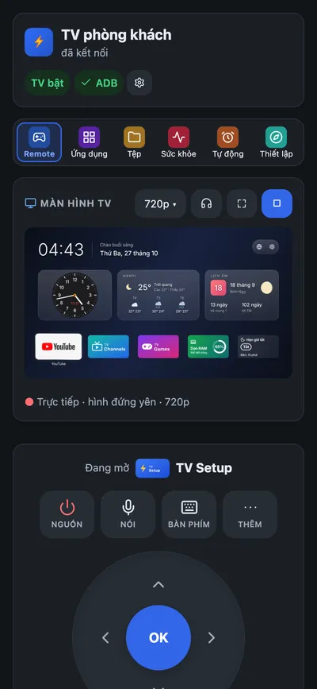
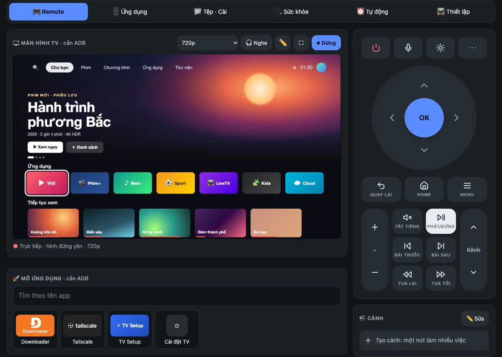
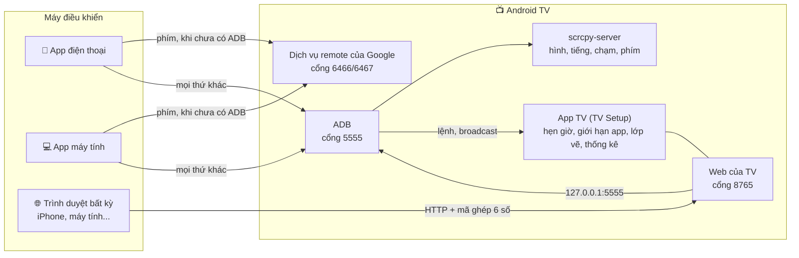
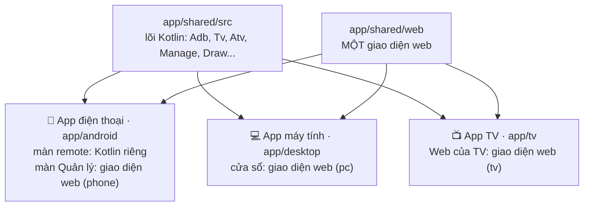
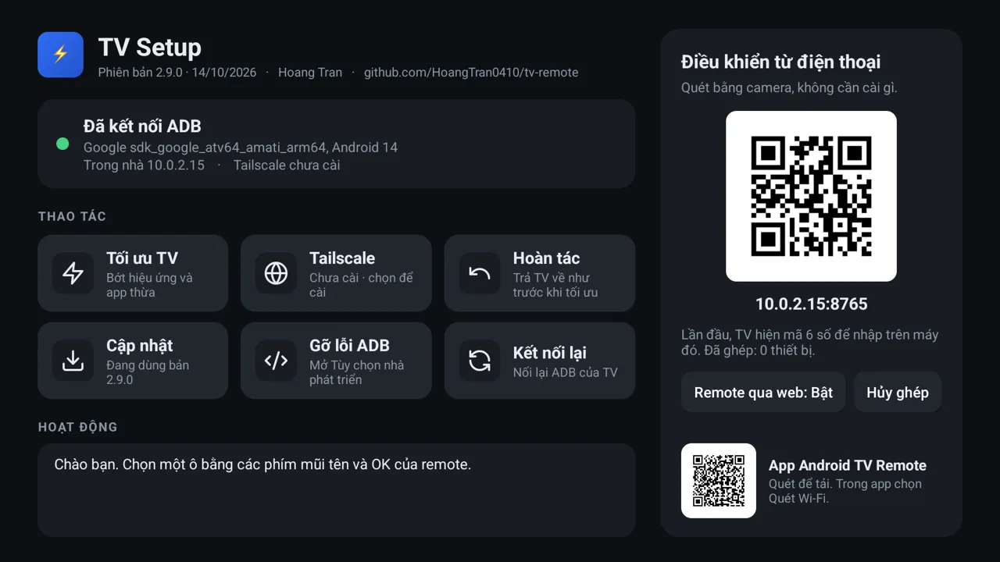
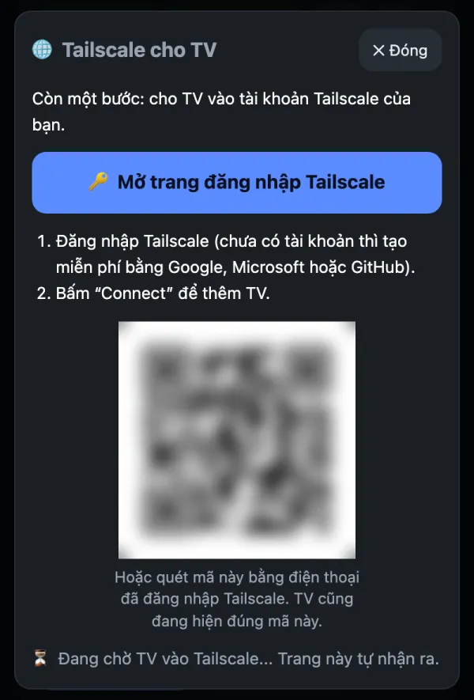
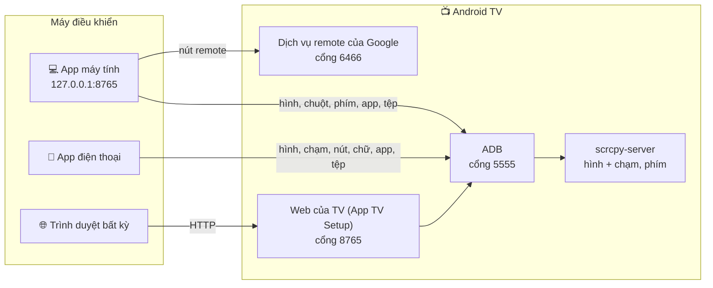

# tv-remote

**Tiếng Việt** · [English](README.md) · 🌐 [tvremote.pages.dev](https://tvremote.pages.dev)

<!-- aio-desktop-badge:start -->
[](https://fbaio.org/#/desktop)
<!-- aio-desktop-badge:end -->

Điều khiển Android TV / Google TV (và TV LG, Samsung, Roku, Hisense / Toshiba VIDAA) từ điện thoại hoặc máy tính, đi thẳng tới TV, không qua máy chủ nào. **Tính năng, ảnh chụp và nút tải: [tvremote.pages.dev](https://tvremote.pages.dev).** README này là hướng dẫn cài đặt, xử lý lỗi và chi tiết kỹ thuật.

Đã chạy thật với Sony BRAVIA (Android 9). TV hãng khác chưa thử. TV LG, Samsung, Roku, VIDAA: **thử nghiệm** ([xem bảng](#ba-app-và-một-trang-web)).

<table>
<tr>
<td align="center"><br><sub>App điện thoại</sub></td>
<td align="center"><br><sub>Web của TV</sub></td>
<td align="center"><br><sub>App máy tính</sub></td>
</tr>
</table>

**Mục lục**

- [Chọn cách dùng](#chọn-cách-dùng)
- [Ba app và một trang web](#ba-app-và-một-trang-web): tên gọi, so sánh, sơ đồ
- [Chuẩn bị TV](#chuẩn-bị-tv)
- [Cài TV Setup bằng mã Downloader](#cài-tv-setup-bằng-mã-downloader)
- Cài và dùng từng cách:
  - [App điện thoại](#1-app-điện-thoại-android)
  - [Web của TV](#2-web-của-tv-qua-app-tv-setup)
  - [App máy tính](#3-app-máy-tính)
- [Dùng khi khác mạng](#dùng-khi-khác-mạng-tailscale)
- [Khi TV tắt](#khi-tv-tắt)
- [Tối ưu TV](#tối-ưu-tv)
- [TV đã thử](#tv-đã-thử)
- [Gặp lỗi](#gặp-lỗi)
- [Bảo mật](#bảo-mật)
- [Chi tiết kỹ thuật](#chi-tiết-kỹ-thuật)

## Chọn cách dùng

| Bạn có | Dùng | Lấy ở đâu |
|---|---|---|
| Điện thoại Android | **App điện thoại** (TV Remote) | `tv-remote.apk` ở [Releases](https://github.com/HoangTran0410/tv-remote/releases), hoặc mã Downloader **`2973135`** |
| Bất kỳ trình duyệt nào, kể cả iPhone | **Web của TV**: cài **App TV** (TV Setup) lên TV, rồi mở `http://<IP của TV>:8765` | Trên TV: app Downloader, mã **`2397346`** ([xem cách cài](#cài-tv-setup-bằng-mã-downloader)) |
| Máy tính (Mac, Windows, Linux) | **App máy tính** (TV Remote) | Tệp cho đúng máy ở [Releases](https://github.com/HoangTran0410/tv-remote/releases/latest) ([xem bảng](#3-app-máy-tính)) |

Trang giới thiệu có [danh sách tính năng](https://tvremote.pages.dev/#features).

## Ba app và một trang web

Trong README, code và trang giới thiệu, các phần luôn được gọi bằng những tên này:

| Tên gọi | Là gì | Code | `data-core` |
|---|---|---|---|
| **App điện thoại** | App Android, tên trên máy là *TV Remote* | `app/android` | `phone` |
| **App máy tính** | App cho Mac, Windows, Linux, tên trên máy là *TV Remote* | `app/desktop` | `pc` |
| **App TV** | App cài trên TV, tên trên TV là *TV Setup*: hẹn giờ, giới hạn app, vẽ, thống kê, Tailscale | `app/tv` | |
| **Web của TV** | Trang web App TV phát ra ở cổng 8765, mở từ trình duyệt nào cũng được sau khi nhập mã 6 số; cũng hiện ngay trên màn hình TV (*Quản lý trên TV*, không có tab Remote) | `app/tv` (`RemoteService`) | `tv` |

**Mỗi nơi làm được gì**

| | App điện thoại | Web của TV | App máy tính |
|---|---|---|---|
| Remote, xem và chạm hình TV, ✏️ vẽ, 🖼️ đưa ảnh, 💬 lời nhắn lên TV | ✓ | ✓ | ✓ |
| ▶️ Đang phát (tên bài, tua, tạm dừng), 📋 clipboard của TV, tắt màn hình vẫn nghe, 🔅 giảm độ sáng | ✓ | ✓ | ✓ |
| 🔊 Giới hạn âm lượng theo giờ (cùng hẹn giờ tắt, giờ đi ngủ, giới hạn app, 🔒 khóa app bằng PIN) | ✓ | ✓ | ✓ |
| 🎧 Nghe tiếng TV | ✓, cả khi tắt màn hình | ✓, khi trang đang mở | ✓, chất lượng cao |
| Ứng dụng, Tệp, Sức khỏe, Tự động, Thiết lập | ✓ | ✓ | ✓ |
| Chất lượng hình *Nét nhất* | | | ✓ |
| Nhiều TV, đổi TV | ✓ | chỉ TV đó | ✓ |
| Bật TV khi TV đã tắt hẳn (Wake-on-LAN) | ✓ | TV tắt thì trang cũng tắt | ✓ |
| Bấm phím khi TV chưa cho ADB | ✓ | | ✓ |
| Remote hồng ngoại (đèn IR của điện thoại, không cần mạng, không cần chọn TV) | ✓ | | |
| Widget, ô Cài đặt nhanh, phím âm lượng của máy | ✓ | | |
| 🎮 Tay cầm chơi game | ✓ | ✓ | ✓ |
| Link cho Home Assistant, Phím tắt (Siri) | | ✓ | ✓, mở cổng riêng khi bật |
| Cần cài gì trên máy điều khiển | app | không, hợp với iPhone | app |
| TV LG, Samsung, Roku, VIDAA | ✓ | | ✓ |

**TV LG, Samsung, Roku, VIDAA** (thử nghiệm, chưa thử trên TV thật). App điện thoại và App máy tính điều khiển không cần ADB, tìm thấy khi quét mạng. Lần đầu chọn Cho phép trên TV (VIDAA: gõ mã 4 số).

| | LG | Samsung | Roku | VIDAA |
|---|:-:|:-:|:-:|:-:|
| Phím, gõ chữ, mở app, bật TV, cảnh | ✓ | ✓ | ✓ | ✓ |
| Đổi nguồn vào | ✓ | | ✓ | ✓ |
| Âm lượng theo số | ✓ | | | ✓ |
| Link YouTube, tắt màn hình | ✓ | | | |

Xem hình, tệp, sức khỏe, hẹn giờ cần Android TV. TV làm sai: Giới thiệu → 📋 Gửi nhật ký.

**Các phần nối với nhau thế nào.** Không có máy chủ nào ở giữa: mọi thứ đi thẳng tới TV.



**Trong code**, ba app dùng chung một lõi Kotlin và một giao diện web. Riêng màn remote của App điện thoại viết bằng Kotlin cho mượt, nên sửa màn remote thì sửa ở hai chỗ: `app/shared/web` và `app/android`.



## Chuẩn bị TV

Làm một lần, bằng remote của TV. Tên menu dưới đây là trên Sony; hãng khác có thể hơi khác.

1. **Bật Tùy chọn nhà phát triển:** Cài đặt → Tùy chọn thiết bị → Giới thiệu → **Bản dựng** → bấm OK 7 lần.
2. **Bật ADB:** Cài đặt → Tùy chọn thiết bị → Tùy chọn nhà phát triển → **Gỡ lỗi ADB** (có TV ghi "Gỡ lỗi USB").
3. **Nên bật đánh thức từ xa:** Cài đặt → Mạng và Internet → **Khởi động từ xa**. Thiếu bước này thì không bật lại được TV từ xa khi nó đã tắt hẳn.

Lần đầu mỗi máy kết nối, TV hỏi "Cho phép gỡ lỗi USB?": tích **Luôn cho phép** rồi OK. Cần một người ở cạnh TV cho việc này. Lúc đó cả ba nơi đều hiện một màn hình lớn "Nhìn lên TV" và tự đóng khi TV đã cho phép.

<details>
<summary><b>Khi không ở nhà mà TV lại hỏi</b> (TV quên máy này, Android 11+ tự thu hồi sau 7 ngày không dùng...)</summary>

- **Tự động:** app điện thoại và app máy tính, mỗi lần đã kết nối được ADB, tự xin TV Setup một "thẻ". Lần sau TV hỏi, chúng nhờ TV Setup bấm cho phép, không cần ai ở TV. TV Setup chỉ bấm khi **mã khóa trong hộp hỏi trùng mã của chính máy đang xin**, và hiện thông báo trên TV mỗi lần cho phép.
- **Bấm tay:** trang nào đang có ADB (Web của TV đã ghép mã, App máy tính, App điện thoại) hiện dải báo "TV đang hỏi... cho một thiết bị" kèm mã và nút **Cho phép / Từ chối**. Chỉ cho phép khi mã trùng với mã mà app TV Remote hiện trong lúc chờ.
- Máy chưa từng kết nối và chưa ghép mã với TV Setup thì vẫn phải có người ở TV. Đó là chủ ý, để người lạ không vào được.
</details>

Bước này **không bắt buộc**: chưa có ADB thì app điện thoại và app máy tính vẫn bấm phím được. TV chưa bật được ADB (box nhà mạng như FPT Play giấu Cài đặt, bấm Bản dựng thì đòi mật khẩu...)? Cài TV Setup bằng [mã Downloader](#cài-tv-setup-bằng-mã-downloader): app đó mở thẳng chỗ bật. App máy tính có nút **🧭 Bật ADB giúp tôi**, app điện thoại có trợ lý tương tự: chỉ dùng nút remote để tự cài TV Setup, hoặc mở Cài đặt TV bằng nhiều cách.

<details>
<summary>Xem IP của TV ở đâu</summary>

- Trên TV: Cài đặt → Mạng và Internet → bấm tên Wi-Fi đang kết nối → **Địa chỉ IP** (dạng `192.168.1.88`).
- IP Tailscale (dạng `100.x.x.x`): mở app Tailscale trên TV, hoặc xem ở [login.tailscale.com/admin/machines](https://login.tailscale.com/admin/machines).
- App TV Setup cũng hiện cả hai IP ngay trên TV.
</details>

## Cài TV Setup bằng mã Downloader

Cách dễ nhất cho người mới: chỉ cần remote của TV, không cần máy tính hay điện thoại Android. Sau đó điện thoại nào (kể cả iPhone) cũng điều khiển được qua trình duyệt.

1. Trên TV mở **CH Play**, tìm và cài **Downloader** (của AFTVnews, biểu tượng màu cam).
2. Mở Downloader. Nó xin quyền truy cập tệp thì chọn **Cho phép**.
3. Ở ô nhập địa chỉ, gõ mã **`2397346`** rồi chọn **Go**.
4. Downloader tải TV Setup bản mới nhất. TV hỏi cài đặt: chọn **Cài đặt**. TV báo chưa cho phép cài từ nguồn này: bật cho Downloader, bấm Quay lại, rồi chọn Cài đặt.
5. Mở **TV Setup**. Chưa bật Gỡ lỗi ADB thì app chỉ cách và mở thẳng Tùy chọn nhà phát triển.
6. TV Setup hiện **mã QR**: quét bằng camera điện thoại, nhập **mã 6 số** hiện trên TV. Xong.

| App | Mã Downloader | Link trực tiếp |
|---|---|---|
| TV Setup (cài trên TV) | **`2397346`** | [tv-setup.apk](https://github.com/HoangTran0410/tv-remote/releases/latest/download/tv-setup.apk) |
| TV Remote (điện thoại Android) | **`2973135`** | [tv-remote.apk](https://github.com/HoangTran0410/tv-remote/releases/latest/download/tv-remote.apk) |

Mã luôn trỏ tới bản mới nhất. Không có Downloader thì mở `go.aftvnews.com/<mã>` trong trình duyệt cũng tải được.

## 1. App điện thoại (Android)

1. Cài `tv-remote.apk` từ [Releases](https://github.com/HoangTran0410/tv-remote/releases) (hoặc mã Downloader `2973135`).
2. Mở app, bấm **Quét Wi-Fi** rồi chọn TV, hoặc gõ IP của TV. TV chưa bật ADB thì app vẫn bấm phím được sau khi ghép mã, và tự dẫn từng bước tới khi cài xong TV Setup.

Phím âm lượng của điện thoại chỉnh âm lượng TV; widget, ô Cài đặt nhanh và phím tắt điều khiển TV dùng gần nhất mà không cần mở app. App tự báo khi có bản mới.

## 2. Web của TV (qua App TV Setup)

Dùng được từ mọi trình duyệt, không cần cài gì trên điện thoại hay máy tính.

1. Cài TV Setup lên TV: [mã Downloader `2397346`](#cài-tv-setup-bằng-mã-downloader), USB, hoặc để app điện thoại / app máy tính cài giúp.
2. Mở **TV Setup** trên TV, chọn "Luôn cho phép" khi TV hỏi.
3. Trên điện thoại hoặc máy tính, mở địa chỉ app hiện trên TV: `http://<IP của TV>:8765`.
4. Nhập **mã 6 số** TV hiện ra. Từ đó thiết bị ấy vào thẳng.

<details>
<summary>Lưu ý về TV Setup</summary>

- **iPhone:** trong Safari bấm Chia sẻ → "Thêm vào MH chính" để có biểu tượng như một app (mở từ biểu tượng thì nhập mã ghép thêm một lần).
- Không cần gõ địa chỉ: app TV Setup hiện mã QR trỏ tới trang này, quét bằng camera điện thoại là mở.
- Trang tự chạy lại khi TV khởi động.
- **Không có điện thoại hay máy tính?** Trên TV chọn **Quản lý trên TV**: các tab Ứng dụng, Tệp, Sức khỏe, Tự động, Thiết lập hiện ngay trên TV, dùng remote của TV để chọn (Back để đóng / thoát). Chạy được cả khi đã tắt remote qua web.
- Trên TV, app còn có: **Tối ưu TV** / **Hoàn tác**, **Tailscale** (tự cài và mở mã đăng nhập), **Cập nhật**, bật/tắt remote qua web, **Hủy ghép** (mọi thiết bị).
- Kết nối là HTTP thường, không mã hóa. **Đừng mở cổng 8765 ra Internet**; ở ngoài nhà hãy đi qua Tailscale.
- Cần TV mở ADB ở cổng 5555. Một số Google TV đời mới chỉ có "Gỡ lỗi không dây" kiểu ghép mã có thể không dùng được.
- **Trên điện thoại / máy tính bảng Android** cũng cài được (giao diện một cột cho màn nhỏ), để điều khiển chính máy đó từ trình duyệt khác. Điều kiện: ADB mở cổng 5555. Điện thoại thường chỉ mở qua cáp: cắm máy tính chạy `adb tcpip 5555` một lần, khởi động lại máy thì phải làm lại. "Gỡ lỗi không dây" của Android 11+ chưa dùng được. Tối ưu TV không chạy trên máy không phải TV.

<p align="center"></p>
</details>

## 3. App máy tính

Một app có cửa sổ riêng, khoảng 20 MB, không cần cài Python, adb hay gì thêm.

| Máy | Tải về |
|---|---|
| Mac (chip Apple và Intel) | [TV-Remote-mac.zip](https://github.com/HoangTran0410/tv-remote/releases/latest/download/TV-Remote-mac.zip) |
| Windows 10 / 11 | [TV-Remote-windows-x64.zip](https://github.com/HoangTran0410/tv-remote/releases/latest/download/TV-Remote-windows-x64.zip) |
| Linux x64 / arm64 | [TV-Remote-linux-x64.tar.gz](https://github.com/HoangTran0410/tv-remote/releases/latest/download/TV-Remote-linux-x64.tar.gz) · [arm64](https://github.com/HoangTran0410/tv-remote/releases/latest/download/TV-Remote-linux-arm64.tar.gz) |

1. Tải tệp cho đúng máy ở bảng trên rồi giải nén.
   - **Mac:** kéo **TV Remote** vào Applications rồi mở. Mac báo không mở được vì “chưa xác minh nhà phát triển” thì vào Cài đặt hệ thống → Quyền riêng tư & Bảo mật → kéo xuống, bấm **Vẫn mở**. Chỉ cần làm lần đầu.
   - **Windows:** mở thư mục `TV Remote`, chạy **`TV Remote.exe`**. Windows hiện “Windows đã bảo vệ PC của bạn” thì bấm **Thông tin bổ sung → Vẫn chạy**.
   - **Linux:** chạy `tv-remote/bin/tv-remote`. Cửa sổ cần gói `libwebkit2gtk-4.1-0` (Ubuntu 22.04 trở lên thường có sẵn); thiếu thì app mở trong trình duyệt.
2. Cửa sổ app hiện danh sách TV (tự quét mạng lần đầu). Chọn TV, hoặc gõ IP. Lần đầu TV hỏi “Cho phép gỡ lỗi USB?”: chọn Luôn cho phép.

3. TV đã sẵn sàng thì vào thẳng tab Remote. Chưa thì sang tab **Thiết lập**, làm theo các bước có dấu ✓: ADB → Tailscale (tùy chọn, một nút) → Ghép nút remote (gõ mã 6 ký tự TV hiện) → Lưu.

Nút **📺 Đổi TV** ở thanh trên quay về danh sách TV.

Đóng cửa sổ (hoặc ⏻ Tắt trong 🛠️ Cài đặt) là app dừng hẳn, không có gì chạy ngầm. Link sang trang khác mở bằng trình duyệt; ảnh chụp màn hình và tệp sao lưu lưu vào thư mục Tải về (Downloads). App chỉ nghe ở `127.0.0.1`, máy khác trong mạng không vào được.

**Cập nhật:** app tự tìm bản mới (lúc mở và vài giờ một lần) và tải sẵn, rồi báo ở đầu trang. Bấm **Cập nhật** là app tự thay bản mới và mở lại; bấm **Để sau** thì bản mới được cài khi đóng app. TV, mã ghép và cảnh đã lưu vẫn giữ nguyên. Nếu app nằm ở thư mục nó không ghi được (Program Files, hoặc trên Mac chạy thẳng từ Tải về mà chưa kéo vào Applications) thì nút thành **Tải bản mới**.

**Khi ADB đóng**, chỉ còn nút bấm, nguồn, âm lượng từng nấc và đánh thức; trang ghi rõ điều này và có nút "Thử kết nối lại".

<details>
<summary>Lưu ý khi dùng</summary>

- Chất lượng hình chọn từ 240p tới 960p; số nhỏ nhẹ cho TV và mạng. App máy tính có thêm *Nét nhất* (làm TV chậm hơn rõ rệt). *Ảnh chụp* thì tải từng ảnh, nhẹ nhất. Sang tab khác thì hình thu nhỏ ở góc.
- **▶️ Đang phát**: trên remote hiện app trên TV đang phát gì (tên, kênh hoặc ca sĩ), kéo thanh để tua, bấm để tạm dừng hoặc qua bài. Cần ADB; app nào không báo thời lượng thì không có thanh tua.
- **📋 Clipboard của TV** (*Mở trên TV* → *Clipboard của TV*): xem chữ TV đang sao chép, chép về máy mình, hoặc gửi chữ lên TV và dán vào ô đang gõ.
- **✏️ Vẽ lên màn hình TV** (nút ✏️ cạnh hình; trên app điện thoại là *Vẽ lên TV* trong Thêm phím): vẽ lên hình thì TV hiện ngay nét vẽ, đè lên mọi app, để chỉ chỗ cho người đang xem. Cần TV Setup trên TV. Bấm 🗑 để xóa, hoặc nét vẽ tự mất sau 10 phút.
- **📲 Chia sẻ** (Thêm phím → *Chia sẻ*): mã QR cho điện thoại khác quét là mở ngay remote của TV trên trình duyệt, không cần gõ mã (dùng 1 lần, trong 10 phút; cần TV Setup; chọn Toàn quyền, Chỉ remote hoặc Chỉ xem), và mã QR tải app điện thoại. Máy này nối TV qua Tailscale thì app nhắc: điện thoại quét phải cùng Wi-Fi với TV.
- **💬 Lời nhắn lên TV** (nút 💬 Chữ khi đang vẽ): gõ một câu, chữ to hiện trên TV, kéo và chỉnh cỡ như ảnh.
- **Tắt / bật màn hình** (*Hẹn giờ tắt* → *Tắt / bật màn hình*): màn hình TV đen, nhạc vẫn phát, app vẫn xem hình và bấm phím được. Bấm lại mục đó, hoặc remote của TV, là màn hình bật lại.
- **🔅 Giảm độ sáng** (*Hẹn giờ tắt* → *Giảm độ sáng*): phủ màu Tối, Lọc xanh, Vàng, Nâu cổ, Đỏ đêm hoặc Xanh lên mọi app, độ mạnh 5–90%. Màn OLED tối thật; màn LCD vẫn sáng đèn nền nhưng màu ấm bớt ánh sáng xanh. Cần TV Setup.
- **🔒 Khóa app bằng mã PIN** (tab Tự động): mở app đã khóa thì TV hỏi PIN; sang app khác hoặc TV tắt là khóa lại. Cần TV Setup.
- **⚡ Đo tốc độ mạng** (Sức khỏe → 📶 Mạng): TV tự đo độ trễ, tải xuống, tải lên của chính nó.
- **🏠 TV Home** (tab TV → 🏠 → Thư viện launcher): màn hình chính riêng của dự án, không quảng cáo: đồng hồ, app yêu thích, lưới app, nút Nguồn vào / Mạng / Cài đặt. Chỉnh từ điện thoại / máy tính bằng *Tùy chỉnh TV Home*: app yêu thích, app ẩn, hình nền (cả ảnh của bạn), đồng hồ 12/24 giờ. Lỗi thì TV tự quay về màn hình chính cũ.
- **📱 App đang chạy** (tab Sức khỏe): app nào đang chạy, chạy ngầm, tốn bao nhiêu RAM; bấm ⏹ Dừng để tắt một app. Chỉ dừng được app người dùng cài hoặc có trên màn hình chính; màn hình chính, bàn phím, phần của Android, TV Remote và Tailscale có 🔒 Cần giữ.
- **🧹 Báo khi RAM đầy** (tab Tự động, mặc định tắt): RAM dùng quá mức chọn (80–95%) thì TV hiện bảng đè lên app đang xem: Dọn RAM, Xem app hoặc Bỏ qua. Cần TV Setup.
- **🔊 Giới hạn âm lượng** (tab Tự động): chọn các khoảng giờ và mức tối đa mỗi khoảng, vd 22:00 – 06:00 tối đa 30%. Ai tăng quá mức thì TV hạ lại và báo trên màn hình vì sao. Cần TV Setup; TV mà âm lượng do loa ngoài giữ (qua HDMI) thì không giới hạn được.
- Video có bản quyền (Netflix...) hiện màu đen.
- Bàn phím ảo trên TV không bấm được bằng chuột; hãy gõ bằng bàn phím máy tính. Chữ có dấu thì gõ trong ô "Bàn phím".
</details>

## Dùng khi khác mạng (Tailscale)

Làm một lần, lúc đang ở nhà (cùng Wi-Fi với TV):

1. Mở tab **Thiết lập** (app điện thoại: nút ô lưới → Thiết lập; app TV Setup trên TV: nút **Tailscale**) → **⚡ Cài và đăng nhập Tailscale**.
2. Chờ khoảng nửa phút: TV tự tải Tailscale bản chính thức (kiểm checksum), cài, bỏ qua hộp hỏi VPN, cho nó tự chạy lại mỗi khi bật TV, bật lên và lấy link đăng nhập.
3. Bấm **🔑 Mở trang đăng nhập Tailscale** (hoặc quét mã QR), đăng nhập tài khoản Tailscale của bạn (chưa có thì tạo miễn phí bằng Google, Microsoft, GitHub), bấm **Connect**. Không phải gõ gì trên TV. Trang tự nhận khi TV đã vào.
4. Nên làm thêm: ở [trang quản trị Tailscale](https://login.tailscale.com/admin/machines), mở menu ⋯ của TV → **Disable key expiry**, nếu không khoảng 180 ngày sau TV bị đăng xuất.
5. Cài Tailscale trên máy điều khiển (cùng tài khoản), rồi dùng IP `100.x.x.x` của TV thay cho IP trong nhà. App máy tính có bước **Lưu** để tự chuyển sang IP này.

<details>
<summary>Ảnh hộp Tailscale, và vì sao phải đăng nhập qua link</summary>

<p align="center"></p>

Vì sao không gửi thẳng tài khoản từ điện thoại sang TV? Tailscale chỉ nhận đăng nhập qua trang web của nó (Google, Microsoft...) hoặc khóa cấp qua phần mềm quản lý thiết bị doanh nghiệp, thứ mà TV gia đình không có. Gửi link đăng nhập là cách ít bước nhất mà không phải đưa mật khẩu cho app nào.
</details>

<details>
<summary>Người ở nhà chỉ có remote TV, người hỗ trợ ở xa</summary>

Người ở cạnh TV: bật Gỡ lỗi ADB, cài TV Setup (hoặc nhờ người hỗ trợ cài từ xa qua nút "Bật ADB giúp tôi"), mở TV Setup, bấm nút **Tailscale**. TV hiện mã QR: chụp ảnh gửi cho người hỗ trợ. Người hỗ trợ quét mã bằng điện thoại đã đăng nhập Tailscale của mình, bấm Connect, rồi kết nối tới IP `100.x` của TV.
</details>

## Tay cầm chơi game

Nối tay cầm (Xbox, PlayStation, Bluetooth hay USB) vào **máy đang chạy app**, không phải vào TV, mở màn remote rồi bấm một nút bất kỳ: hiện "Đã nối tay cầm". Giữ mũi tên, âm lượng, kênh thì lặp lại.

| Nút | Đang ở remote | Đang xem hình TV |
|---|---|---|
| D-pad, cần trái | Mũi tên | Mũi tên |
| A / B | OK / Back | Nút A / B của tay cầm |
| X / Y | Phát-dừng / Tắt tiếng | Nút X / Y |
| LB / RB | Giảm / tăng âm lượng | Nút L1 / R1 |
| LT / RT | Lùi / tới kênh | Lùi / tới kênh |
| Start / Select | Home / Menu | Nút Start / Select |

Khi xem hình, game trên TV thấy như có tay cầm cắm vào TV (trễ bằng trễ của hình). Đang gõ chữ hay mở hộp thoại thì tay cầm không gửi gì.

## Home Assistant và Phím tắt (Siri)

Bấm phím, mở app, chạy cảnh trên TV từ Home Assistant hay Phím tắt của iPhone, trong mạng nhà. Vào 🛠️ Cài đặt → **Home Assistant · Phím tắt**, chọn **Cho dùng**, sao chép đường dẫn. Mã của nó riêng, không phải mã ghép; **Đổi mã mới** thì đường dẫn cũ hết dùng. Chỉ dùng trong nhà, đừng mở ra Internet (ở xa: Tailscale).

- Web của TV (TV Setup): dùng ngay cổng 8765. App máy tính: mở thêm cổng `8766` (cổng app + 1) **chỉ khi đang bật**, chỉ trả lời `/api/hook`. Máy tính ngủ thì không gọi được: cho TV thì dùng TV Setup.
- Mỗi lần gọi một việc: `key=HOME`, `scene=Xem phim`, `app=com.netflix.ninja`, `text=...`, `volume=20` (hay `up` / `down` / `mute`), `power=on|off|toggle`. `GET /api/hook/state` trả `{"on","volume","app"}`.

Phím tắt: “Lấy nội dung của URL” với đường dẫn đã sao chép. Home Assistant (`configuration.yaml`, mã đặt trong header `x-tvr-hook`):

```yaml
rest_command:
  tv_key:
    url: "http://192.168.1.20:8766/api/hook"
    method: post
    headers:
      x-tvr-hook: "<mã>"
    content_type: "application/json"
    payload: '{"key": "{{ key }}"}'
```

Rồi trong tự động hóa: `action: rest_command.tv_key` với `data: { key: HOME }`. Gọi sai mã 5 lần thì địa chỉ đó bị chặn 1 phút.

## Khi TV tắt

- **Chế độ chờ (còn mạng):** nút Nguồn hoặc Đánh thức là đủ, kể cả qua Tailscale.
- **Tắt hẳn (mất mạng):** chỉ gói Wake-on-LAN gọi được TV, và gói này phải gửi từ **trong mạng nhà**. App điện thoại và app máy tính đều tự gửi khi đang cùng mạng với TV. Ở xa, app máy tính nhờ được một máy ở nhà gửi giúp qua SSH: thêm `relay_user`, `relay_host` vào mục của TV trong `tvs.json`.
- Giữ lâu nút nguồn trên remote của TV sẽ mở menu tắt hẳn; muốn bật lại từ xa thì chỉ bấm ngắn.
- **Sau khi TV khởi động lại:** Tailscale tự chạy lại nếu đã cài bằng nút Tailscale (hoặc đã chạy Tối ưu TV). Nếu ADB không tự mở, tắt rồi bật lại "Gỡ lỗi ADB".

## Tối ưu TV

Nút **⚡ Tối ưu TV** ở tab Thiết lập của cả ba nơi (và ngay trong app TV Setup trên TV) mở hộp **chọn việc cần làm**; **Hoàn tác** trả lại như cũ. Chạy lại bao nhiêu lần cũng được. Không bắt buộc.

<details>
<summary>Các lựa chọn</summary>

- **Tắt hiệu ứng chuyển cảnh** (tích sẵn).
- **Dùng FLauncher làm màn hình chính** (tích sẵn): cài FLauncher và tắt màn hình chính "Android TV Home" của Google, vốn chiếm nhiều CPU. TV giao diện Google TV mới, box nhà mạng (vd FPT) và TV chỉ chạy app 64-bit thì màn hình chính được giữ nguyên.
- **Tắt app đề xuất** (tích sẵn): app hệ thống không dùng, danh sách viết cho Sony BRAVIA và vài app Google; chỉ hiện những app TV đó có.
- **Tắt thêm app khác** (không tích sẵn): mọi app có biểu tượng trên TV, có ô lọc theo tên. App quan trọng (Cài đặt, giao diện hệ thống, bàn phím, Google Play Services, TV Setup, Tailscale...) không bao giờ có trong danh sách.

Tắt là tạm ngưng, không gỡ. **Hoàn tác** bật lại cả những app bạn tự chọn thêm (TV nhớ danh sách ở `/data/local/tmp/tvr-disabled.txt`).

Nếu sau này TV không hiện màn hình chính: Cài đặt → Ứng dụng → Ứng dụng hệ thống → **Android TV Home** → Bật.
</details>

## TV đã thử

Chỉ Sony BRAVIA (Android 9) do ta tự thử trên TV thật. Còn lại là **chủ TV báo chạy được** (qua issue của [cleanyourtv](https://github.com/Gathin23/cleanyourtv)), ta chưa thử lại.

| Loại | Hãng | Nguồn |
|---|---|---|
| TV | Sony BRAVIA | ta thử |
| TV | TCL, Xiaomi / Mi TV, Hisense (Google TV), Philips (Google TV), OnePlus, BenQ, CHiQ, RCA, SANYO, Toshiba, Insignia, Thomson | chủ TV báo |
| Box | Chromecast with Google TV, NVIDIA Shield, Mi Box S, Mi TV Stick | chủ TV báo |
| Box | Fire TV Stick / Fire TV Edition: remote và ADB chạy, Tối ưu TV không đổi được Home | chủ TV báo |
| Máy chiếu | XGIMI, Epson | chủ TV báo |

TCL Trung Quốc không có Tùy chọn nhà phát triển: Cài đặt → Giới thiệu, bấm Lên, Xuống, Trái, Phải (mỗi lần cần lại). TV chỉ có Gỡ lỗi không dây (không có cổng 5555) được app tìm thấy và ghép bằng mã 6 số.

## Gặp lỗi

| Hiện tượng | Cách xử lý |
|---|---|
| Không kết nối được | App tự kiểm mạng và cổng của TV rồi nói một lý do kèm cách sửa (TV tắt hay đổi địa chỉ, ADB tắt, chưa cho phép, khác mạng, VPN chặn, đồng hồ sai). Tự xem: cùng mạng với TV chưa? Đã bật Gỡ lỗi ADB chưa? IP đúng chưa? Nhìn TV xem có hộp hỏi cho phép không |
| **ADB: chờ TV cho phép** | Trên TV chọn "Luôn cho phép". Lỡ đóng hộp hỏi (Back, Home, Hủy)? App tự hỏi lại vài lần; web thì bấm "Thử kết nối lại". Không ở nhà: xem "Khi không ở nhà mà TV lại hỏi" ở trên |
| **ADB: cổng đóng** | TV đang tắt, hoặc vừa khởi động lại: tắt rồi bật lại "Gỡ lỗi ADB" |
| Bấm nút không ăn (app máy tính) | Chưa ghép nút remote (tab **Thiết lập**), hoặc đang mở hai cửa sổ cho cùng một TV |
| Web của TV hỏi lại mã 6 số | Trên TV đã bấm "Hủy ghép", hoặc trình duyệt đã xóa dữ liệu trang: nhập mã mới |
| Tailscale không ra link đăng nhập | TV phải đang mở màn hình (không ở chế độ chờ) và có Internet. Bấm lại nút; vẫn không được thì mở Tailscale trên TV và quét mã QR nó hiện |
| Hình giật, TV chậm | Chọn chất lượng thấp hơn; tắt hình khi không cần |
| Ở xa không kết nối được | Hai máy có cùng tài khoản Tailscale và đều đang bật không? |
| Android báo app "có hại" khi cài | Play Protect cảnh báo app lạ có quyền cài APK. Mã nguồn ở ngay repo này; chọn "Vẫn cài" nếu bạn tin |

## Bảo mật

- ADB qua mạng không có mật khẩu: máy nào đã được TV "Luôn cho phép" là có toàn quyền trên TV. Chỉ dùng trong mạng bạn tin và qua Tailscale. Thu hồi: Tùy chọn nhà phát triển → Thu hồi quyền gỡ lỗi USB.
- **Ai được nhờ TV Setup cho phép:** chỉ máy đã ghép mã 6 số (mã hiện trên màn hình TV, tức đã có người ở TV) hoặc máy đã có ADB. "Thẻ" cho máy có ADB được phát qua một broadcast chỉ lệnh shell của ADB gửi được, app khác trên TV không lấy được. Mỗi lần cho phép đều so mã khóa và hiện thông báo trên TV. **Hủy ghép** trên TV vô hiệu mọi thẻ.
- Thư mục `keys` của app máy tính (Mac: `~/Library/Application Support/TV Remote`, Windows: `%APPDATA%\TV Remote`, Linux: `~/.local/share/tv-remote`) là chìa khóa ghép với TV. **Ai có các file trong đó là điều khiển được TV.** Đừng gửi cho ai.
- App máy tính chỉ nghe ở `127.0.0.1`, và mỗi lần mở có một khóa mới: cửa sổ app và trình duyệt nó mở tự mang khóa, chương trình hay người dùng khác trên máy không vào được. Ngoại lệ duy nhất là cổng Home Assistant · Phím tắt, mở khi bạn bật, chỉ có `/api/hook` với mã riêng. Web của TV nghe trong mạng nhà và đòi ghép mã.
- **Chủ TV** là người với tới được chính TV: app điện thoại, app máy tính (qua ADB), Quản lý trên TV, và trình duyệt nhập mã 6 số hiện trên màn hình TV. Họ có toàn quyền. Người được chia sẻ bằng mã QR nhận quyền người chia sẻ chọn: **Toàn quyền**, **Chỉ remote** (phím, gõ chữ, hình, mở app, hẹn giờ tắt, chạy cảnh có sẵn; không cài gỡ, không tệp, không Thiết lập) hoặc **Chỉ xem** (hình TV và đang phát). Chủ TV đổi quyền từng thiết bị trong Thiết lập → Thiết bị đã ghép.
- App điện thoại hỏi trước khi gửi tệp hay đường link mà app khác chia sẻ sang lên TV.
- Chỉ cài APK từ nguồn bạn tin.

## Chi tiết kỹ thuật

<details>
<summary>Cách hoạt động</summary>



- **App điện thoại và TV Setup** tự nói giao thức ADB, đẩy `scrcpy-server` lên TV để lấy hình H.264 và gửi chạm, phím. TV Setup nối vào ADB của chính TV (`127.0.0.1:5555`).
- **Hình trên Web của TV:** H.264 đi qua `/api/video`, trình duyệt phát bằng JMuxer (MSE).
- **App máy tính** (`app/desktop`) dùng chung lõi Kotlin với hai app Android (ADB, scrcpy, giao thức remote), chạy trên Java riêng đóng gói kèm; cửa sổ là WebView của hệ điều hành (thư viện [webview](https://github.com/webview/webview), qua JNA). Hình H.264 đi thẳng tới trang như trang của TV. Nút remote khi chưa có ADB: giao thức Android TV Remote v2, cổng 6466/6467.
- **Chữ có dấu:** đưa vào clipboard của TV rồi dán.
- **Âm lượng:** gọi thẳng `AudioService.setStreamVolume` (Android 9), không được thì `media volume`, không có ADB thì bấm từng nấc.
- **Tên và logo app:** cả ba nơi đều hỏi hệ thống của TV. TV Setup hỏi trực tiếp; app điện thoại và app máy tính chép APK của app điện thoại lên `/data/local/tmp` rồi chạy lớp `Meta` trong đó bằng `app_process`. App máy tính lưu lại ở `.cache/apps`.
- **TV chưa bật ADB:** app điện thoại và app máy tính vẫn bấm phím được sau khi ghép bằng mã 6 ký tự hiện trên TV (giao thức Android TV Remote, cổng 6466/6467). Xem hình, ứng dụng, tệp thì cần ADB.
- **Lịch sử:** TV Setup ghi vào `/sdcard/Android/data/dev.tvremote.setup/files/stats/` (`usage.json` 90 ngày, `samples.jsonl` khoảng 30 ngày); các remote đọc qua ADB và vẽ bằng `app/shared/web/stats.js`. Quyền xem app đang mở (usage access) được cấp qua ADB.
- **Nguồn (hai app):** phím SLEEP (223) / WAKEUP (224) thay cho phím POWER, nên bấm lặp không bị đảo trạng thái.
- **Tailscale một nút** (`Tailscale.kt`): tải APK từ `pkgs.tailscale.com` và kiểm SHA-256, cài qua ADB, `appops set com.tailscale.ipn ACTIVATE_VPN allow` để khỏi hộp hỏi VPN, bật bằng broadcast `CONNECT_VPN`; còn chưa đăng nhập thì mở app, bấm "Log in" và đọc mã dưới QR bằng `uiautomator dump`. Link đăng nhập là `https://login.tailscale.com/a/<mã>`.
</details>

<details>
<summary>Dành cho người sửa code</summary>

Hướng dẫn đầy đủ cho người (và AI agent) sửa code: [AGENTS.md](AGENTS.md).

**Cần có:** JDK 17, Android SDK (có Emulator và Command-line Tools), Node.js (chạy test web), Python 3 (công cụ trong `dev/`). Mac và Linux chạy thẳng; Windows dùng Git Bash.

**Mã nguồn nằm đâu**

```
app/shared/web/  MỘT giao diện web cho cả ba nơi (App máy tính, Web của TV, màn Quản lý của App điện thoại)
app/shared/src/  lõi Kotlin dùng chung: ADB, hình và tiếng (scrcpy), remote theo hãng TV, /api
app/desktop/     App máy tính (Kotlin JVM; cửa sổ là WebView của hệ điều hành)
app/android/     App điện thoại (màn remote viết bằng Kotlin, màn Quản lý là giao diện web)
app/tv/          App TV (TV Setup) + Web của TV
app/gradle/      build Gradle cho mọi phần Kotlin (mở thư mục này bằng Android Studio)
dev/             emu.sh (máy ảo), release.sh (phát hành), gen_icons.py, contrast.py, shots.py (dev/README.md)
docs/            trang giới thiệu https://tvremote.pages.dev (docs/README.md)
tvs.json, cert.pem, key.pem, *.jks, .cache/      dữ liệu riêng của máy bạn, không đưa lên git
```

**App máy tính từ mã nguồn**

| Việc | Lệnh |
|---|---|
| Build | `cd app/gradle && ./gradlew :desktop:installDist` |
| Mở trong cửa sổ riêng | `app/desktop/build/install/desktop/bin/desktop --window` |
| Mở trong trình duyệt | `app/desktop/build/install/desktop/bin/desktop` (in ra link có sẵn khóa `?k=`) |
| Chạy thử, không đụng danh sách TV thật | `TVS_FILE=/tmp/x.json TVR_KEYS=/tmp/keys TVR_PASS=testtest app/desktop/build/install/desktop/bin/desktop --port 8769`, mở `http://127.0.0.1:8769/?k=testtest` (curl: header `x-tvr-pass: testtest`) |
| Đóng gói app cho người dùng | `./gradlew :desktop:packageApp` → `app/desktop/build/package/` |

Sửa `app/shared/web` thì chỉ cần tải lại trang (app đọc thẳng từ thư mục này); sửa Kotlin thì build lại (vài giây). Chạy trong repo, app dùng `tvs.json` và khóa ADB trong `.cache/keys` của repo, tách khỏi bản đã cài.

**App Android**

- `app/android/build.sh`, `app/tv/build.sh` → `app/*/build/*.apk`. Giao diện web được đóng vào cả hai APK.

**Máy ảo** (`dev/emu.sh help` có đủ lệnh)

| Việc | Lệnh |
|---|---|
| Tạo một máy ảo Google TV và một máy ảo điện thoại (Android 14), một lần | `dev/emu.sh create` |
| Bật cả hai (TV trước), build và cài TV Setup lên TV, TV Remote lên điện thoại | `dev/emu.sh` |
| Chỉ build và cài lại (máy ảo đang chạy) | `dev/emu.sh install` |
| Đưa danh sách TV của app điện thoại về `10.0.2.2` | `dev/emu.sh reset` |
| Tắt | `dev/emu.sh stop` |

Địa chỉ của TV ảo: từ app điện thoại (máy ảo) là **`10.0.2.2`**, từ app máy tính là **`127.0.0.1`**. Địa chỉ `10.0.2.15` hiện trên TV ảo chỉ có nghĩa bên trong chính nó. Lần đầu nối, chọn Cho phép ở câu "Allow USB debugging?" trên cửa sổ TV ảo. Máy ảo chỉ mở cổng ADB, nên phần ghép remote của Android TV (không ADB) không thử được trên máy ảo.

**Kiểm tra**

| Việc | Lệnh |
|---|---|
| Test giao diện web | `node --test app/shared/tests/` |
| Test Kotlin | `cd app/gradle && ./gradlew :shared:testDebugUnitTest :android:testDebugUnitTest :tv:testDebugUnitTest` |
| Độ tương phản màu trên trang thật | `dev/contrast.py` |
| Ảnh chụp cho trang giới thiệu | `dev/shots.py` |

**Khác**

- **Phiên bản:** ba số, mỗi số chỉ tăng khi phần của nó đổi: `VERSION` (bản phát hành và app máy tính), `app/android/VERSION`, `app/tv/VERSION`. `dev/release.sh` tự tăng số của phần đã đổi, build APK và tạo GitHub release; ghi chú bản mới để dưới `## Unreleased` trong `CHANGELOG.md`.
- **Giữ ba nơi đồng bộ:** sửa hay thêm gì ở phần điều khiển thì làm ở cả App điện thoại, Web của TV và App máy tính. Các phím của màn remote nằm một chỗ: `app/shared/web/remote.json`. Tên gọi và sơ đồ: [Ba app và một trang web](#ba-app-và-một-trang-web).
- **Ghi công:** [scrcpy](https://github.com/Genymobile/scrcpy) v5.0.1 (Apache-2.0), [JMuxer](https://github.com/samirkumardas/jmuxer) 2.1.0 (MIT), [webview](https://github.com/webview/webview) 0.12.0 (MIT), [JNA](https://github.com/java-native-access/jna) (Apache-2.0).
</details>

Thay đổi từng bản: [CHANGELOG.md](CHANGELOG.md).

<!-- aio-desktop:start -->
### 🖥️ AIO Desktop

Xem app này cùng nhiều công cụ, trò chơi miễn phí khác trong **[AIO Desktop](https://fbaio.org/#/desktop)**, màn kiểu Windows/macOS của Social AIO. [▶ Mở AIO Desktop](https://fbaio.org/#/desktop)
<!-- aio-desktop:end -->
