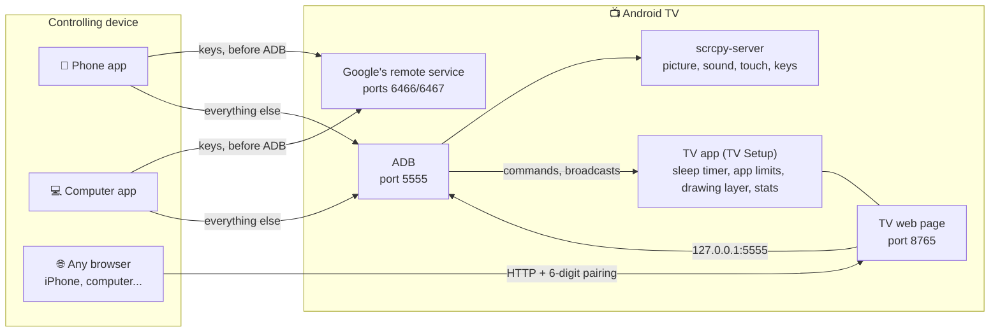
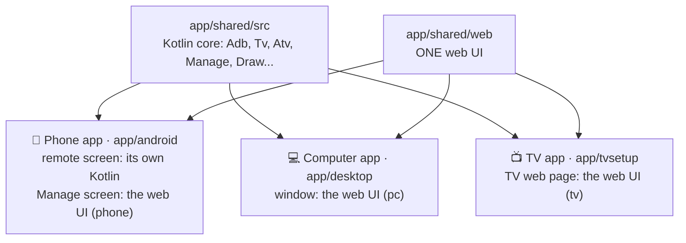

# dev

Tools for people working on the code, one folder per kind of work. Each script says more in its first lines.
Run them from the repo root (`dev/test/emu.sh`, `python3 dev/gen/gen_icons.py`); each finds the root itself.

| Folder | For |
|---|---|
| `test/` | emulators, checks of the page and the routes, the site served locally |
| `gen/` | files made from a recipe: icons, wallpapers, IR codes. Edit the script, never its output; `optimize_images.py`: every tracked PNG / JPEG / WebP made smaller (dry run; `--write` applies; needs Pillow, numpy for the lossy step), skips the hash-pinned `docs/home/` and `docs/launchers/` |
| `shots/` | the site's screenshots and the pictures composed from them |
| `sign/` | the signed lists on the site (`docs/**.json` + `.sig`) |
| `admin/` | the owner's local admin page (themes waiting for review, crash reports): `admin.py`, below |
| `themes/` | the community theme queue (Cloudflare Worker + D1 `tvr-themes`); reviewed with `sign/review_themes.py` |
| `release/` | releases, update keys and their backup (only when the maintainer says so) |

Notes beside them: `DECISIONS.md` + `decisions/` (why some code looks odd), `../app/DESIGN-TV.md` (the TV apps' shared look),
`sign/bloat-sources.md` (where Optimize TV's lists come from). Playwright for the Node scripts: `npm install --prefix dev playwright`.

## test/

| Script | Does |
|---|---|
| `emu.sh` | the two test emulators (Google TV and phone, Android 14): `create` once, then no argument to start them and install the apps, `install`, `reset`, `stop` (AGENTS.md "Testing") |
| `light.sh <cmd>` | runs a heavy step (ffmpeg, Gradle, audit) at low priority, one at a time, once load and memory leave room (waits up to `LIGHT_WAIT` s) |
| `media.sh` | test clips for the video / GIF backgrounds (1080p60 12 Mbps, 1080p30, 720p30, long GOP, two GIFs), made once in `.cache/media` |
| `smoke.py [tv\|URL]` | every `/api` route over a real network path (the TV emulator through `emu redir`, not adb forward): each must answer in full, without 500; exit 1 if not |
| `layout.js [URL]` | the page in Chrome **and** WebKit × 1100 / 400 px × every tab + Settings, English and Vietnamese: sideways scroll, cut words, wrapped labels, things out of their card, overlapping cards, wrapped chips; screenshots in `/tmp/tvr-layout` |
| `audit.js` | the whole page pressed through by a script (every tab, dialog, menu and chip, down to `--depth`), no TV: `/api` is the live demo's made-up TV. Each screen checked for layout, contrast, the UI rules, words, touch size, script errors; report with boxed screenshots in `/tmp/tvr-audit/index.html` (~20 min; `--only=apps`, `--budget=` s per tab) |
| `contrast.py [URL]` | colour contrast on the rendered page, both themes × 1100 / 400 px × every tab; exit 1 under 4.5:1 (needs Chrome) |
| `check_quiz.py` | the TV Games quiz bank (`docs/games/web/quiz/bank.json`) |
| `home_smoke/home_smoke.sh` | TV Home and TV Setup's screens pressed through on the TV emulator by text (uiautomator), en or vi, screenshots |
| `gamebots/run.js [game ...]` | bots play the web games of `docs/games/web` in headless Chrome, several players each |
| `fakegh.sh <tv-home.apk> <version>` | a fake GitHub release on 127.0.0.1:8099 (signed with a throwaway key in `.cache/fakegh`) for trying updates and the launcher gallery end to end; prints how to start the computer app against it |
| `faketv.py <ip> <ports> <cert> <key>` | a fake TV with only Wireless debugging (mDNS + adbd's TLS start, then "not paired"), for the pairing flow without such a TV |
| `serve_docs.py [port]` | the site (`docs/`) on localhost:8000 as Cloudflare Pages serves it (`/guide` is `guide.html`), never cached |

## gen/

| Script | Makes |
|---|---|
| `gen_icons.py` | the line icons: the web sprite and `res/drawable/ic_*.xml` of the apps. Add an icon here |
| `round_icons.py` | the logo's rounded corners everywhere it is a picture, and `app/desktop/icon.icns` / `.ico` |
| `brand_art.py` | the TV apps' banners (all four, one style) and icons (Home, Channels, Games), with their copies |
| `wallpapers.py` | TV Home's wallpaper gallery (`docs/home/`), signed |
| `gen_wallspec.py` | `WallSpec.kt`, the wallpapers TV Home paints, from the page's recipes |
| `ir_codes.py` | `assets/ir/codes.json` of the phone app, from Flipper-IRDB (CC0) |

## shots/

| File | Does |
|---|---|
| `shots.py` | the site's screenshots from the emulators (`docs/README.md`) |
| `home-<lang>.html`, `Roboto.ttf` | what `shots.py` puts on the TV's screen: a made-up home screen per language, and its font |
| `games/` | the TV Games picture of the home page: the TV, the library and two phones as pads. `node dev/shots/games/compose.js` → `docs/img/tv-games-<lang>[-640].webp` |

## sign/

Each checks its list, then signs it with the launcher list's key (`~/.tv-remote-release/launchers.key`, apart from the
release key; its public half is `Launchers.KEYS`). Run after every edit of the list and commit both files.

| Script | List |
|---|---|
| `sign_launchers.py` | `docs/launchers/launchers.json`, and each APK's SHA-256 and thumbnail. Makes the key when absent |
| `sign_games.py` | `docs/games/games.json`: TV Games' cores, suggested web games, homebrew |
| `sign_providers.py` | `docs/channels/providers.json`: TV Channels' extra sources, e.g. VieON |
| `sign_bloat.py` | `docs/optimize/bloat.json`: Optimize TV's suggestions added from the site |
| `review_themes.py` | agent flags `--list --json` / `--approve` / `--reject` / `--local DIR` (guide: `themes/REVIEW.md`); (also behind `dev/admin/admin.py`) reviews the community themes sent from TV Home (HTML page, then approve / reject / skip each): saves the pictures, adds the theme to `docs/home/themes.json`, signs it; commits nothing |
| `sign_themes.py` | `docs/home/themes.json`: TV Home's ready-made themes (names per language, looks; a theme may set `wurl`, so only a signed list may). Packed in the APK by `:home` `packThemes`; `HomeThemesTest` keeps the copy equal; stamps `rev` (the higher one wins, so an undeployed site never overwrites a newer APK). Web backgrounds go through `docs/home/loop.html` (host allow-list); each theme names its `src` + licence (photos: `dev/gen/wallpapers.py`, Unsplash or Wikimedia Commons; the two videos: Pexels, 1080p) |
| `sign_downloader.py` | `docs/data/downloader.json`: the Downloader codes |

## admin/admin.py

Agents use the scripts, not this page: `census/CRASHES.md` (`crashes.py --json --new --frames`) and `themes/REVIEW.md`.

`python3 dev/admin/admin.py [--port N]`: the owner's local admin page (Vietnamese), instead of terminal prompts. Opens `http://127.0.0.1:<port>/?k=<random key per run>`;
127.0.0.1 only, every request (page, API, pictures) must carry the key and a local Host. The tokens (`~/.tv-remote-release/themes-admin-token`, `crash-token`) are read here, never sent to the browser.
Tab **Chủ đề chờ duyệt**: a card per pending community theme (preview, wall photo, sender, settings, red flags, free slots of `READY_MAX`); Duyệt runs `review_themes.py`'s own `approve()` (pictures, `themes.json`, signature) and shows the files + the `git add` / `git commit` lines to copy; nothing is committed or pushed. Bỏ rejects (the reason is asked but the API has no field: not stored).
Tab **Lỗi**: the census worker's crashes by count, filter by app / version, a click shows the stack and device, Xóa removes it (all versions).
Tests: `THEMES_URL`, `THEMES_TOKEN_FILE`, `CENSUS_URL`, `CRASH_TOKEN` point it at local `wrangler dev` workers (`dev/themes`, `dev/census`).

## release/

| Script | Does |
|---|---|
| `release.sh` | the whole release: version numbers, CHANGELOG, tag, APKs, GitHub release, the computer apps through GitHub Actions, then `sums.sh` ([release/AGENTS.md](release/AGENTS.md)) |
| `sums.sh <tag>` | `SHA256SUMS` of a release, signed, attached. Run again after replacing any file of a release by hand: the apps refuse a file the list does not match |
| `code_changed.py <tag> <paths>` | did an app's code change since a tag, beyond comments, `.md`, `build.sh`, tests: `release.sh` bumps an app's number only then |
| `guide_stale.py` | the guide's topics whose app files changed since their `data-v`; `release.sh` stops on them |
| `stamp_since.py` | `docs/data/since.json`: "next" becomes the version and its date |
| `churn.sh` | how often the `/api` still changes, week by week; `release.sh` prints it and says when 1.0 is near |
| `cores.sh` | downloads the libretro cores TV Games lists from the buildbot, prints their sha256 / size entries and the `gh release upload cores-1` command (run by hand) |

**Keys.** The apps install an update only if its `SHA256SUMS` is signed (Ed25519) by a key in `Release.KEYS`.

- `java dev/release/Sign.java new|pub|sign`: makes a key, prints its public half, signs a file. No build needed.
- The keys live in `~/.tv-remote-release/`: `ed25519.pem` in use, `ed25519-spare.pem` kept elsewhere. Never on GitHub.
  Losing both means no installed app takes an update again.
- `dev/release/keys.sh backup` packs the keys, the admin tokens (`crash-token`, `themes-admin-token`) and every `signing.jks` (the APKs' signatures) into one password-locked file
  (`dev/release/Keys.java`, AES-GCM, `*.tvrkeys`, never committed) to keep off this computer. `dev/release/keys.sh list <file>` checks a
  copy opens; `restore <file>` puts the keys back.

## How it works

No server in between: everything goes straight to the TV.



In the code the three apps share one Kotlin core and one web UI. Only the Phone app's remote screen is its own Kotlin (for smoothness), so a change to the remote screen goes in two places: `app/shared/web` and `app/android`.



- **Phone app and TV Setup** speak ADB themselves and push `scrcpy-server` to the TV for H.264 video, touch and keys. TV Setup connects to the TV's own ADB (`127.0.0.1:5555`). On the TV web page the video goes through `/api/video` and plays with JMuxer (MSE).
- **Computer app** (`app/desktop`) shares the Kotlin core (ADB, scrcpy, remote protocol), runs on its own bundled Java; the window is the system's web view ([webview](https://github.com/webview/webview) via JNA). Before ADB: Android TV Remote v2 protocol, ports 6466/6467.
- **Accented text** goes into the TV's clipboard and is pasted. **Volume** calls `AudioService.setStreamVolume` (Android 9), else `media volume`, with no ADB it presses steps. **Power** uses SLEEP (223) / WAKEUP (224), not POWER, so repeated presses don't flip state.
- **App names and logos:** asked from the TV's system; TV Setup directly, the Phone and Computer apps copy the phone app's APK to `/data/local/tmp` and run its `Meta` class with `app_process` (the Computer app caches in `.cache/apps`).
- **History:** TV Setup writes to `/sdcard/Android/data/dev.tvremote.setup/files/stats/` (`usage.json` 90 days, `samples.jsonl` about 30); the remotes read it over ADB. Usage access is granted over ADB.
- **One-button Tailscale** (`Tailscale.kt`): downloads the APK from `pkgs.tailscale.com` and checks SHA-256, installs over ADB, `appops set com.tailscale.ipn ACTIVATE_VPN allow`, starts with the `CONNECT_VPN` broadcast; if not signed in it opens the app, presses "Log in" and reads the code under the QR with `uiautomator dump` (link `https://login.tailscale.com/a/<code>`).

## Build, run, test

Needs JDK 17, the Android SDK (with Emulator and Command-line Tools), Node.js and Python 3. Mac and Linux run directly; Windows uses Git Bash.

```
app/shared/web/  THE web UI (Computer app, TV web page, the Phone app's Manage screen)
app/shared/src/  Kotlin core: ADB, picture and sound (scrcpy), each brand's remote, /api
app/desktop/     Computer app (Kotlin JVM; window = the system's web view)
app/android/     Phone app (remote screen in Kotlin, Manage screen = the web UI)
app/tvsetup/          TV app (TV Setup) + TV web page
app/gradle/      Gradle build of all Kotlin (open it in Android Studio)
dev/  docs/      dev tools · the site
tvs.json, cert.pem, key.pem, *.jks, .cache/      your own data, never in git
```

| Task | Command |
|---|---|
| Web tests | `node --test app/shared/tests/ app/tvgames/tests/` |
| Kotlin tests | `cd app/gradle && ./gradlew :shared:testDebugUnitTest :android:testDebugUnitTest :tvsetup:testDebugUnitTest` |
| Build the Computer app | `cd app/gradle && ./gradlew :desktop:installDist` |
| Run it (window / browser) | `app/desktop/build/install/desktop/bin/desktop --window` · without `--window` it prints a link with the `?k=` key |
| Run a test copy (real TVs untouched) | `TVS_FILE=/tmp/x.json TVR_KEYS=/tmp/keys TVR_PASS=testtest app/desktop/build/install/desktop/bin/desktop --port 8769`, open `http://127.0.0.1:8769/?k=testtest` (curl: header `x-tvr-pass`) |
| Package for people | `./gradlew :desktop:packageApp` → `app/desktop/build/package/` |
| Android APKs | `app/android/build.sh`, `app/tvsetup/build.sh` → `app/*/build/*.apk` |
| Emulators: create / start + build + install / install only / reset / stop | `dev/test/emu.sh create` · `emu.sh` · `emu.sh install` · `emu.sh reset` · `emu.sh stop` |

Editing `app/shared/web` needs only a page reload; Kotlin needs a rebuild. Inside the repo the app uses the repo's `tvs.json` and ADB keys in `.cache/keys`, apart from an installed copy. In the emulators the TV is `10.0.2.2` from the phone emulator and `127.0.0.1` from the Computer app (`10.0.2.15` on the virtual TV means nothing outside it); accept "Allow USB debugging?" in the TV emulator's window. They open only the ADB port, so the Android TV Remote pairing can't be tried there. Other checks: `dev/test/contrast.py`, `dev/shots/shots.py`.

**Versions:** six numbers, each bumped only when its part changes; `dev/release/release.sh` does it, builds and makes the GitHub release; notes go under `## Unreleased` in `CHANGELOG.md`. **Keep the three places in step:** a change to the controls goes in the Phone app, the TV web page and the Computer app; the remote's keys live once in `app/shared/web/remote.json`.

Credits: [scrcpy](https://github.com/Genymobile/scrcpy) (Apache-2.0), [JMuxer](https://github.com/samirkumardas/jmuxer) (MIT), [webview](https://github.com/webview/webview) (MIT), [JNA](https://github.com/java-native-access/jna) (Apache-2.0); the table games follow [gamehub24](https://gamehub24.pages.dev).
